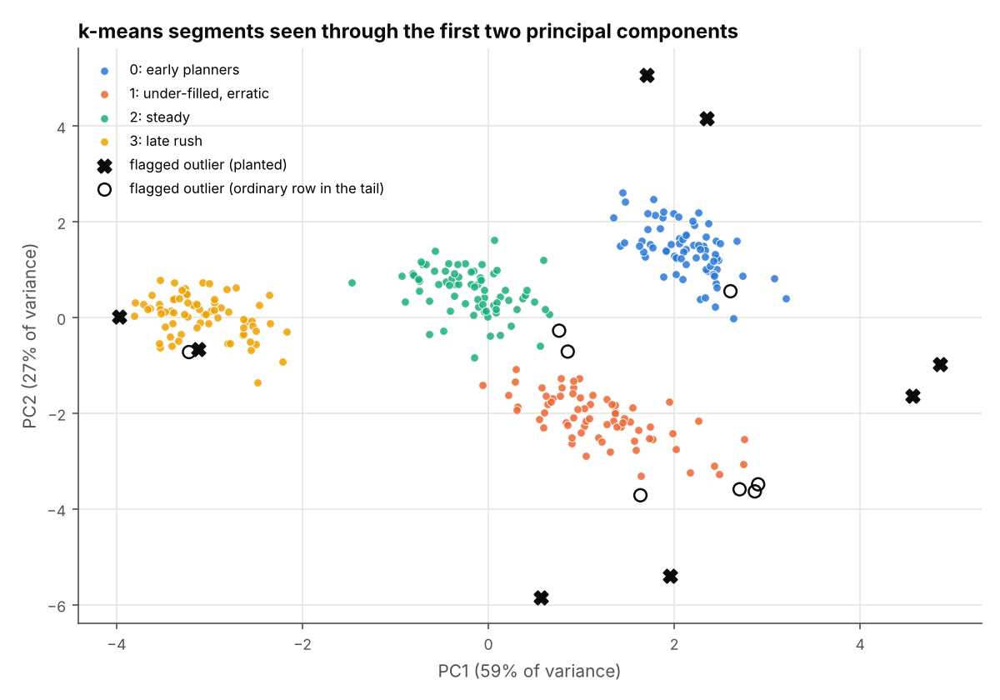
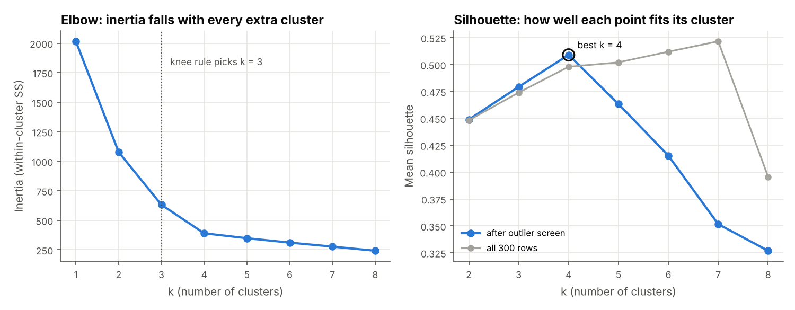
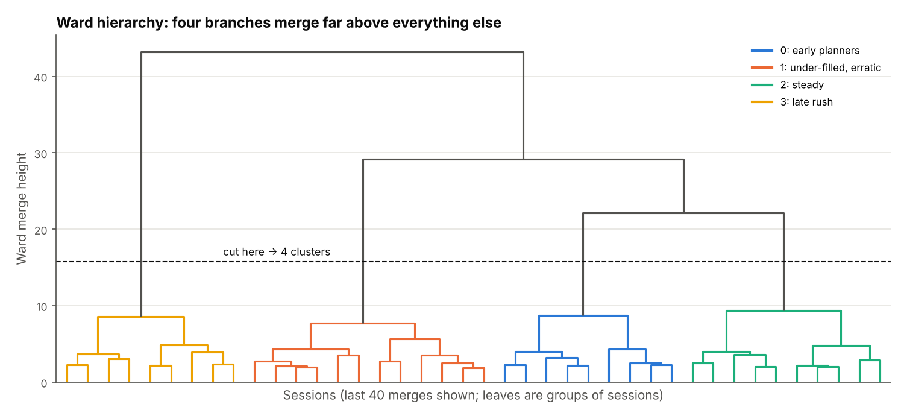
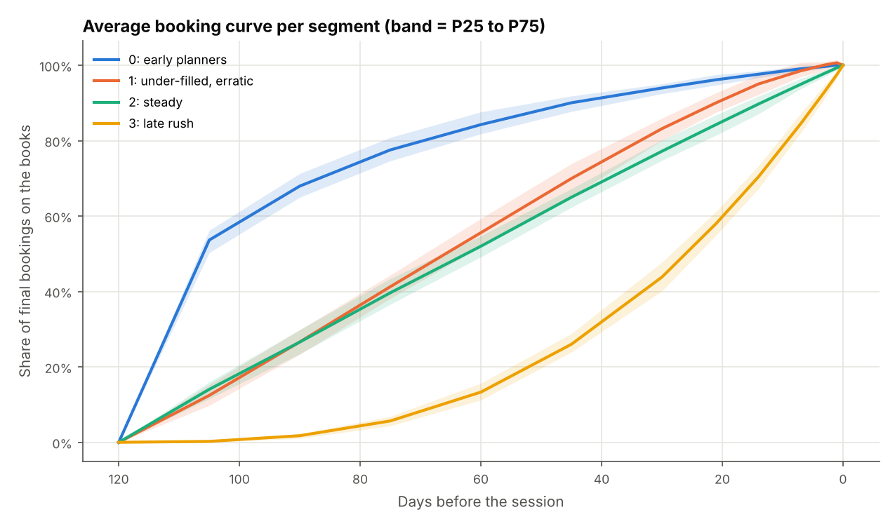

# Cluster analysis: finding booking-behaviour segments
> Scaling, distance measures, k-means++, choosing k (elbow, silhouette, gap), Ward hierarchy, PCA, validation and segment profiling, written from scratch in NumPy and checked against four segments planted in synthetic clinic data.

**Tools:** Python (NumPy, pandas, matplotlib; SciPy only to draw the dendrogram), pytest (SciPy and scikit-learn as independent cross-checks)

*Synthetic data: 300 clinic sessions (a clinic day with 120 to 320 appointment slots). Bookings arrive over the
120 days before each session and some later cancel. Each session is described by the shape of its demand curve,
not its size. 292 sessions come from four planted segments and 8 are planted outliers. Because the true segment
of every session is known, each method can be checked against it.*



## The data ([`synth.py`](src/clusterkit/synth.py))
| Planted segment | Curve `F(d) = (1 − d/120)^p` | Final fill | Cancel rate | Day-to-day noise |
|---|---|---|---|---|
| early planners | p = 0.35 (books early) | 96% | 10% | low |
| steady | p = 1.0 (linear) | 84% | 6% | low |
| late rush | p = 3.0 (books late) | 80% | 3% | low |
| under-filled, erratic | p = 1.1 | 52% | 22% | high |
| 8 outliers | block bookings 3 days out, mass cancellations, near-empty, overbooked early | | | |

Bookings are simulated day by day (Poisson arrivals with gamma noise, each booking cancelling on a random later day).
Seven features per session:

| Feature | Meaning |
|---|---|
| `share_90`, `share_60`, `share_30`, `share_7` | net bookings on the books at 90 / 60 / 30 / 7 days out ÷ final bookings |
| `fill_rate` | final bookings ÷ slots |
| `cancel_rate` | cancellations ÷ gross bookings |
| `volatility` | sd of weekly pickup around its 3-week moving average ÷ mean weekly pickup |

Each session also has a "service line" label that matches its segment only 35% of the time. The aim is to show that
behaviour, not the label, defines a segment.

## The concepts

### 1. Feature scaling ([`scaling.py`](src/clusterkit/scaling.py))
Distance-based methods add up squared differences across features, so a feature measured in big numbers drowns
out the rest. **z-scoring** puts every column on mean 0, sd 1. **Min-max** maps every column onto [0, 1]. The
scaler is kept as an object so cluster centres can be turned back into original units.
```
z-score:  z = (x − mean) / sd               back:  x = mean + sd · z
min-max:  x' = (x − min) / (max − min)
```
**Demonstration** ([`sample_output/scaling_demo.csv`](sample_output/scaling_demo.csv)): add slot capacity (120 to 320)
to the seven shape features and cluster again.

| Scaling | Capacity's share of squared distance | Nearest neighbour in same segment | k-means ARI vs truth |
|---|---|---|---|
| raw units | 99% | 46% | −0.00 |
| min-max | 29% | 99% | 0.67 |
| z-score | 19% | 99% | 0.99 |

In raw units, capacity accounts for 99% of every distance and k-means just slices sessions by size (ARI ≈ 0). After
scaling, the shape features count again. Min-max is weaker here because a few extreme rows squash everyone else into a
narrow band.

*Used for:* any clustering, nearest-neighbour lookup or PCA where features come in different units (counts, rates, money).

### 2. Distance measures ([`distance.py`](src/clusterkit/distance.py))
```
Euclidean:    d = √Σ(aᵢ − bᵢ)²                  straight-line
Manhattan:    d = Σ|aᵢ − bᵢ|                    city-block; less swayed by one big difference
Cosine:       d = 1 − a·b / (|a| |b|)           direction only, ignores magnitude
Mahalanobis:  d = √((a − b)ᵀ S⁻¹ (a − b))       S = covariance; rescales AND removes correlation
```
Three pairs in z units ([`distance_demo.csv`](sample_output/distance_demo.csv)):

| Pair | Euclidean | Manhattan | Cosine | Mahalanobis |
|---|---|---|---|---|
| two steady sessions | 0.55 | 1.26 | 0.10 | 2.45 |
| steady vs under-filled | 2.97 | 6.07 | 1.37 | 3.49 |
| early vs late rush | 5.47 | 12.78 | 1.65 | 3.08 |

Euclidean ranks "early vs late rush" as the most different pair. Mahalanobis ranks it below "steady vs under-filled".
The four share features are strongly correlated, so a move along the early-to-late axis is a common direction and
Mahalanobis discounts it. Under-filled sessions differ in fill and cancellation, which is a rarer combination.

*Used for:* Euclidean is the default for k-means and Ward. Manhattan suits data with spiky differences. Cosine suits
profiles where only proportions matter. Mahalanobis suits outlier screening on correlated measures.

### 3. k-means with k-means++ and restarts ([`kmeans.py`](src/clusterkit/kmeans.py))
Lloyd's algorithm alternates two steps, each of which can only lower the inertia, until the assignment stops changing:
```
assign:  cᵢ = argmin_k |xᵢ − μ_k|²
update:  μ_k = mean of the points assigned to k
inertia  W = Σ_k Σ_{i in k} |xᵢ − μ_k|²
```
**k-means++** seeding: the first centre is a random point. Each next centre is drawn with probability ∝ D(x)², the
squared distance to the nearest centre chosen so far. This spreads the starting centres out. Lloyd only finds a local
minimum, so the fit is run 10 times and the lowest inertia is kept. Here the final fit converged in 4 iterations.

*Used for:* customer and product segmentation, building "typical profile" benchmarks, compressing many series into a
few representatives.

### 4. Choosing k ([`selection.py`](src/clusterkit/selection.py))
```
Elbow:       knee of W(k) = point farthest from the line joining the first and last points (both axes scaled to [0,1])
Silhouette:  s(i) = (b − a) / max(a, b)
             a = mean distance to own cluster, b = mean distance to the nearest other cluster; pick k with max mean s
Gap:         Gap(k) = E*[log W*_k] − log W_k   (W*_k from B uniform reference sets drawn in the PCA-rotated box)
             s_k = sd(log W*_k) · √(1 + 1/B);  pick the smallest k with Gap(k) ≥ Gap(k+1) − s_{k+1}
```


| | Elbow | Silhouette | Gap |
|---|---|---|---|
| all 300 rows | 3 | 7 | 5 |
| after screening 12 isolated rows | 3 | **4** | **4** |

The outliers matter. On all rows, silhouette and gap both reward extra clusters that just hold a few odd sessions.
A pre-screen that needs no k (robust z of the distance to the 5th nearest neighbour > 5) sets aside 12 rows: all 8
planted outliers and 4 tail sessions. After that, silhouette (0.51) and gap both pick the planted k = 4. The knee rule
says 3: the inertia curve bends at 3 and again at 4. This is why the elbow alone is a weak guide.

*Used for:* deciding how many segments a business can act on, while checking that the data supports that number.

### 5. Ward hierarchical clustering ([`hierarchy.py`](src/clusterkit/hierarchy.py))
Start with every session as its own cluster. Repeatedly merge the pair whose merge increases total within-cluster
sum of squares the least. The distance matrix is updated after every merge with the Lance–Williams formula
(on squared distances):
```
d(k, i∪j) = [(nᵢ + n_k) d(k,i) + (n_j + n_k) d(k,j) − n_k d(i,j)] / (nᵢ + n_j + n_k)
height = √d(i,j) = √(2 · increase in within-cluster SS)
```


The four segment branches join at heights of 22 to 43. Inside the branches, merges stay below 10, so the cut is easy
to place. Ward agrees with k-means at ARI 0.96 and with the truth at ARI 0.95. The heights match `scipy` to machine
precision (tested).

*Used for:* showing how segments nest (which ones merge first if you can only afford three), and checking
k-means with a method that needs no random start.

### 6. PCA via SVD ([`pca.py`](src/clusterkit/pca.py))
```
X_c = X − mean = U S Vᵀ          rows of Vᵀ = principal directions (orthonormal)
variance of component j = S_j² / (n − 1)          explained ratio = S_j² / Σ S²
scores = X_c V = U S
```
The first two components explain 59% and 27% of the variance (86% together). PC1 is roughly "how early the session
books". PC2 separates the under-filled, high-cancellation sessions. The scatter at the top of this page shows the four
segments as separate groups, with the planted outliers () out on their own.

*Used for:* drawing many features in 2-D, removing redundancy among correlated measures before modelling.

### 7. Validation ([`validation.py`](src/clusterkit/validation.py))
**Adjusted Rand index** compares two partitions by counting pairs of points that are grouped together in both.
It is corrected so that random labels score about 0:
```
Index    = Σ_ij C(n_ij, 2)                   n_ij = contingency table counts
Expected = Σ_i C(a_i, 2) · Σ_j C(b_j, 2) / C(n, 2)
Max      = [Σ_i C(a_i, 2) + Σ_j C(b_j, 2)] / 2
ARI      = (Index − Expected) / (Max − Expected)
```
**Bootstrap stability** (Hennig's clusterboot idea): resample sessions, recluster, and for each original cluster
record the best Jaccard overlap `|A ∩ B| / |A ∪ B|` with any new cluster. A mean above 0.85 means stable. Below 0.6, the
cluster is probably an artefact of this sample.

| Check | Result |
|---|---|
| k-means vs planted truth (292 non-outlier sessions) | ARI **0.991** |
| Ward vs truth | ARI 0.947 |
| service-line label vs truth | ARI 0.157 |
| bootstrap Jaccard per cluster (50 resamples) | 1.00, 1.00, 1.00, 1.00 |

Confusion matrix ([`confusion_matrix.csv`](sample_output/confusion_matrix.csv)): 291 of 292 sessions land in the
right cluster. One under-filled session is placed with "steady".

*Used for:* proving that segments are real and repeatable before anyone builds reports or targets on them.

### 8. Profiles, benchmark curves and outlier flags ([`profiling.py`](src/clusterkit/profiling.py))
Centroids are turned back into original units (`x = mean + sd · z`), so they can be read directly. Each cluster's
average cumulative curve, with a P25 to P75 band, becomes the benchmark curve for that segment. Outliers are flagged by
**distance to centroid**, converted into a robust z within each cluster:
```
dᵢ = |xᵢ − μ_c|          z = (dᵢ − median d) / (1.4826 · MAD d)          flag z > 3.5
```
Median and MAD are used because a few extreme distances would inflate a mean and sd and hide themselves.

| Cluster | Matches | By 60 days | By 30 days | Fill | Cancel | Volatility | Sessions | Mean slots |
|---|---|---|---|---|---|---|---|---|
| 0 | early planners | 84% | 94% | 96% | 9.9% | 0.32 | 72 | 220 |
| 1 | under-filled, erratic | 56% | 83% | 52% | 21.8% | 0.37 | 68 | 227 |
| 2 | steady | 52% | 77% | 83% | 5.9% | 0.27 | 72 | 228 |
| 3 | late rush | 13% | 44% | 80% | 2.5% | 0.25 | 72 | 214 |

All 8 planted outliers are flagged, plus 8 ordinary sessions from the tails of their clusters (16 flags, 5% of
sessions). Mean slot counts are almost the same across clusters, which confirms the segments describe behaviour, not
size.



*Used for:* benchmark curves to judge "are we on pace?", picking comparable sessions, and sending odd sessions for
a manual look.

## Where it shows up in this portfolio
| Project | Connection |
|---|---|
| [Capacity planning](../../professional-work/capacity-planning/) | Fill curves and percentile benchmarks: segmenting sessions by curve shape gives each one a benchmark curve from comparable sessions, not a single all-sessions average. |
| [Dashboards](../../professional-work/dashboards/) | Nearest-neighbour comparables: scaled distances and cluster membership decide which past items count as "like this one". |
| [Market prices](../../professional-work/market-prices/) | Outlier screening: the same robust-z idea, applied there to price observations. |
| [Loan vintage curves](../../economics-finance/loan-vintage-curves/) | Cohort curves against a reference band: the same idea as a segment benchmark curve with its P25 to P75 band. |

## Results
- 300 sessions, 7 features. Silhouette and gap both choose **k = 4** after screening outliers. The elbow says 3.
- k-means++ (10 restarts) recovers the planted segments with **ARI 0.991**. Ward gets 0.947. The service-line label gets only 0.157.
- Bootstrap Jaccard ≥ 0.997 for every cluster.
- PCA: 59% + 27% of variance in the first two components.
- **8/8** planted outliers flagged by distance-to-centroid robust z, plus 8 tail sessions.
- Without scaling, capacity accounts for 99% of distance and the clusters are meaningless (ARI −0.00).

Outputs in [`sample_output/`](sample_output/): `sessions_clustered.csv` (every session with its cluster, PCA scores,
distance z and flags), `choose_k.csv`, `segment_profiles.csv`, `segment_curves.csv`, `confusion_matrix.csv`,
`scaling_demo.csv`, `distance_demo.csv`, `ward_linkage.csv`, `summary.csv`.

## What the tests check
| Test | What it proves |
|---|---|
| `test_standardise_mean0_sd1_and_inverse` | z-scores have mean 0 and sd 1, the inverse transform round-trips, and min-max spans [0, 1] |
| `test_unscaled_distance_dominated_by_capacity` | raw capacity accounts for > 95% of distance and breaks k-means; z-scoring fixes it |
| `test_distance_hand_values` | 3-4-5 triangle, cosine of orthogonal and parallel vectors, Mahalanobis = Euclidean when S = I |
| `test_inertia_non_increasing_across_iterations` | every Lloyd half-step lowers or keeps the inertia |
| `test_kmeans_recovers_planted_clusters` | ARI > 0.9 on the clinic data and on simple blobs |
| `test_kmeans_pp_restarts_never_worse_than_single_run` | best-of-10 inertia ≤ single run |
| `test_silhouette_hand_example` | {0, 2} vs {10}: s = 0.8, 0.75, 0 worked by hand |
| `test_silhouette_matches_sklearn_if_available` | agrees with scikit-learn to 1e-10 |
| `test_chosen_k_equals_planted_k` | silhouette and gap both pick 4 |
| `test_ari_identical_relabelled_and_random` | ARI = 1 for identical or renamed labels, ≈ 0 for random labels |
| `test_ari_hand_case_and_sklearn` | a 2×2 contingency table worked by hand, plus agreement with scikit-learn |
| `test_confusion_and_bootstrap_stability` | each true segment maps to its own cluster; Jaccard > 0.9 |
| `test_ward_matches_scipy` | merge heights, sizes and cuts identical to `scipy.cluster.hierarchy.linkage` |
| `test_ward_hand_case` | points 0, 1, 5: heights 1 and √27 from Lance–Williams, checked against the change in within-cluster SS |
| `test_pca_variance_ratio_and_orthonormal` | ratios sum to 1 and decrease, components orthonormal, matches the eigendecomposition, total variance preserved |
| `test_planted_outliers_flagged` | all planted outliers flagged, < 5% of normal sessions flagged |
| `test_robust_z_and_profiles_in_original_units` | centroids read back the planted fill rates and curve order |
| `test_determinism` | same seed → identical data and clustering |
| `test_cli_writes_files` | the CLI writes all 9 CSVs and 4 figures |

19 tests. The scikit-learn and SciPy cross-checks are skipped if those libraries are not installed.

## Run it
```bash
pip install -r requirements.txt
PYTHONPATH=src python -m clusterkit run --out sample_output --figures figures
pytest -q tests
```
