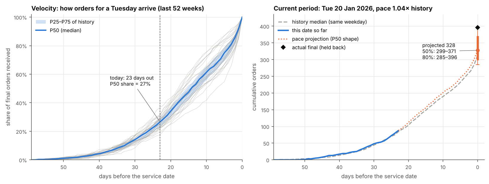
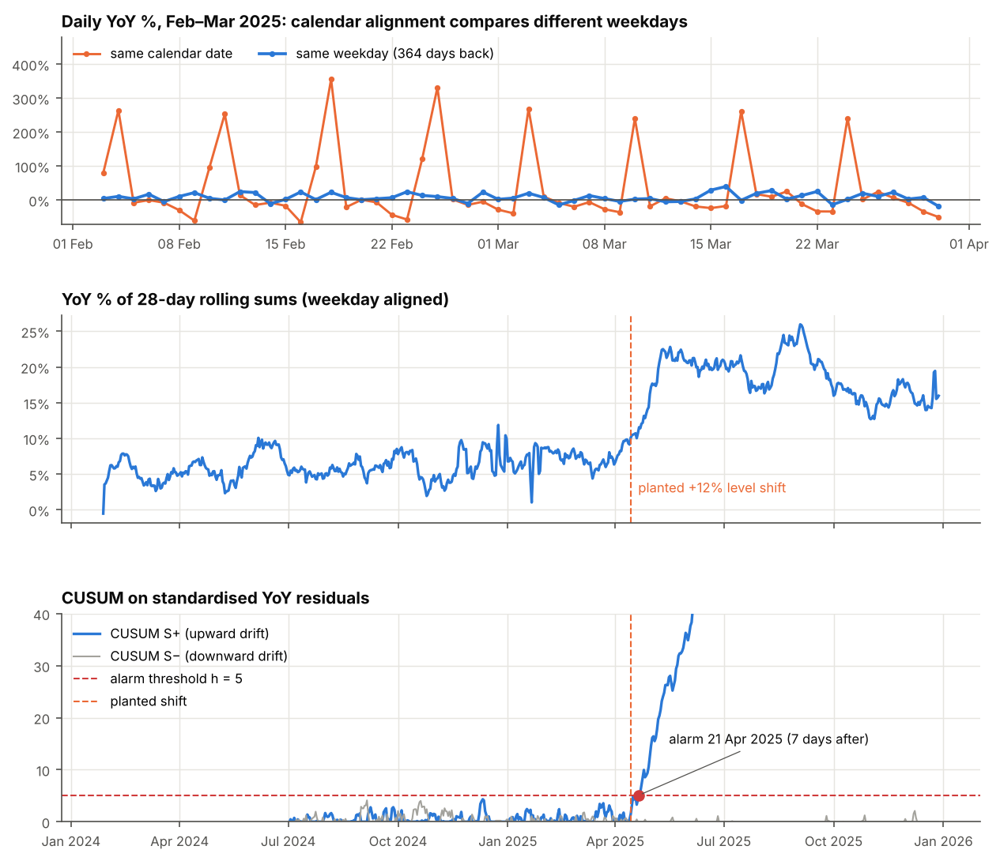
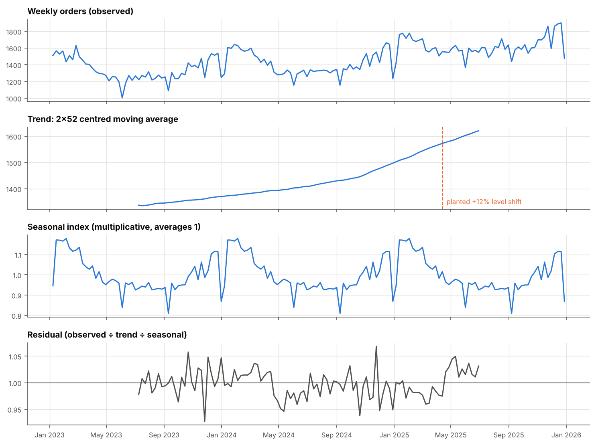
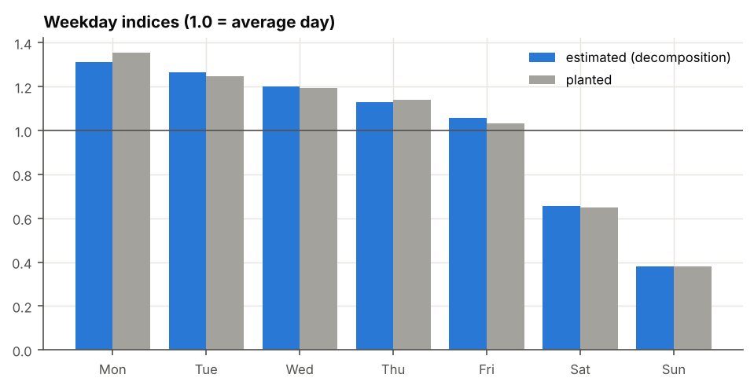
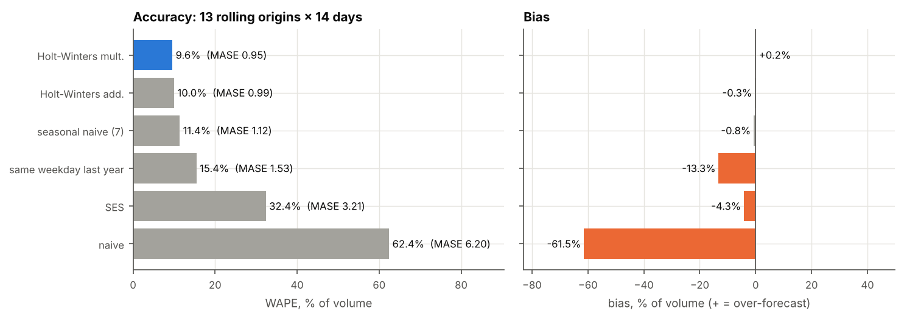

# Historical comparisons & order velocity: reading demand against its own past
> Weekday-aligned YoY, rolling sums, lead-time velocity curves, pace projections with intervals, classical decomposition, forecasting baselines with a rolling-origin backtest, CUSUM change detection and cohort triangles, written from scratch in NumPy/pandas and checked against planted structure.

**Tools:** Python (NumPy, pandas, matplotlib), pytest

*Synthetic appointment data for a network of clinics: three years of daily orders (2 Jan 2023 to 28 Dec 2025, 1,092
days), each with the lead time at which it arrived, plus the next 60 days that are only partly filled. The same code
works for a farm co-op's pre-orders or any business where orders for a date arrive ahead of time. Every part of the
data was planted, so each method can be checked against the truth.*



## The data
Built in [`synth.make_book`](src/historykit/synth.py) (seed 7):
```
expected(date) = 220 × 1.06^years × weekday × annual × holiday × level_shift
orders(date)   ~ Poisson(expected × lognormal day noise, sd 0.04)
```
| Planted part | Value |
|---|---|
| Trend | +6% a year |
| Weekday factors (Mon..Sun) | 1.25, 1.15, 1.10, 1.05, 0.95, 0.60, 0.35 |
| Annual cycle | `1 + 0.12·cos(2π(doy−20)/365.25) + 0.04·cos(4π(doy−20)/365.25)` (peak in late January) |
| Holidays | 6 a year (fixed and moving dates), demand × 0.25 |
| Level shift | +12% from Mon 14 Apr 2025 (a new clinic joins) |
| Lead times | mix of short-notice (geometric, mean ≈ 2.5 days) and planned (negative binomial, mean ≈ 21 days); the mix varies by day |
| Cancellations | 7% of orders cancel between the order date and the visit (measured: 6.98%) |

The result is a matrix `gross[date, lead]` (orders received with `lead` days to go) and `cancels[date, lead]`.

## The concepts

### 1. Historical comparisons ([`history.py`](src/historykit/history.py))
Comparing a day with "the same day last year" depends on what "same" means. The **calendar** date one year back is a
different weekday (2025-03-03 is a Monday, 2024-03-03 a Sunday), so with a strong weekly pattern the YoY figure swings
by hundreds of percent. Going back **364 days** (52 weeks) always lands on the same weekday. **Rolling sums** smooth out
the weekly pattern before comparing, and **indexing** puts any series on a "base period = 100" scale.
```
YoY (weekday aligned)  = y_t / y_{t−364} − 1
YoY (calendar)         = y_t / y_{same date last year} − 1          (29 Feb has no match)
rolling sum R_t(w)     = y_t + y_{t−1} + … + y_{t−w+1}               YoY of R_t(28) = R_t / R_{t−364} − 1
moving average         = R_t(w) / w   (trailing or centred)
index_t                = 100 × x_t / mean(x over the base period)
```
*Used for:* weekly trading reports, "are we up on last year?", like-for-like store or clinic comparisons, and
putting series of different sizes on one chart.

### 2. Velocity, pickup and pace ([`velocity.py`](src/historykit/velocity.py))
Orders for a service date arrive over the weeks before it. Let `C[d, k]` be the orders for date `d` already received
when `k` days were left. **Velocity** is the share of the final count already in hand; **pickup** is what arrived on
one day. Taking **percentiles** of velocity across many past dates (same weekday, last 52 weeks) gives a typical curve
and a band. **Pace vs history** compares today's count with the historical median at the same days-out. The **pace
projection** divides today's count by the typical share received by now; dividing by the P75 and P25 shares (or P90
and P10) gives a 50% (80%) interval.
```
C[d, k]   = Σ_{l ≥ k} gross[d, l]                    V[d, k] = C[d, k] / C[d, 0]
pickup    = gross[d, k] − cancels[d, k]             (net orders taken with k days left)
pace      = C_now(k) / median_ref C[·, k]            (1.0 = on pace)
projected final = C_now(k) / P50_ref V[·, k]
50% interval    = [C_now / P75 share,  C_now / P25 share]      80%: P90 and P10 shares
```
*Used for:* "will this clinic day / delivery slot fill?", early warning on weak dates, staffing a date before it is
fully known, and setting outreach or promotion effort.

### 3. Classical decomposition and weekday indices ([`decompose.py`](src/historykit/decompose.py))
Split a series into trend, seasonal pattern and residual. The trend is a centred moving average of one full season
(for an even season length, a 2×m MA so it stays centred). The seasonal index for each position is the average of the
detrended values at that position, normalised.
```
even m:  T_t = (½y_{t−m/2} + y_{t−m/2+1} + … + y_{t+m/2−1} + ½y_{t+m/2}) / m
multiplicative:  y = T × S × R,   S_p = mean(y_t / T_t for t ≡ p mod m), rescaled so mean(S) = 1
additive:        y = T + S + R,   S_p = mean(y_t − T_t …),               rescaled so Σ S = 0
```
Weekday indices come from the daily series with m = 7; the annual pattern from weekly totals with m = 52.

*Used for:* seasonally adjusting a KPI, staffing by weekday, explaining "is this month high because of the season or
because something changed?"

### 4. Forecasting baselines and a rolling-origin backtest ([`forecast.py`](src/historykit/forecast.py), [`metrics.py`](src/historykit/metrics.py))
Four simple methods, written as recursions:
```
naive               ŷ_{t+h} = y_t
seasonal naive (m)  ŷ_{t+h} = y_{t+h−m·⌈h/m⌉}         (same weekday last week; also "same weekday last year", m = 364)
SES                 l_t = α y_t + (1−α) l_{t−1}         ŷ_{t+h} = l_t
Holt-Winters (additive seasonality)
  level   l_t = α (y_t − s_{t−m}) + (1−α)(l_{t−1} + b_{t−1})
  trend   b_t = β (l_t − l_{t−1}) + (1−β) b_{t−1}
  season  s_t = γ (y_t − l_t) + (1−γ) s_{t−m}
  ŷ_{t+h} = l_t + h·b_t + s_{t+h−m}                    (multiplicative: divide by / multiply by s)
```
Smoothing parameters are picked on a grid by in-sample one-step squared error. The **rolling-origin backtest** forecasts
14 days ahead from 13 origins, 28 days apart, training only on the 728 days before each origin. Accuracy:
```
e_t = ŷ_t − y_t
MAPE = mean(|e_t| / |y_t|)          WAPE = Σ|e_t| / Σ|y_t|          bias = Σe_t / Σy_t  (+ = over-forecast)
MASE = mean|e_t| / mean_train|y_t − y_{t−7}|        (< 1 beats the in-sample weekly naive)
```
*Used for:* setting a baseline any fancier model must beat, short-term demand and staffing forecasts, and reporting
accuracy in a way that is fair across big and small series (WAPE, MASE).

### 5. Change detection: CUSUM and robust z-scores ([`change.py`](src/historykit/change.py))
To ask "has the level changed?", first remove what is expected: the weekday-aligned log YoY ratio, divided by its
Poisson noise, is roughly N(0, 1) when nothing changes (holidays on either side are skipped). It is standardised on a
six-month in-control window, then a two-sided **tabular CUSUM** adds up evidence and raises an alarm when the sum
passes `h`. For one-off days, a **robust z-score** on the decomposition residual uses the median and MAD, so the outliers
it is looking for cannot inflate the scale.
```
r_t  = ln(y_t / y_{t−364}) / √(1/y_t + 1/y_{t−364})          z_t = (r_t − mean_ref) / sd_ref
S⁺_t = max(0, S⁺_{t−1} + z_t − k)    S⁻_t = max(0, S⁻_{t−1} − z_t − k)    alarm when S > h   (k = 0.5, h = 5)
robust z = (x − median) / (1.4826 · MAD)          flag when |robust z| > 3.5
```
*Used for:* spotting a step change (a new site, a lost contract, a broken data feed) within days instead of at
month-end, and flagging unusual days for review.

### 6. Cohort views ([`cohort.py`](src/historykit/cohort.py))
Two ways to cut the same `gross[date, lead]` matrix by week:
- **Service-week triangle:** rows are the week of the visit, columns are weeks out (9w … 0w), each cell is the orders
  received by then. Weeks still in the future are only partly known, which gives the triangle shape. It is the same
  layout as a claims or loan-vintage triangle.
- **Order-week cohorts:** rows are the week an order was placed, columns are how many weeks later the visit is. It shows
  where one week's intake lands.
```
triangle[w, j] = Σ orders for service week w received with ≥ j weeks to go      (unknown if that cut-off is after as-of)
cohort[b, j]   = Σ orders placed in week b for a visit j weeks later
```
*Used for:* vintage analysis, completion factors (how much of a week is usually in hand at 4 weeks out), and checking
whether lead times are getting shorter.

## Results (seed 7)

**Orders per year:** 69,646 (2023), 73,836 (2024), 83,845 (2025).

**Historical comparisons.** Over the full history, the variance of daily YoY is 1.294 with calendar alignment and 0.090
with weekday alignment, 14× lower. The YoY of 28-day rolling sums averages **+6.6%** before the shift (planted +6.0%)
and **+18.7%** after it (planted 1.06 × 1.12 − 1 = +18.7%).



**Velocity.** Across the last 52 weeks, the median date has **68.6%** of its final orders 7 days out, **50.3%** at
14 days and **17.0%** at 28 days ([`velocity_percentiles.csv`](sample_output/velocity_percentiles.csv)).

Projection backtest: every date in the last year, projected as if seen 7, 14 and 28 days before, using only dates that
were already complete at that point ([`projection_backtest.csv`](sample_output/projection_backtest.csv)):

| Days out | Mean error | Mean abs. error | 50% interval holds | 80% interval holds | n |
|---|---|---|---|---|---|
| 7 | −0.9% | 9.1% | 50.0% | 77.5% | 364 |
| 14 | −0.6% | 10.9% | 50.3% | 79.4% | 364 |
| 28 | +0.3% | 16.0% | 49.7% | 75.8% | 364 |

The projection is unbiased and the intervals hold close to their nominal rate. They are a little short at 80%
because the reference band is built from only 52 same-weekday dates.

For the 59 dates still on the books at the as-of date ([`current_pace.csv`](sample_output/current_pace.csv)), the mean
error is −1.0%; 46% of actual finals fall in the 50% interval and 71% in the 80% interval. The example in the top figure,
Tue 20 Jan 2026 at 23 days out, has 87 orders, pace 1.04× history, projection 328 (50%: 299–371, 80%: 285–396). Its
actual final was 396, right at the top of the 80% interval. Two limits are visible in that file. Pace vs history uses
raw counts, so in January (annual peak, after the trend and shift) most dates read 1.1–1.5× a year-wide median, while
the share-based projection is not affected by scale. New Year's Day reads 0.3× because holidays are not separated
from the reference.

**Decomposition.** Weekday indices from the daily series against the planted factors (rescaled to mean 1):

| | Mon | Tue | Wed | Thu | Fri | Sat | Sun |
|---|---|---|---|---|---|---|---|
| estimated | 1.310 | 1.265 | 1.201 | 1.128 | 1.058 | 0.656 | 0.382 |
| planted | 1.357 | 1.248 | 1.194 | 1.140 | 1.031 | 0.651 | 0.380 |

The annual index from weekly totals runs from 0.81 (holiday weeks) to 1.18 (January). The 2×52 trend rises smoothly
through the shift, because a one-year moving average spreads a step over a year. That is why the shift is detected with
CUSUM, not read from the trend.




**Forecasting backtest** (13 origins × 14 days, [`forecast_accuracy.csv`](sample_output/forecast_accuracy.csv)):

| Method | MAPE | WAPE | Bias | MASE |
|---|---|---|---|---|
| naive | 55.1% | 62.4% | −61.5% | 6.20 |
| seasonal naive (7) | 15.1% | 11.4% | −0.8% | 1.12 |
| same weekday last year | 16.4% | 15.4% | −13.3% | 1.53 |
| SES | 47.2% | 32.4% | −4.3% | 3.21 |
| Holt-Winters additive | 14.2% | 10.0% | −0.3% | 0.99 |
| **Holt-Winters multiplicative** | **13.5%** | **9.6%** | **+0.2%** | **0.95** |

Every origin falls on a Monday, so the naive forecast repeats a Sunday and under-forecasts by 61%. SES has no weekly
pattern and smooths across it. "Same weekday last year" misses growth and the +12% shift, hence −13% bias. MAPE is higher
than WAPE because low-volume Sundays and holidays weigh as much as Mondays.



**Change detection.** With a reference window of Jan–Jul 2024, CUSUM S⁺ first passes h = 5 on **21 Apr 2025, 7 days after
the planted shift**, with no false alarm in the nine months before. On the same seed with no shift, it never alarms.
Robust z-scores flag 27 days: 16 of the 17 holidays in the history (the 17th, 26 Dec 2025, is too close to the end for a
centred trend), plus 11 working days next to holidays that look high only because the 7-day trend is pulled down by the
holiday ([`anomalies.csv`](sample_output/anomalies.csv)).

**Cohorts.** In complete service weeks, the median week has 24% of its orders 4 weeks out, 60% at 2 weeks and 81% at 1
week ([`service_week_triangle.csv`](sample_output/service_week_triangle.csv)). Read along a row of
[`order_week_cohorts.csv`](sample_output/order_week_cohorts.csv), one week's intake lands 19% in the same week, 20%
one week later, 19% at two weeks, 17% at three and 12% at four.

## Where it shows up in this portfolio
| Project | Connection |
|---|---|
| [Capacity planning](../../professional-work/capacity-planning/) | The same velocity curves, P25/P50/P75 benchmarks and pace projections, used to set fill targets and glide paths for clinic sessions |
| [Loan vintage curves](../../economics-finance/loan-vintage-curves/) | Cohort triangles and cumulative curves by age; the service-week triangle here is the same layout as a loan-vintage or chain-ladder triangle |
| [Formula toolkit](../../economics-finance/formula-toolkit/) | One-line versions of demand velocity, pace projection, benchmark percentiles and WAPE |

## What the tests check
27 tests in [`tests/test_historykit.py`](tests/test_historykit.py).

| Test | What it proves |
|---|---|
| Velocity starts at 1 and only falls with days-out; percentile curves are ordered and monotone | curve construction |
| Cumulative = reverse cumsum of lead counts; net pickup sums to final net orders | bookkeeping adds up |
| Pace projection = 100 on a hand-built reference; interval ordering; pace = 60/50 | formulas by hand |
| Projection backtest over 364 held-out dates: mean and median error within ±2%, 50% interval holds 42–58%, 80% holds 72–88% | unbiased and calibrated |
| Weekday-aligned YoY variance < ⅕ of calendar; 364 days back is always the same weekday | the alignment argument |
| Rolling sum, moving average (trailing and centred), index and YoY on hand-made series | basic tools |
| 28-day YoY recovers +6% before and +18.7% after the shift | planted growth found |
| 2×4 centred MA reproduces a straight line; 3-point MA by hand | trend filter |
| Additive and multiplicative decompositions normalise and recombine exactly | decomposition identity |
| Weekday indices within 5% of the planted factors | planted seasonality found |
| Holt-Winters matches a 5-step hand calculation (states and 2-step forecast) | the recursion |
| Vectorised parameter grid = separate scalar runs | the grid search |
| Holt-Winters reproduces a clean trend + weekly pattern exactly | initialisation is right |
| SES, naive and seasonal naive by hand | baselines |
| MAPE, WAPE, bias, MASE by hand (zero actuals skipped in MAPE); in-sample seasonal naive has MASE = 1 | metric definitions |
| Changing data after the first origin's window does not change its forecast | no look-ahead in the backtest |
| Holt-Winters (mult.) beats seasonal naive, which beats naive; bias < 3% | backtest ranking |
| CUSUM by hand, including a skipped day; alarm within 14 days of the shift and none without a shift | change detection |
| Robust z flags ≥ 90% of holidays and < 2% of other days | anomaly flags |
| Triangle's 0w column = weekly totals; cumulative grows; future weeks partly known | cohort triangle |
| Order-week cohort row = all orders placed that week | cohort table |
| Same seed → same data; cancel rate ≈ 7%; CLI writes all CSVs and 5 figures | reproducibility |

## Run it
```bash
cd analytics-methods/historical-velocity-analysis
pip install -r requirements.txt
PYTHONPATH=src python -m historykit run --out sample_output --figures figures
pytest -q                     # 27 tests
```
```
history: 2023-01-02 to 2025-12-28 (1092 days)
cusum_alarm: 2025-04-21 (7 days after the planted shift on 2025-04-14)
current_target: 2026-01-20, 23 days out, 87 orders so far, pace 1.04,
                projection 328 (50%: 299-371, 80%: 285-396), actual 396
```
The CLI prints a JSON summary; the full set of numbers is in [`sample_output/summary.json`](sample_output/summary.json).
