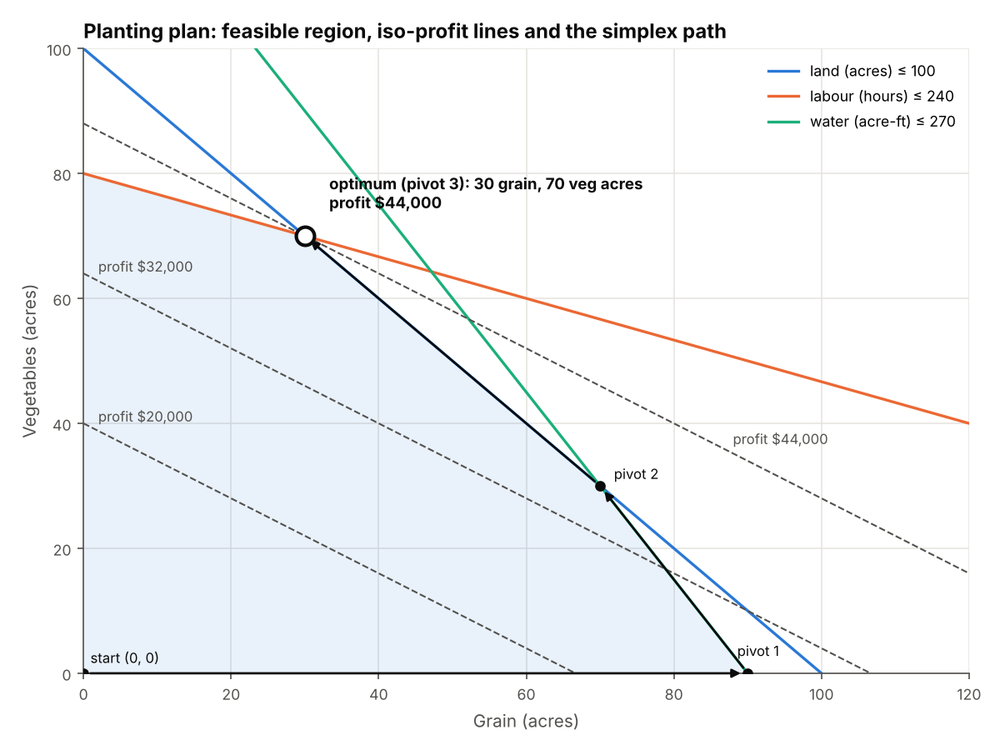
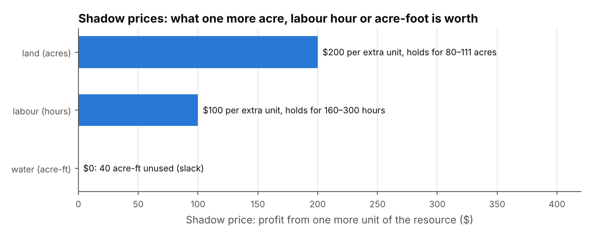
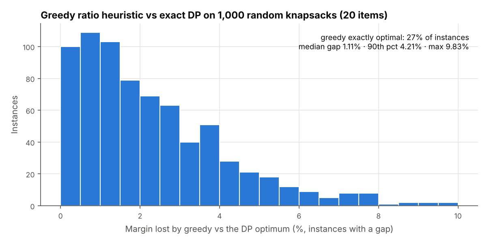
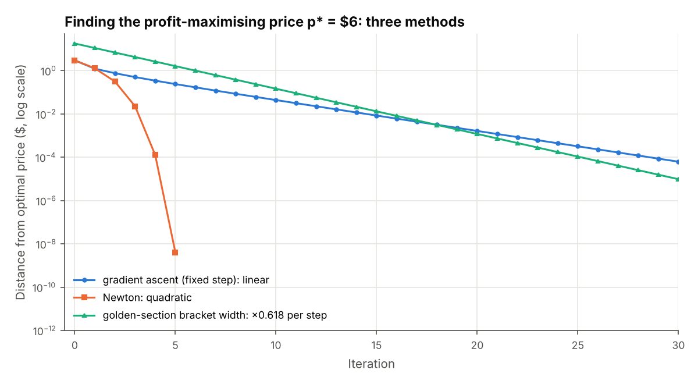
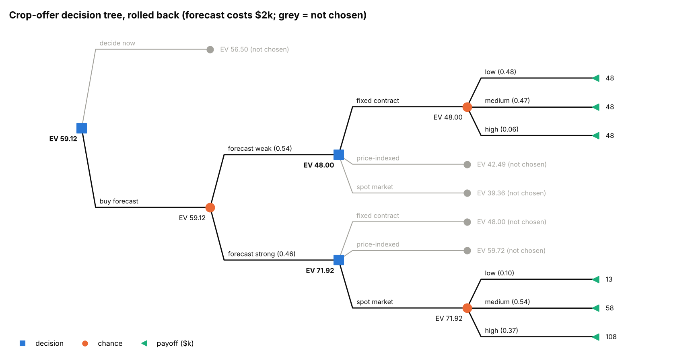
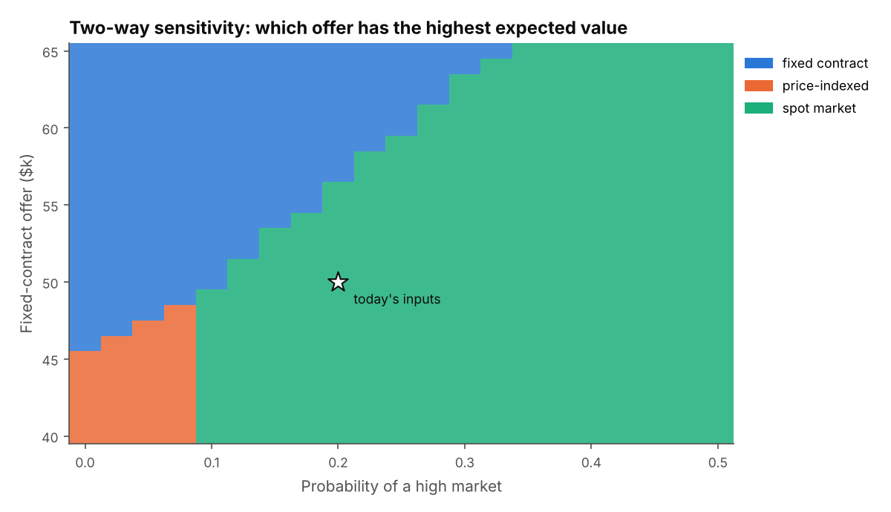
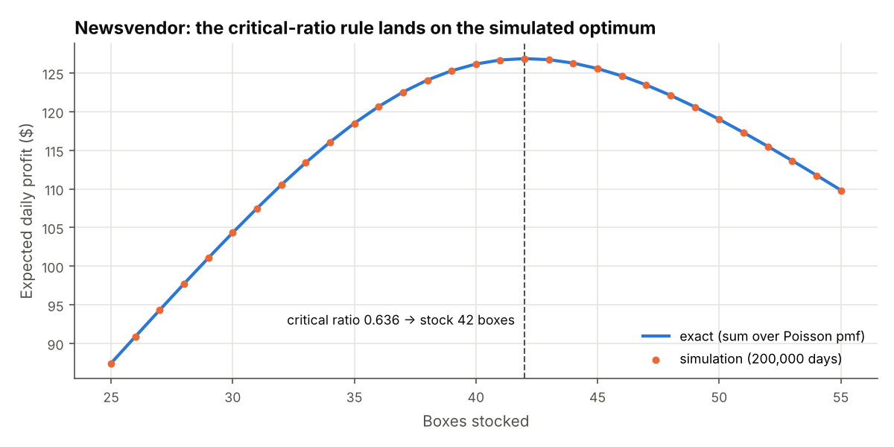

# Optimisation & decision maths: from linear programs to expected value
> A from-scratch toolkit for planning and decision problems: simplex with shadow prices and sensitivity ranges, transportation, knapsack and branch-and-bound, the Hungarian algorithm, Newton and golden-section pricing, Lagrange budget splits, decision trees, EVPI and the newsvendor rule, each checked against brute force, closed forms or SciPy.

**Tools:** Python (NumPy, pandas, Matplotlib), SciPy (as an independent check in tests only), pytest

*The settings are invented: a farm co-op planning plantings, deliveries and sales, a clinic scheduling staff, and the
co-op weighing a buyer's offers. Every solver is written out so the maths is visible; SciPy appears only in the tests,
as a second opinion.*



## The concepts

### 1. Linear programming ([`lp.py`](src/optkit/lp.py))
Choose quantities (decision variables) to maximise or minimise a linear objective while staying within linear limits.
The best plan always sits on a corner of the feasible region. With two variables you can draw the region and slide the
iso-profit line outward until it last touches a corner. The **simplex method** does the same in any number of
dimensions: it walks from corner to corner, improving the objective each step. This one keeps a dense tableau, uses two
phases (phase 1 finds a feasible corner when there are `≥` or `=` rows) and uses **Bland's rule**: enter the
lowest-index improving column, break ties by the lowest-index leaving variable. That rule cannot cycle.
```
max c·x   s.t.  A x ≤ b,  x ≥ 0
dual:     min b·y   s.t.  Aᵀy ≥ c,  y ≥ 0      strong duality: c·x* = b·y*
shadow price  y = c_Bᵀ B⁻¹        reduced cost  c_j − a_jᵀy
complementary slackness:  y_i · slack_i = 0,   x_j · reduced_cost_j = 0
RHS range:   b_i + δ is fine while x_B + δ·B⁻¹e_i ≥ 0
```
A **shadow price** is the profit from one more unit of a resource ("what is one more acre worth?"). It holds only
within the **RHS range**. A **reduced cost** is how much a variable's profit must rise before it is worth using. The
**objective range** is how far a profit coefficient can move before the plan changes.

*Used for:* production and planting plans, blending, staffing mixes, and pricing a scarce resource before buying more of it.

### 2. Transportation problem ([`transport.py`](src/optkit/transport.py))
Move goods from supply points to demand points at least cost. It is an LP with one equality per farm and one per market:
```
min Σ c_ij x_ij   s.t.  Σ_j x_ij = s_i,  Σ_i x_ij = d_j,  x ≥ 0      (needs Σs = Σd)
```
If supply and demand don't balance, a zero-cost dummy market (or a dummy farm that records shortage) is added. The
duals `u_i + v_j` give the marginal delivered cost on each route. The reduced cost `c_ij − u_i − v_j ≥ 0` on unused
routes says how much cheaper a route would need to be before it gets used.

*Used for:* distribution planning, allocating stock to stores, and routing work between sites.

### 3. Integer programming ([`integer.py`](src/optkit/integer.py))
Some decisions come in whole units: accept an order or not, hire 3 people rather than 2.5.
- **0/1 knapsack, exact by dynamic programming:** `best[i][w] = max(best[i−1][w], best[i−1][w−w_i] + v_i)`, O(n·W).
- **Greedy ratio heuristic:** take items by value per unit of weight while they fit. It is fast and usually close, but
  not optimal: with values 60/100/120, weights 10/20/30 and capacity 50, greedy gets 160 and the optimum is 220.
- **Branch-and-bound:** solve the LP relaxation. If a variable is fractional, split into `x_j ≤ ⌊v⌋` and
  `x_j ≥ ⌈v⌉` and solve each side. Prune a branch when its LP bound can't beat the best whole-number plan so far.
- **Why not just round the LP?** Rounding down can break constraints (too few staff). Rounding up stays feasible but
  can cost far more than the true integer optimum.

*Used for:* capital budgeting, choosing which orders or bids to accept, crew and shift scheduling, and loading trucks or storage.

### 4. Assignment problem ([`assignment.py`](src/optkit/assignment.py))
Pair n items with n slots one-to-one at least cost (or highest value). Brute force checks n! pairings. The
**Hungarian algorithm** solves it in O(n³). It keeps potentials `u_i + v_j ≤ c_ij` and grows the matching one row at a
time along the cheapest augmenting path. When it finishes, `Σu + Σv` equals the cost of the matching, which proves
the matching is optimal. The intuitive alternative, taking the single highest bid first, is not optimal.

*Used for:* matching staff to shifts, lots to buyers and listings to products, and pairing records across two systems.

### 5. Non-linear optimisation ([`nonlinear.py`](src/optkit/nonlinear.py))
Profit from a price with exponential demand:
```
π(p) = (p − c)·a·e^(−b·p)      π'(p) = a·e^(−bp)·(1 − b(p − c)) = 0  →  p* = c + 1/b
gradient ascent: p ← p + α·π'(p)              error × |1 + α·π''(p*)| per step   (linear)
Newton:          p ← p − π'(p)/π''(p)         error ≈ C·error² per step          (quadratic)
golden section:  keep 0.618 of the bracket each step, no derivatives needed
```
**Lagrange multipliers** handle a budget constraint. To split budget B across channels with diminishing returns
`a_i·ln(1 + x_i/s_i)`:
```
L = Σ a_i ln(1 + x_i/s_i) − λ(Σx_i − B)   →   a_i/(s_i + x_i) = λ  for every funded channel
x_i = a_i/λ − s_i,   λ = Σ a_i / (B + Σ s_i);   a channel with a_i/s_i ≤ λ gets 0 (KKT)
```
At the optimum every funded channel earns the same marginal return. λ is the value of one more dollar of budget,
the non-linear counterpart of a shadow price.

*Used for:* price optimisation, marketing mix, and splitting effort or stock across uses with diminishing returns.

### 6. Decisions under uncertainty ([`decisions.py`](src/optkit/decisions.py))
- **Expected value** `EV = Σ p_s·payoff_s`. **Maximin** picks the best worst case. **Maximax** picks the best best case.
  **Minimax regret** picks the option whose largest regret is smallest, where regret = best payoff in that state − this payoff.
- **Decision tree rollback:** working from the leaves back to the root, a chance node takes the probability-weighted
  mean of its branches and a decision node takes the best branch.
- **Value of information:** `EVPI = Σ p_s·max_option payoff − max_option EV` is the most any forecast can be worth
  (always ≥ 0). An imperfect forecast is valued by Bayes `P(state | signal) ∝ P(signal | state)·P(state)` inside the
  tree, and is worth between 0 and EVPI.
- **Newsvendor:** stock Q so that `P(D ≤ Q) ≥ Cu/(Cu + Co)`, where Cu = price − cost and Co = cost − salvage.
- **Risk aversion:** with exponential utility `u(x) = 1 − e^(−x/R)`, the certainty equivalent is
  `CE = −R·ln Σ p·e^(−x/R)`. A smaller R means more risk-averse; as R → ∞ the CE becomes the EV.

*Used for:* choosing between offers or contracts, deciding whether to pay for research, and setting stock, overbooking and safety-stock levels.

### 7. Sensitivity analysis
A **one-way** table moves one input to a low and a high value and records the EV and the best choice. A **two-way**
table sweeps two inputs over a grid and maps where the decision flips. In an LP the same question is answered exactly
by the ranges in section 1.

*Used for:* stress-testing a recommendation before acting on it, and showing which inputs are worth measuring better.

## Where it shows up in this portfolio
| Project | Method used there |
|---|---|
| [order-reconciliation](../../professional-work/order-reconciliation/) | integer programming (MILP) to decide which grade-substitution bids to accept |
| [market-prices](../../professional-work/market-prices/) | assignment problem to pair competitor listings with the co-op's lots |
| [produce-pricing](../../professional-work/produce-pricing/) | constrained price optimisation (closed-form optimum, volume and guardrail limits) |
| [marketing-roi](../../economics-finance/marketing-roi/) | Lagrange / equal-marginal-ROI budget split across media channels |
| [overbooking-economics](../../economics-finance/overbooking-economics/) | newsvendor critical ratio for the best booking limit |
| [dashboards](../../professional-work/dashboards/) | group-quote displacement: the expected value of the slots a block would displace |
| [formula-toolkit](../../economics-finance/formula-toolkit/) | markup rule and capacity price: closed forms for the pricing problem in section 5 |

## Results (from `python -m optkit run`)

**Planting plan (LP).** The co-op has 100 acres, 240 labour hours and 270 acre-ft of water. Grain earns $300/acre and
vegetables $500/acre. The simplex reaches the corner **30 acres grain, 70 acres vegetables, $44,000** in 3 pivots,
via (0,0) → (90,0) → (70,30) → (30,70).

| Constraint | Used / available | Shadow price | Holds while the limit is between |
|---|---|---|---|
| land | 100 / 100 acres | **$200** per acre | 80 and 111.4 acres |
| labour | 240 / 240 hours | **$100** per hour | 160 and 300 hours |
| water | 230 / 270 acre-ft | $0 (40 acre-ft spare) | 230 and ∞ |

Duality check: 200·100 + 100·240 = 44,000, which equals the profit. The plan stays optimal while grain earns between
**$166.67 and $500** per acre. The one-way sweep in [`lp_sensitivity_grain_profit.csv`](sample_output/lp_sensitivity_grain_profit.csv)
shows the plan changing as grain crosses those two values.



**Deliveries.** Three farms (120/80/100 t) supply four markets (70/90/60/80 t). The least-cost plan costs **$2,260**,
against $2,580 for the northwest-corner starting plan. Six of the twelve routes are used. Every unused route has a
reduced cost of $2–7/t.

**Orders into cold storage (knapsack).** With 40 pallets of space, the DP picks orders worth **$4,122** against
$4,032 for greedy (2.2% less). Over 1,000 random 20-item instances, greedy is exactly optimal in **27%**; the median
gap is 1.11%, the 90th percentile 4.21% and the worst 9.83%.



**Clinic staffing (branch-and-bound).** The clinic needs 4/6/7/5/6/4 staff across six two-hour blocks, covered by six
shift patterns, some with breaks.

| Plan | Cost | Note |
|---|---|---|
| LP relaxation | $3,005 | 2.5 late, 4.5 mid, 2.5 morning-half, 1.5 split shifts: a lower bound, not a rota |
| round down | n/a | leaves 4 of 6 blocks short-staffed |
| round up | $3,530 | feasible but 16% above the optimum |
| **branch-and-bound** | **$3,040** | 3 late, 4 mid, 2 morning-half, 2 split; 3 nodes; equals brute force |

**Lots to buyers (assignment).** Six lots and six buyer bids. The Hungarian algorithm reaches **$6,722**; taking the
highest bid first reaches $6,687. Greedy grabs a $1,045 bid for lot F, which forces lot E onto a $788 bid.

**Pricing a box of produce.** Demand is 1000·e^(−0.25p) and the unit cost is $2, so the closed form gives p* = $6.
Newton gets within 1e-8 in **5 steps**. Fixed-step gradient ascent needs **22 steps** to get within 1e-3, shrinking
the error by a factor of 0.72 each step, as the theory predicts. Golden-section narrows the bracket to 1e-8 in 46 steps
without any derivatives.



**Promotion budget ($100k over four channels).** The Lagrange solution spends 52.3 / 36.5 / 11.2 / 0 and returns
**415.5**, against 356.2 for an even split (+17%). The three funded channels each return λ = 1.926 per extra dollar. Radio's first
dollar returns only 0.80, so it gets nothing.

**The buyer's offers ($k).**

| Option | low (0.3) | medium (0.5) | high (0.2) | EV | worst | max regret | CE, R = 25 |
|---|---|---|---|---|---|---|---|
| fixed contract | 50 | 50 | 50 | 50.0 | **50** | 60 | **50.0** |
| price-indexed | 30 | 55 | 80 | 52.5 | 30 | **30** | 46.8 |
| spot market | 15 | 60 | 110 | **56.5** | 15 | 35 | 38.7 |

Each criterion picks a different offer: EV picks spot, maximin picks fixed, minimax regret picks price-indexed. A
risk-averse seller (R ≤ 50) prefers the fixed contract. **EVPI = 67 − 56.5 = $10.5k.** A $2k market forecast
(85% right about a low or high market) is worth **$4.6k** before its cost. Rolling back the tree gives EV $59.1k for
"buy forecast, then take the fixed contract on a weak signal and spot on a strong one".



**Sensitivity.** In the one-way table, the probability of a high market moves the best EV the most (−6.5 to +6.7).
Lowering spot's high-market payoff to 85 flips the choice to price-indexed. The two-way map shows where each offer wins.



**Newsvendor.** A farm stand sells strawberry boxes at $6. They cost $2.50, leftovers salvage at $0.50, and demand is
Poisson(40). The critical ratio is 3.5/5.5 = **0.636**, so the stand should stock **42 boxes**. Exact enumeration and
a 200,000-day simulation both peak at 42.



All tables are in [`sample_output/`](sample_output/), with the headline numbers in [`summary.json`](sample_output/summary.json).

## What the tests check
| Check | Test |
|---|---|
| Simplex objective matches `scipy.optimize.linprog` within 1e-6 on 240 random LPs (with `≥` and `=` rows) | `test_simplex_matches_linprog_on_random_lps` |
| Planting LP equals the hand solution: plan, shadow prices (200, 100, 0), grain range [166.7, 500], best graphical vertex | `test_farm_lp_hand_solution` |
| Duals: sign, complementary slackness on rows and columns, strong duality `b·y = c·x` | `test_duals_complementary_slackness_and_strong_duality` |
| Shadow price = finite-difference profit change inside the RHS range | `test_shadow_price_equals_finite_difference_within_range` |
| Infeasible and unbounded problems are reported as such | `test_infeasible_and_unbounded_detected` |
| Transportation plan meets every supply and demand, matches linprog, reduced costs ≥ 0 and 0 on used routes | `test_transportation_balanced_and_matches_linprog` |
| Unbalanced problem gets a dummy column | `test_unbalanced_transport_gets_dummy` |
| Knapsack DP = brute force on 150 small instances and always ≥ greedy; textbook greedy trap | `test_knapsack_dp_*`, `test_greedy_trap_*` |
| Branch-and-bound = brute-force enumeration on 40 random integer programs | `test_branch_and_bound_equals_brute_force` |
| Staffing: B&B = brute force, LP ≤ integer < round-up, round-down infeasible | `test_staffing_rounding_story` |
| Hungarian = brute force (n ≤ 7) and = `scipy.optimize.linear_sum_assignment` (including 40×40 and rectangular) | `test_hungarian_matches_brute_force_and_scipy` |
| Newton error ratio e_{k+1}/e_k² settles at the theoretical 0.25; gradient ratio e_{k+1}/e_k = \|1 + α·π''(p*)\| | `test_newton_*`, `test_gradient_*` |
| Golden-section finds p* = 6 and the minimum of x² − 4x; bracket shrinks by 0.618 | `test_golden_section_finds_known_optimum` |
| Lagrange: equal marginal returns = λ, unfunded channels below λ, beats 500 random splits, λ = d(return)/d(budget) | `test_lagrange_equal_marginal_returns` |
| Decision-tree rollback hand case; EVPI = 10.5 by hand and ≥ 0 on random tables; maximin and minimax regret picks | `test_decision_tree_*`, `test_evpi_*` |
| A forecast is worth between 0 and EVPI; a perfect forecast recovers EV with perfect information | `test_forecast_value_between_zero_and_evpi` |
| Certainty equivalent rises with risk tolerance towards the EV | `test_certainty_equivalent_risk_aversion` |
| Newsvendor critical-ratio Q = exact brute-force optimum = simulated optimum | `test_newsvendor_critical_ratio_equals_brute_force` |
| Two-way sensitivity picks the right option at known grid points | `test_sensitivity_tables` |
| CLI writes all files, 7 figures, byte-identical CSVs on a rerun | `test_cli_writes_files_and_is_deterministic` |

## Run it
```bash
cd analytics-methods/optimization-decisions
pip install -r requirements.txt
PYTHONPATH=src python -m optkit run --out sample_output --figures figures
pytest -q                                   # 27 tests
```
```
planting LP: grain 30 ac, vegetables 70 ac, profit $44,000 after 3 pivots
  shadow prices: land (acres) $200, labour (hours) $100, water (acre-ft) $0
transport: $2,260 (northwest-corner start $2,580)
cold storage: DP $4,122 vs greedy $4,032; 1,000 random knapsacks: greedy optimal 27%, median gap 1.11%, max 9.83%
staffing: LP $3,005, round-up $3,530, round-down feasible=False, branch-and-bound $3,040 (3 nodes)
lot assignment: Hungarian $6,722 vs greedy $6,687
pricing: p* = 6.0000; Newton 5 steps to 1e-8, gradient 22 steps to 1e-3, golden-section 6.000000
budget: lambda = 1.9259, return 415.5 vs even split 356.2
offers: EV {'fixed contract': 50.0, 'price-indexed': 52.5, 'spot market': 56.5}; EVPI 10.50, forecast worth 4.625 (tree EV 59.125)
newsvendor: critical ratio 0.6364 -> stock 42 (simulated best 42)
```
