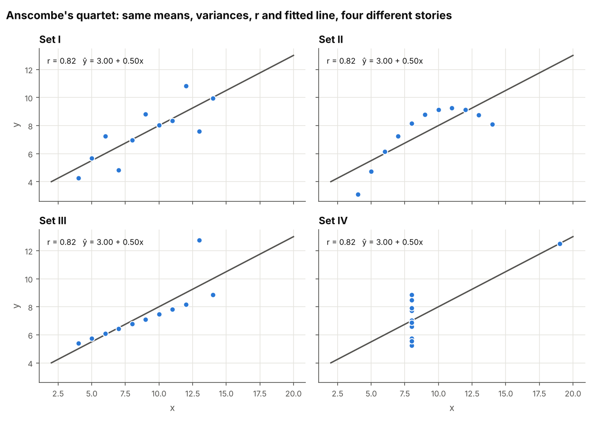
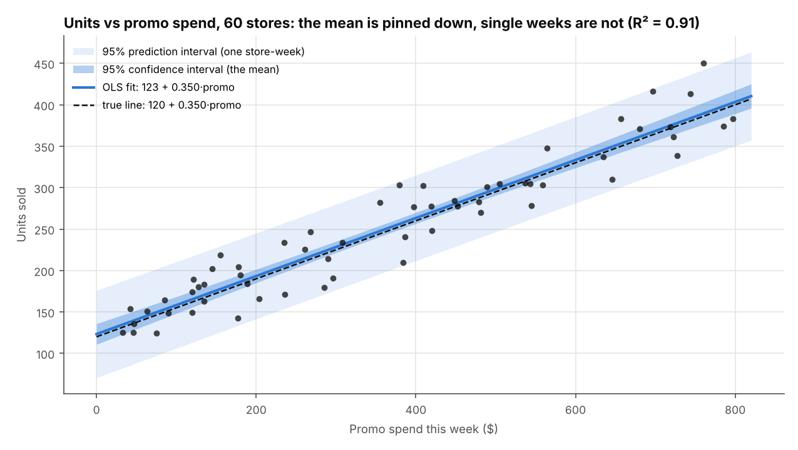
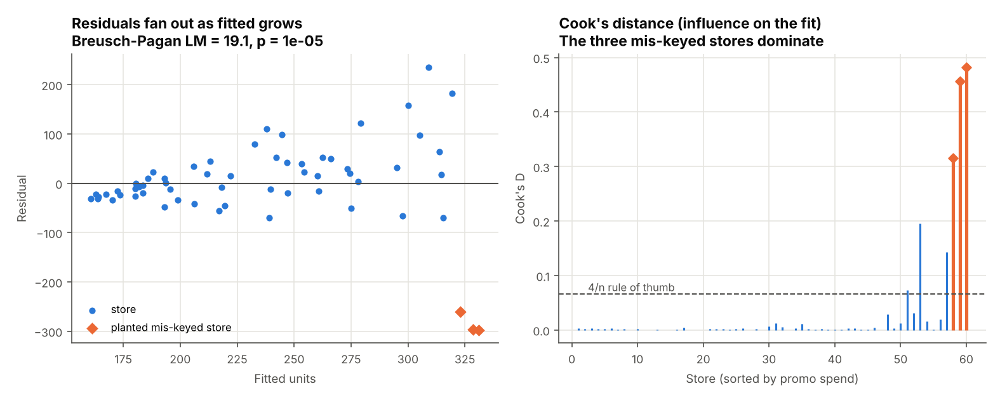
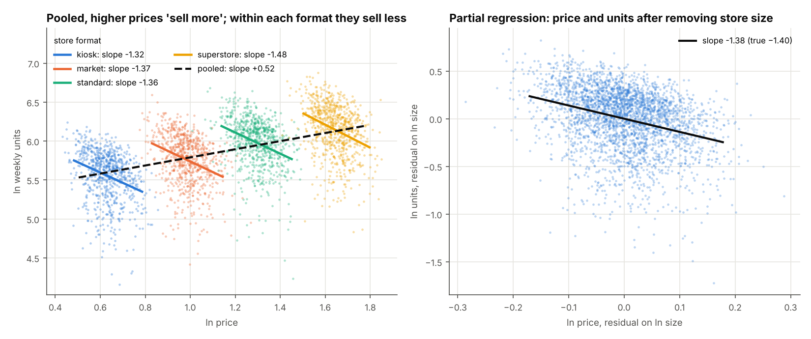
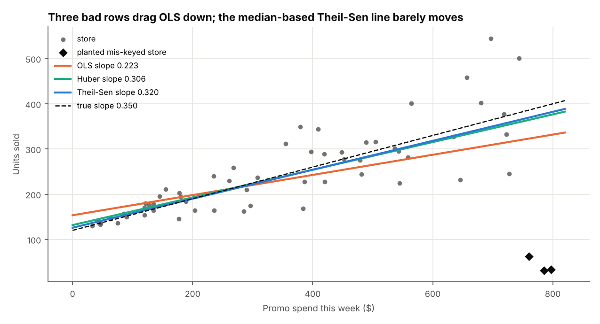
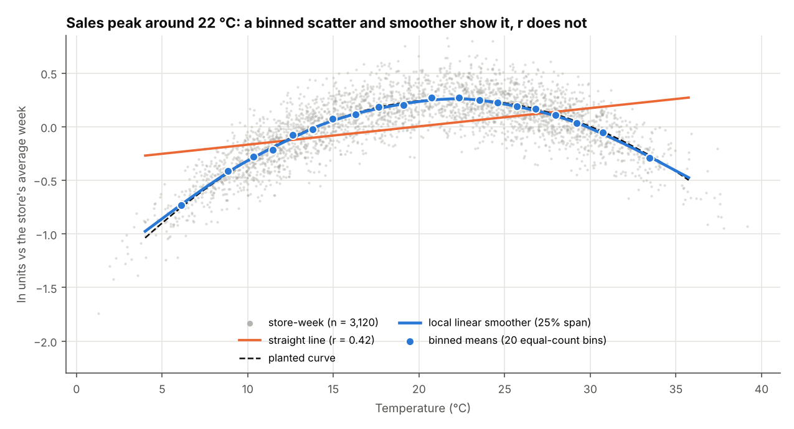

# Scatter, correlation & regression: reading relationships honestly
> Correlation, OLS with full inference, log-log elasticity, diagnostics, confounding and robust fits, written from scratch in NumPy and tested against data where the true relationships are known.

**Tools:** Python (NumPy, pandas, SciPy for the t / χ² distributions, matplotlib), pytest

*Synthetic weekly data for 60 retail stores of a farm co-op: price, promo spend, foot traffic, temperature and
units sold. Every relationship in it was planted on purpose: a −1.4 price elasticity, a confounder (store size), a curved
temperature effect, a collinear pair, a funnel of heteroscedastic noise and three mis-keyed rows. Because the answers are
known in advance, each method can be checked against them.*



## The data
| Dataset | Rows | Planted structure | Used for |
|---|---|---|---|
| Store-week panel ([`synth.make_stores`](src/regkit/synth.py)) | 60 stores × 52 weeks = 3,120 | `ln units = 7.5 + 1.0·ln size − 1.4·ln price + 0.0004·promo − 0.004·(temp − 22)² + N(0, 0.12)`. Bigger stores also charge more (`ln price = ln 3 + 0.5·ln size + noise`), and foot traffic is almost a copy of size. | elasticity, functional forms, Simpson's paradox, VIF, smoothing |
| Promo week ([`synth.make_promo`](src/regkit/synth.py)) | 60 stores | `units = 120 + 0.35·promo`. The noise sd grows with promo (2 + 0.12·promo). The three highest-promo stores had their units keyed in cases of 10. Clean and homoscedastic versions can be switched on. | CI/PI bands, Breusch-Pagan, HC1, leverage, Cook's distance, robust fits |
| Anscombe's quartet | 4 × 11 | The published 1973 values | why r alone misleads |

## The concepts

### 1. Reading a scatter: Pearson, Spearman, Kendall ([`corr.py`](src/regkit/corr.py))
**Pearson r** measures how well a *straight line* describes the points, on a −1 to 1 scale.
**Spearman ρ** is Pearson computed on the ranks, so it measures any *monotone* relationship and is barely moved by
one extreme value. **Kendall τ** counts pairs of points that move in the same direction (concordant) against pairs
that move in opposite directions (discordant).
```
r   = Σ(x−x̄)(y−ȳ) / √(Σ(x−x̄)² · Σ(y−ȳ)²)          test: t = r√(n−2) / √(1−r²),  df = n−2
ρ   = r(rank x, rank y)        (ties get the average rank; with no ties ρ = 1 − 6Σd² / (n(n²−1)))
τ-b = (concordant − discordant) / √((n₀ − ties_x)(n₀ − ties_y)),   n₀ = n(n−1)/2
```
**Why r misleads.** All four Anscombe sets have mean x = 9.0, mean y = 7.50, var x = 11.0, var y ≈ 4.12,
r = 0.82 and the same fitted line ŷ = 3.00 + 0.50x. Set II is an exact parabola. In set III one point drags the
slope. In set IV one point *creates* the whole slope: it has leverage 1.0. Spearman tells them apart
(0.82, 0.69, 0.99, 0.50). Two cases from the store data: three mis-keyed rows drop r for promo vs units from 0.83 to
0.50, and temperature has a strong curved effect that r reports as a modest 0.42.

*Used for:* first-pass screening of drivers, checking that two series move together, and checking monotone
relationships (rank-based) when outliers or skew are present.

### 2. OLS with inference ([`ols.py`](src/regkit/ols.py))
OLS picks the line (or plane) that minimises the sum of squared residuals. It is solved through the QR decomposition
`X = QR`. This gives the normal-equation answer without forming XᵀX, which would square the condition number. A
`method="normal"` switch keeps the textbook route, and a test checks that both agree with `np.linalg.lstsq`.
```
β̂ = (XᵀX)⁻¹Xᵀy = R⁻¹Qᵀy            s² = Σe² / (n − p)          Var(β̂) = s²(XᵀX)⁻¹
R² = 1 − SSE/SST                   adj R² = 1 − (1 − R²)(n − 1)/(n − p)
t = β̂ / se,  p = 2·P(T_{n−p} > |t|)          95% CI: β̂ ± t₀.₉₇₅ · se
mean at x₀ (CI):    ŷ₀ ± t·s·√(x₀ᵀ(XᵀX)⁻¹x₀)
new point (PI):     ŷ₀ ± t·s·√(1 + x₀ᵀ(XᵀX)⁻¹x₀)
```
The confidence interval describes where the *average* store at that promo level sits. The prediction interval
describes where *one* store-week will land, and it never shrinks below ±1.96·s however much data there is.

*Used for:* driver models, forecasting a single outcome with an honest range, and checking whether an effect could
be zero.



### 3. Log-log regression and reading coefficients ([`analysis.functional_forms`](src/regkit/analysis.py))
How you read a coefficient depends on whether each side is in levels or logs:

| Form | Model | Reading of b | Result here (same data, same controls) |
|---|---|---|---|
| level-level | `units = a + b·price` | +$1 price → b more units | +$0.10 → −9.0 units/week; elasticity at the mean −0.80 |
| log-level | `ln units = a + b·price` | +$1 price → 100·(eᵇ − 1)% units | +$0.10 → −2.5% units; elasticity at the mean −0.85 |
| level-log | `units = a + b·ln price` | +1% price → b·ln 1.01 ≈ b/100 units | +1% → −5.23 units/week; elasticity at the mean −1.39 |
| **log-log** | `ln units = a + b·ln price` | **b is the elasticity**: +1% price → ≈ b% units | **b = −1.393 (95% CI −1.448 to −1.337); true −1.40** |

The log-log form recovers the planted elasticity and has roughly constant residual variance (Breusch-Pagan p = 0.08).
The level-level fit has strongly heteroscedastic residuals (p ≈ 10⁻³⁰) and, read at the mean, understates price
sensitivity by almost half. Both problems come from imposing a straight line on a curved, multiplicative
relationship.

*Used for:* price elasticity and markdown planning, the percentage effect of a driver, and any multiplicative
relationship where effects scale with size.

### 4. Diagnostics ([`diagnostics.py`](src/regkit/diagnostics.py))
| Check | Formula | What it catches |
|---|---|---|
| Residuals vs fitted | plot e against ŷ | curvature, a funnel shape, odd clusters |
| Breusch-Pagan (Koenker) | regress e² on X; `LM = n·R²_aux ~ χ²(p−1)` | variance that changes with x |
| HC1 robust SE | `n/(n−p) · (XᵀX)⁻¹ Xᵀdiag(e²)X (XᵀX)⁻¹` | standard errors that stay valid under heteroscedasticity |
| Leverage | `h_ii = diag(X(XᵀX)⁻¹Xᵀ)`, Σh_ii = p; high if > 2p/n | points with unusual x that *can* pull the fit |
| Cook's distance | `D_i = e_i² / (p·s²) · h_ii / (1 − h_ii)²`; look at D > 4/n | points that *do* pull the fit (leverage × misfit) |
| VIF | `VIF_j = 1 / (1 − R²_j)`, R²_j from x_j on the other x's | predictors that duplicate each other, inflating SEs |

Results on the promo week, which has the funnel and the outliers: Breusch-Pagan LM = 19.1, p = 1×10⁻⁵ (on the clean
homoscedastic version, p = 0.06). The HC1 standard error on the slope is **0.078, against 0.051 classical**, so the
naive SE is about 35% too small. The three mis-keyed stores have the three largest Cook's distances (0.48, 0.46, 0.32
against a 4/n cutoff of 0.067). On the store panel, adding foot traffic next to store size gives **VIFs of 220 and
193**. Dropping traffic brings size back to 26. That remaining 26 is itself a warning: price and size are correlated
(r = 0.98), which is exactly the confounding in section 5.

*Used for:* deciding whether to trust a p-value, finding data-entry errors, and choosing which of two overlapping
drivers to keep.



### 5. Confounding, Simpson's paradox and partial regression ([`analysis.simpson`](src/regkit/analysis.py))
Superstores charge more *and* sell more, because they are bigger. Pooling all store-weeks, the slope of ln units on
ln price is **+0.52** (95% CI 0.49 to 0.55): higher prices appear to *raise* sales. Within each format the slope is
negative (−1.32, −1.37, −1.36, −1.48), and controlling for ln size gives **−1.38**. The sign flips because size
drives both price and units.

**Partial regression** (Frisch-Waugh-Lovell) shows what "controlling for" does. Regress both ln units and ln price on
ln size, keep the residuals, and regress one residual on the other. The slope equals the multiple-regression
coefficient exactly (to 1e-10 in the tests):
```
β_price | size  =  slope of  resid(ln units ~ ln size)  on  resid(ln price ~ ln size)
```
*Used for:* any "does X drive Y" question on observational data: price tests across stores, campaign
effects across regions, outcomes compared across sites of different size.



### 6. Robust lines: Theil-Sen and Huber ([`robust.py`](src/regkit/robust.py))
OLS squares residuals, so one bad row with high leverage can move the whole line.
**Theil-Sen** takes the median of all pairwise slopes, and up to ~29% of points can be arbitrary before it breaks.
**Huber** regression uses squared loss for small residuals and absolute loss for large ones. It is solved by
iteratively reweighted least squares and down-weights big misfits.
```
Theil-Sen:  b = median_{i<j} (y_j − y_i)/(x_j − x_i),   a = median(y − b·x)
Huber:      minimise Σ ρ(e_i/s),  ρ(u) = u²/2 if |u| ≤ c else c|u| − c²/2,  c = 1.345,  s = MAD/0.6745
            IRLS weights w_i = min(1, c/|u_i|)
```
| Promo week, true slope 0.350 | OLS | Huber | Theil-Sen |
|---|---|---|---|
| with the 3 mis-keyed rows | 0.223 | 0.306 | **0.320** |
| rows removed | 0.365 | 0.347 | 0.352 |

Huber helps but does less well than Theil-Sen. Huber limits large residuals but not leverage, and these bad rows sit
at the highest promo spend.

*Used for:* price and cost trends on data with keying errors, and as a quick check of whether a few rows are
driving an OLS result.



### 7. Big scatters: binned means and a local linear smoother ([`smooth.py`](src/regkit/smooth.py))
With 3,120 points a raw scatter is a cloud. A **binned scatter** splits x into equal-count bins and plots the mean y
in each. A **local linear smoother** (the core of LOWESS) fits a weighted straight line around each point of a grid.
It uses the nearest 25% of the data with tricube weights and reads the fitted line at that point. Optional bisquare
robustness passes are included.
```
w_i = (1 − (|x_i − x₀| / d_max)³)³    for the k = frac·n nearest points;   ŷ(x₀) = a  from  min Σ w_i (y_i − a − b(x_i − x₀))²
```
Temperature vs units (relative to each store's own average week): the smoother tracks the planted
`−0.004·(t − 22)²` curve with an RMSE of 0.017 log points, against 0.33 for the straight line, whose r = 0.42 hides the
peak at 22 °C.

*Used for:* finding the shape before choosing a model (thresholds, saturation, peaks), and showing a trend in
dashboards where there are too many points to plot.



## Results at a glance
| Check | Result |
|---|---|
| Elasticity, log-log with controls | −1.393, 95% CI [−1.448, −1.337]; true −1.40. All five planted coefficients fall inside their CIs. |
| Simpson's paradox | pooled +0.52 → controlled −1.38 → format fixed effects −1.38 |
| Interval coverage, 4,000 simulations (n = 30) | prediction interval 94.5%, CI for the mean 95.0%, slope CI 94.9% |
| Heteroscedasticity | Breusch-Pagan rejects in >90% of funnel datasets and in close to 5% of clean ones; HC1 SE 1.55× classical |
| Influence | Cook's distance ranks the 3 planted rows 1-2-3 |
| Collinearity | VIF 220 / 193 for size / foot traffic |
| Robustness | slope error with outliers: OLS −0.127, Huber −0.044, Theil-Sen −0.030 |

All tables are in [`sample_output/`](sample_output/): `anscombe.csv`, `elasticity_model.csv`, `functional_forms.csv`,
`simpson.csv`, `influence.csv`, `heteroscedasticity.csv`, `vif.csv`, `robust.csv`, `coverage.csv`, `binned_temperature.csv`.

## Where it shows up in this portfolio
| Project | Connection |
|---|---|
| [Produce pricing](../../professional-work/produce-pricing/) | Log-log OLS per segment gives the elasticities that drive prices. The confounding in section 5 is why those models control for seasonality and segment. |
| [Market prices](../../professional-work/market-prices/) | Outlier rules for ×10 / ÷10 keying errors, the same kind of mis-keyed rows that Cook's distance and Theil-Sen deal with here |
| [Formula toolkit](../../economics-finance/formula-toolkit/) | `fit_elasticity` is the one-variable version of the log-log slope, `cov(ln P, ln Q) / var(ln P)` |
| [Marketing ROI](../../economics-finance/marketing-roi/) | Response curves fitted to weekly sales: least squares, parameter uncertainty and diminishing (non-linear) returns |

## What the tests check
| Test | What it proves |
|---|---|
| Pearson vs hand calculation, `np.corrcoef`, `scipy.stats.pearsonr` p-value | the formula and the t-test are right |
| Spearman = Pearson on ranks, with ties; = 1 − 6Σd²/(n(n²−1)) without ties; = scipy | rank handling is right |
| Kendall τ-b = scipy | pair counting with ties |
| Anscombe: equal means, var x, r, intercept, slope to 2 dp; var y to 1 dp; different Spearman; set II is a parabola (R² > 0.999); set IV has a point with leverage 1 | same summary statistics, different shapes |
| OLS (QR and normal equations) = `np.linalg.lstsq`; hat diagonals agree | the linear algebra |
| All planted coefficients inside their 95% CI | the estimates recover the truth |
| R² = r² for simple regression; adj R²; slope, SE and p = `scipy.stats.linregress` | inference matches an independent library |
| Coverage of PI, mean CI and slope CI between 93.5% and 96.5% over 3,000 simulations | the intervals are calibrated |
| PI wider than CI; CI widens when extrapolating | interval behaviour |
| Log-log recovers −1.40; level-log at the mean ≈ −1.4; logs remove heteroscedasticity | functional forms |
| Leverage sums to p and equals the diagonal of X(XᵀX)⁻¹Xᵀ | hat matrix |
| Cook's D ranks the planted rows top 3, and matches the leave-one-out definition | influence |
| VIF > 50 for the collinear pair, < 1.1 for an independent driver | multicollinearity |
| Breusch-Pagan rejection rate > 90% (funnel) and < 9% (clean); LM = n·R² by hand | heteroscedasticity test |
| HC1 SE > classical SE under the funnel; equals the closed-form sandwich for the slope | robust standard errors |
| Simpson: pooled slope significantly > 0, controlled significantly < 0, every within-format slope < 0; FWL equals the multiple-regression coefficient | confounding |
| Theil-Sen error < ⅓ of OLS error with outliers; brute-force median of pairwise slopes | robust fit |
| Local linear smoother reproduces a straight line exactly and beats a line on the curve; equal-count bins | smoothing |
| Same seed → identical data; CLI writes all CSVs and 6 figures | reproducibility |

## Run it
```bash
cd analytics-methods/scatter-regression
pip install -r requirements.txt
PYTHONPATH=src python -m regkit run --out sample_output --figures figures
pytest -q                     # 20 tests
```
```
Anscombe: r = 0.816, 0.816, 0.816, 0.817 · Spearman = 0.82, 0.69, 0.99, 0.50
elasticity (log-log, controls): -1.393 [95% CI -1.448, -1.337] · true -1.40 · all truths in CI: True
Simpson: pooled slope +0.52 → controlling for size -1.38 · FWL -1.38
Breusch-Pagan p: hetero 1.3e-05 vs clean 0.06 · slope SE classical 0.0505 vs HC1 0.0784
Cook's D top 3 stores: [60, 59, 58] (planted [58, 59, 60])
VIF ln_size 220, ln_traffic 193
slope with outliers: OLS 0.223 · Huber 0.306 · Theil-Sen 0.320 · true 0.350
coverage over 4000 sims: PI 0.945 · CI(mean) 0.950 · slope CI 0.949
temperature: r = 0.42; RMSE vs planted curve: smoother 0.017, line 0.329
```
