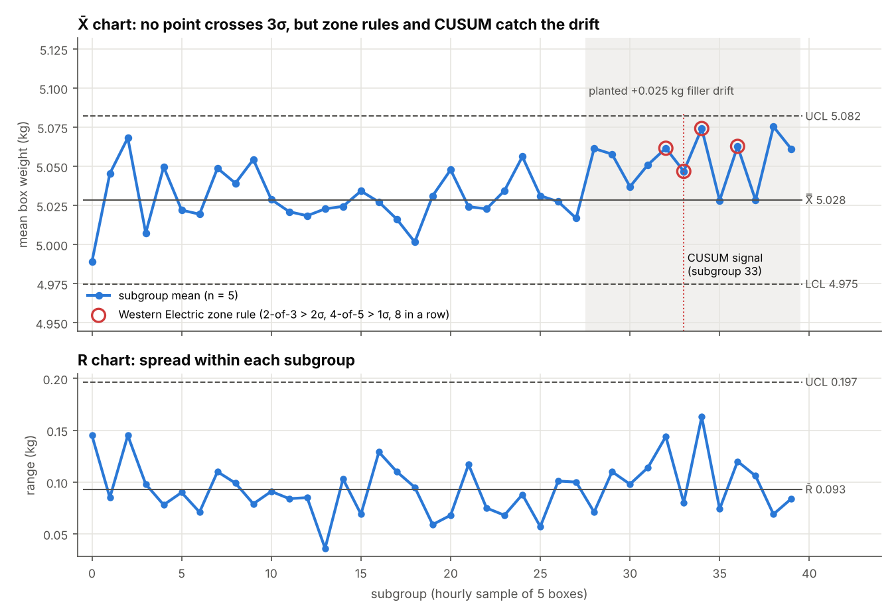
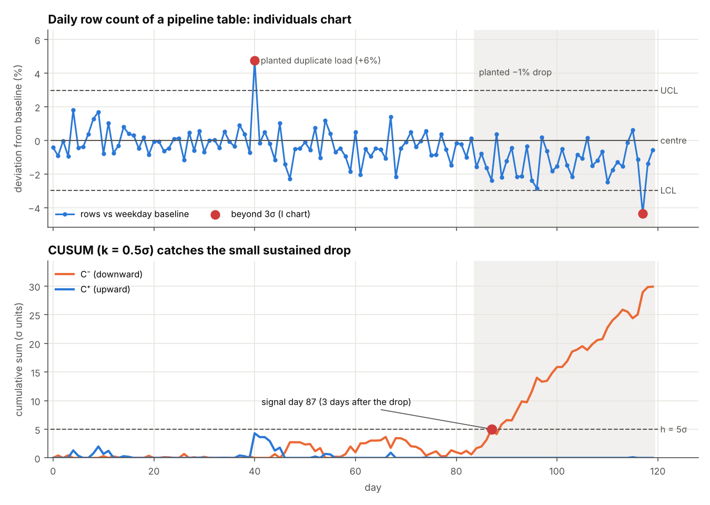
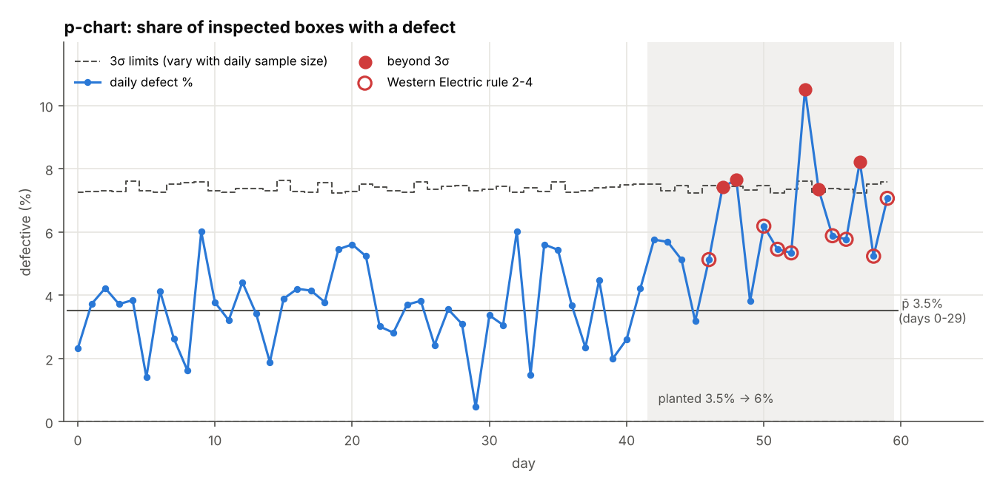
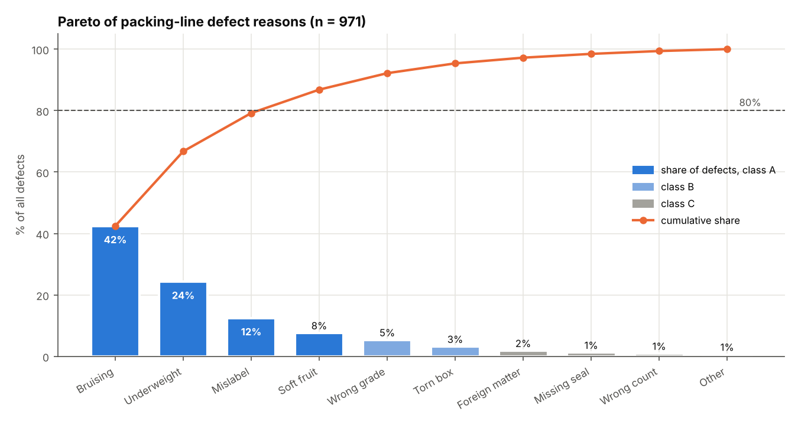
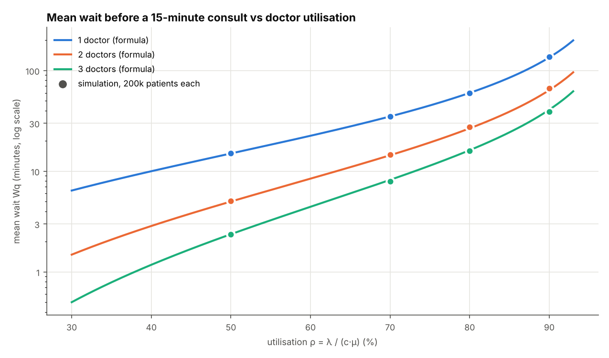
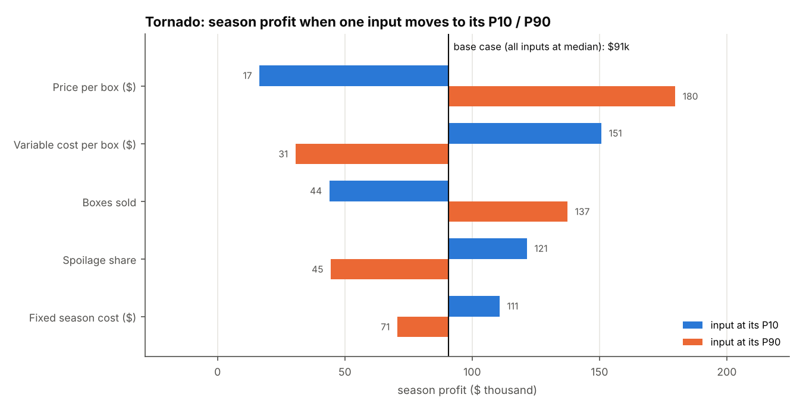

# Statistics & quality control: from a confidence interval to a control chart
> A from-scratch toolkit for everyday statistics and process quality: descriptive stats and the core distributions, confidence intervals and tests, control charts with CUSUM and EWMA, capability indices, Pareto/ABC and Gini, queueing formulas checked by simulation, and Monte Carlo with tornado sensitivity, each validated against hand calculations, closed forms or SciPy.

**Tools:** Python (NumPy, pandas, Matplotlib), SciPy (probability tables, and as an independent check in tests), pytest

All data is synthetic and seeded, generated in [`synth.py`](src/statkit/synth.py) with **planted structure** so every
method has a known right answer to find: a produce packing line whose filler drifts up by 0.025 kg at hour 28, a data
pipeline whose daily row count silently drops 1% on day 84 (plus a one-day duplicate load on day 40), a defect rate
that steps from 3.5% to 6% on day 42, two clinic sites with different waiting times, and a list of 120 SKUs.

## The concepts

### 1. Descriptive statistics ([`descriptive.py`](src/statkit/descriptive.py))
Mean, median and mode describe the centre; variance and standard deviation the spread; skewness the lopsidedness;
percentiles the tails. Waiting times are right-skewed, so the mean sits above the median and P95 matters more than the mean.
```
mean  x̄ = Σx / n            sample variance  s² = Σ(x − x̄)² / (n − 1)        s = √s²
skew  g1 = m3 / m2^1.5      adjusted G1 = g1·√(n(n−1)) / (n−2)              (mₖ = Σ(x − x̄)ᵏ / n)
percentile (linear, = numpy / Excel PERCENTILE.INC):  rank h = (n − 1)·q/100, interpolate between neighbours
```
*Used for:* KPI summaries, service-level reporting (P90 wait, P95 latency), spotting skew before choosing a test.

### 2. Distributions and the central limit theorem
```
normal       f(x) = e^(−z²/2) / (σ√2π),  z = (x − μ)/σ        Φ(z) = ½(1 + erf(z/√2))
binomial     P(K = k) = C(n,k)·pᵏ·(1 − p)ⁿ⁻ᵏ                  k successes in n independent tries
Poisson      P(K = k) = e^(−λ)·λᵏ / k!                          counts of rare events in a fixed window
exponential  f(x) = λ·e^(−λx)                                   time between Poisson events (memoryless)
CLT          x̄ of n draws ≈ Normal(μ, σ/√n);  skew of x̄ = skew of x / √n  (exponential: 2/√n)
```
The CLT demo averages n exponential waits (mean 12 minutes, skew 2) and shows both the sd and the skew of the
average shrinking exactly as the formulas say.

*Used for:* no-shows and overbooking (binomial), arrivals and defects per day (Poisson), time between arrivals
(exponential), and the reason a 95% interval of ±1.96 standard errors works even on skewed data.

### 3. Confidence intervals and tests ([`inference.py`](src/statkit/inference.py))
```
t interval for a mean     x̄ ± t(1−α/2, n−1)·s/√n
Wilson interval (rate)    [p̂ + z²/2n ± z·√(p̂(1−p̂)/n + z²/4n²)] / (1 + z²/n)
Welch t (two means)       t = (x̄₁ − x̄₂) / √(s₁²/n₁ + s₂²/n₂)
                          df = (v₁ + v₂)² / (v₁²/(n₁−1) + v₂²/(n₂−1)),  vᵢ = sᵢ²/nᵢ
chi-square independence   χ² = Σ (O − E)²/E,  E = row total × column total / grand total,  df = (r−1)(c−1)
percentile bootstrap      resample with replacement B times; CI = α/2 and 1−α/2 quantiles of the statistic
power (two-sample)        power = Φ(δ/(σ√(2/n)) − z(1−α/2)) + Φ(−δ/(σ√(2/n)) − z(1−α/2))
sample size per group     n = 2·(z(1−α/2) + z(power))²·σ² / δ²
```
Wilson is used instead of the textbook p̂ ± z·√(p̂(1−p̂)/n) because it never goes below 0 and behaves at small
counts. Welch does not assume equal variances. The bootstrap gives an interval for statistics with no simple
formula, here the median. A type I error is a false alarm (rate α); a type II error is a missed real effect
(rate β = 1 − power). Both are checked by simulation.

*Used for:* margins of error on survey and conversion rates, A/B and holdout tests, "is this site really slower?",
"does defect type depend on shift?", and sizing a test before running it.

### 4. Statistical process control ([`spc.py`](src/statkit/spc.py))
A control chart separates common-cause noise from a real change. Limits come from a stable baseline period (phase I)
and are then applied to new data (phase II).
```
X̄–R chart (subgroups of n)   X̄ chart: X̿ ± A2·R̄       R chart: D3·R̄ … D4·R̄       σ̂_within = R̄/d2
                              n = 5: A2 = 0.577, D3 = 0, D4 = 2.114, d2 = 2.326;  A2 = 3/(d2·√n)
I-MR chart (single values)    X̄ ± 3·MR̄/1.128  (= X̄ ± 2.66·MR̄),   MR chart UCL = 3.267·MR̄
p-chart (defect share)        p̄ ± 3·√(p̄(1 − p̄)/nᵢ)   (limits widen on days with fewer boxes inspected)
Western Electric rules        1: one point beyond 3σ   2: 2 of 3 beyond 2σ (same side)
                              3: 4 of 5 beyond 1σ (same side)   4: 8 in a row on one side of the centre
CUSUM (σ units, z = (x−target)/σ)   C⁺ₜ = max(0, zₜ − k + C⁺ₜ₋₁),  C⁻ₜ = max(0, −zₜ − k + C⁻ₜ₋₁),  signal if > h
                              k = 0.5, h = 5: in-control ARL ≈ 469, ARL for a 1σ shift ≈ 10 (Siegmund)
EWMA                          zₜ = λxₜ + (1 − λ)zₜ₋₁,   limits target ± L·σ·√(λ/(2−λ)·(1 − (1−λ)^(2t)))
```
A 3σ Shewhart chart is good at big, sudden jumps. CUSUM and EWMA accumulate evidence, so they catch small
sustained shifts that a 3σ chart misses for weeks.

*Used for:* fill weights on a packing line, defect rates from inspection, and data-quality monitors on pipeline
tables (row counts, null rates, totals) where a silent 1% loss is the expensive failure.

### 5. Process capability ([`capability.py`](src/statkit/capability.py))
Control says the process is stable; capability says whether a stable process fits inside the customer's spec.
```
Cp  = (USL − LSL) / 6σ_within            Cpk = min(USL − μ, μ − LSL) / 3σ_within
Pp  = (USL − LSL) / 6σ_overall           Ppk = min(USL − μ, μ − LSL) / 3σ_overall
ppm out of spec = [Φ((LSL − μ)/σ) + 1 − Φ((USL − μ)/σ)] × 10⁶
```
Cp is potential if the process were centred; Cpk is what you get given where it sits. Cp uses short-term (within
subgroup) variation; Pp uses everything, including drift. Cpk = 1.00 means about 1,350 ppm out on the near side;
1.33 is the usual minimum for a supplier.

*Used for:* deciding whether a filler, scale or supplier can hold a spec, and pricing the giveaway vs rejects trade-off.

### 6. Pareto / ABC, Lorenz curve and Gini ([`pareto.py`](src/statkit/pareto.py))
Sort categories largest first and accumulate their share. ABC classes: an item is **A** while the cumulative share
*before* it is under 80% (so the item that crosses 80% is still A), **B** up to 95%, **C** after that.
```
share_i = vᵢ / Σv      cum_i = Σ_{j ≤ i} share_j
Lorenz curve: points (i/n, cumulative share of the i smallest)
Gini  G = Σᵢ (2i − n − 1)·x₍ᵢ₎ / (n·Σx),  x sorted ascending   (= 1 − 2 × area under the Lorenz curve)
      0 = everyone equal;  (n − 1)/n = one item holds everything
```
*Used for:* which defect causes to fix first, which SKUs get tight inventory control, and how concentrated revenue
or demand is across customers, stores or products.

### 7. Queueing: Little's law, M/M/1 and Erlang C ([`queueing.py`](src/statkit/queueing.py))
```
Little's law     L = λ·W         (average number in system = arrival rate × average time in system; any stable queue)
M/M/1            ρ = λ/μ,  L = ρ/(1−ρ),  Lq = ρ²/(1−ρ),  W = 1/(μ−λ),  Wq = ρ/(μ−λ)
M/M/c Erlang C   a = λ/μ,  P(wait) = [aᶜ/c! · c/(c−a)] / [Σₖ₌₀^(c−1) aᵏ/k! + aᶜ/c! · c/(c−a)]
                 Wq = P(wait) / (cμ − λ),  W = Wq + 1/μ
```
Waiting time is not linear in utilisation: it explodes as ρ → 1. The formulas assume Poisson arrivals and
exponential service, so a discrete-event simulation (first come first served, each patient takes the first doctor
to free up) checks them, and measures L by sweeping the number in the clinic over time so that Little's law is a
genuine check rather than a definition.

*Used for:* staffing clinics, call centres and checkouts; setting a utilisation target; explaining why "95% busy" means long queues.

### 8. Monte Carlo and tornado sensitivity ([`montecarlo.py`](src/statkit/montecarlo.py))
A season-profit model for the packing operation with five uncertain inputs:
```
profit = boxes · (1 − spoilage) · price − boxes · unit cost − fixed
boxes ~ Normal(52,000, 6,000)     price ~ Triangular($17, mode $19.40, $23)     unit cost ~ Normal($12.50, $0.90)
spoilage ~ Beta(4, 60) (mean 6.3%)     fixed ~ Uniform($200k, $250k)
```
**Monte Carlo** draws all inputs together 100,000 times to get the distribution of profit (P5, P95, chance of a
loss). **Tornado** moves one input at a time to its P10 and P90 with the others at their median and ranks inputs by
the swing in profit, which shows where better information is worth paying for.

*Used for:* budgets and business cases with ranges instead of single numbers, and deciding which assumption to research first.

## Where it shows up in this portfolio
| Project | What it uses from here |
|---|---|
| [Warehouse governance](../../professional-work/warehouse-governance/) | Row counts and test status per model: the I-MR / CUSUM pipeline monitor here is the statistical version of those checks |
| [Capacity planning](../../professional-work/capacity-planning/) | The validation gate and control totals; percentile benchmarks (section 1) |
| [Dashboards](../../professional-work/dashboards/) | Holdout tests with 95% intervals (section 3), Poisson fill probabilities (section 2), Monte Carlo check |
| [Overbooking economics](../../economics-finance/overbooking-economics/) | Binomial and Poisson show-up models (section 2), Monte Carlo check |
| [Marketing ROI](../../economics-finance/marketing-roi/) | A/B test sizing with power analysis (section 3), Monte Carlo ROI range (section 8) |
| [Produce pricing](../../professional-work/produce-pricing/) | Same farm co-op setting; plain-SQL validation checks for whoever runs it next |
| [Formula toolkit](../../economics-finance/formula-toolkit/) | Percentiles, credibility and change-tolerance gates for data checks |

## Results (from `python -m statkit run`)

### Packing line: X̄–R, zone rules, CUSUM, EWMA
Subgroups of 5 boxes per hour, limits from the first 20 hours. True within-sigma 0.04 kg; the filler drifts
+0.025 kg (0.6σ of a box, 1.4σ of a subgroup mean) from subgroup 28.

| | value |
|---|---|
| X̄ chart limits | LCL 4.975, X̿ 5.028, UCL 5.082 kg; R̄ = 0.093 → σ̂_within = 0.040 kg |
| Points beyond 3σ before / after the drift | 0 / 0 (the 3σ chart misses it) |
| First Western Electric signal | subgroup 32 (rule 3: 4 of 5 beyond 1σ) |
| First CUSUM signal (k = 0.5, h = 5) | subgroup 33, 5 hours after the drift |
| First EWMA signal (λ = 0.2, L = 3) | subgroup 34 |



### Capability against spec 4.90–5.15 kg

| period | Cp | Cpk | Pp | Ppk | ppm out (within σ) | ppm out (overall σ) |
|---|---|---|---|---|---|---|
| baseline (subgroups 0–19) | 1.04 | 1.01 | 1.04 | 1.01 | 1,851 | 1,809 |
| after drift (from 28) | 1.04 | 0.80 | 1.00 | 0.77 | 8,152 | 10,764 |

Cp is unchanged because the spread did not change; Cpk falls because the mean moved toward the upper limit, and
expected out-of-spec boxes rise about 4–6×.

### Pipeline row counts: I-MR chart vs CUSUM
Each day's rows are compared with the weekday average of the first 56 days, so the residual is a % deviation
with σ̂ = 0.99%.

| | day |
|---|---|
| Planted duplicate load (+6%) | 40: flagged by the I chart the same day |
| Planted silent drop (−1%) | 84 |
| CUSUM C⁻ signal | **87** (3 days after the drop) |
| EWMA signal | 87 |
| First I-chart point beyond 3σ after the drop | 117 (33 days late) |

The Shewhart chart is the right tool for the spike and nearly useless for the drop; CUSUM is the reverse.
No false drop alarm before day 84.



### p-chart of inspected boxes
p̄ = 3.51% over days 0–29 (about 200 boxes inspected a day). After the planted step to 6% on day 42, the first
Western Electric signal is day 46 (rule 3) and points beyond 3σ follow on days 47, 48, 53, 54 and 57. No signals
before the step.



### Inference on clinic waiting times and defects

| quantity | estimate | 95% interval / test |
|---|---|---|
| Site A mean wait | 17.1 min | t interval 15.6 – 18.6 |
| Site A median wait | 15.7 min | bootstrap (B = 5,000) 13.7 – 17.6 |
| Site B − Site A mean wait | +2.8 min | Welch t = 2.22, df = 263.9, p = 0.027 |
| Defect rate, first week | 3.33% | Wilson 2.53% – 4.37% |
| Defect reason vs shift (3×2 table) | χ² = 10.6 | df = 2, p = 0.005 (planted: night shift bruises more) |
| n per site to detect a 3-minute difference, 80% power | 199 | simulated: type I 0.053, power 0.789 |

Descriptives: Site A mean 17.1, median 15.7, P95 37.3 minutes, skew 1.10; Site B mean 19.9, median 16.9, skew 1.66.

### Central limit theorem (means of n exponential waits, 20,000 reps)

| n | sd of mean (theory σ/√n) | skew of mean (theory 2/√n) | share within ±1.96 SE |
|---|---|---|---|
| 1 | 11.95 (12.00) | 1.96 (2.00) | 94.8% |
| 5 | 5.35 (5.37) | 0.88 (0.89) | 95.7% |
| 30 | 2.19 (2.19) | 0.39 (0.37) | 95.3% |
| 100 | 1.20 (1.20) | 0.19 (0.20) | 95.0% |

### Pareto of defect reasons and ABC of SKUs
971 defects across 10 reasons: Bruising 42%, Underweight 24%, Mislabel 12% (79.2% cumulative), so those three plus
Soft fruit (which crosses 80%) are class A. Across 120 SKUs, 43 are class A and hold 80.0% of revenue, 36 are B
(15.1%), 41 are C (4.8%); Gini = 0.605. The chart puts bar shares and the cumulative line on one percentage axis.



### Queueing: Erlang C vs simulation (15-minute consults, 200,000 patients per point)
Across 12 combinations of 1–3 doctors and 50–90% utilisation the largest gap between formula and simulation is
2.3 minutes (on a 64-minute wait at 2 doctors, 90%), and L measured over time equals λW to 3 decimals in every case.

| clinic with 10 arrivals/hour | utilisation | P(wait) | mean wait (formula / sim) | P90 wait (sim) | patients in clinic L (formula / sim) |
|---|---|---|---|---|---|
| 3 doctors | 83% | 70% | 21.1 / 20.5 min | 57 min | 6.01 / 5.92 |
| 4 doctors | 63% | 32% | 3.2 / 3.2 min | 11 min | 3.03 / 3.00 |

A fourth doctor cuts the average wait from 21 to 3 minutes; at 83% utilisation the queue is long even though
everyone is "only" 83% busy.



### Monte Carlo and tornado (100,000 draws)
Mean profit $90.2k (base case at medians $90.7k), P5 −$52.2k, median $85.9k, P95 $247.7k, **16.1% chance of a loss**.
Swing in profit from P10 to P90 of each input: price $163k, unit cost $120k, boxes sold $93k, spoilage $77k,
fixed cost $40k. Price and cost per box matter more than volume.



## What the tests check
22 tests in [`tests/test_statkit.py`](tests/test_statkit.py).

| Check | Test |
|---|---|
| Variance, sd, skewness (adjusted and not), percentiles, median, mode = NumPy / SciPy | `test_variance_skew_percentile_match_numpy_scipy` |
| Binomial, Poisson (including k = 400), exponential and normal pdf/cdf = SciPy | `test_pmfs_and_pdfs_match_scipy` |
| CLT: skew of the mean ≈ 2 at n = 1 and 2/√30 at n = 30; sd = σ/√n; 95% within ±1.96 SE | `test_clt_skew_and_sd_shrink_like_theory` |
| Wilson interval hand case (8/40 → 0.1050–0.3476) and stays ≥ 0 at 0/25 | `test_wilson_hand_case` |
| t interval, Welch t and p, chi-square statistic, p, df and expected counts = SciPy; planted shift effect detected | `test_t_ci_welch_and_chi_square_match_scipy` |
| Bootstrap 95% interval covers the true mean 90–98% of the time | `test_bootstrap_ci_covers_true_mean_about_95_percent` |
| Sample-size formula by hand; simulated type I ≈ 0.05 and power ≈ the formula | `test_type_I_rate_and_power_match_formula` |
| X̄–R limits by hand; A2 = 3/(d2·√n) for every tabulated n | `test_xbar_r_limits_match_hand_computation` |
| I-MR and p-chart limits by hand (including clipping at 0) | `test_imr_and_p_chart_hand_cases` |
| Individuals chart false-alarm rate on 400k normal points ≈ 0.27% | `test_individuals_chart_false_alarm_rate_near_0_0027` |
| Each Western Electric rule fires on its pattern and not on a broken run | `test_western_electric_rules_fire_on_their_patterns` |
| Simulated CUSUM ARL ≈ Siegmund (≈ 469 in control, ≈ 10 after a 1σ shift) | `test_cusum_arl_matches_siegmund_in_control_and_after_shift` |
| Planted drift and drop caught within a few samples; 3σ chart misses both; spike flagged; no false drop alarm | `test_cusum_detects_planted_shifts_within_k_samples` |
| EWMA limit starts at L·σ·λ and approaches L·σ·√(λ/(2−λ)) | `test_ewma_limits_approach_asymptote` |
| Cp, Cpk, Pp, Ppk and ppm hand case (1,381.6 ppm) | `test_capability_hand_case` |
| Gini 0 for equal values, (n−1)/n for one holder, 20/75 by hand, = 1 − 2 × Lorenz area | `test_gini_extremes_and_hand_case` |
| ABC thresholds at exactly 80% and 95% | `test_abc_class_thresholds` |
| M/M/1 closed form; Erlang C with c = 1 = M/M/1; C(2, 1) = 1/3; unstable queue raises | `test_mm1_and_erlang_c_closed_forms` |
| Simulation: L (time average) = λW within 1%; Wq, P(wait), L match Erlang C | `test_littles_law_and_erlang_c_vs_simulation` |
| Monte Carlo mean = analytic expected profit; tornado sorted; fixed-cost swing exactly $40k | `test_monte_carlo_mean_and_tornado` |
| Seeded data, simulation and bootstrap are reproducible | `test_determinism` |
| CLI writes every CSV and figure | `test_cli_writes_files` |

## Run it
```bash
cd analytics-methods/statistics-quality
pip install -r requirements.txt
PYTHONPATH=src python -m statkit run --out sample_output --figures figures   # prints a JSON summary
pytest -q                                                                   # 22 tests
```
Outputs: [`sample_output/`](sample_output/) (control-chart tables, capability, inference, Pareto/ABC, queue
validation, clinic scenarios, Monte Carlo and tornado CSVs) and [`figures/`](figures/).
