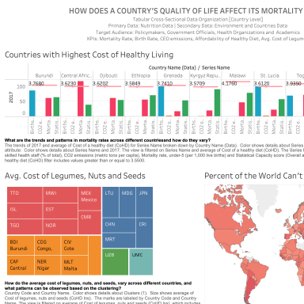
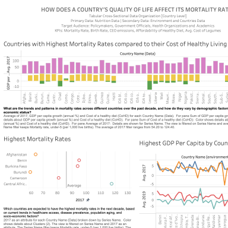

# How does a country's quality of life affect mortality?
> Interactive Tableau story on the cost of a healthy diet, food affordability, GDP and mortality around the world.

**Tools:** Tableau (dashboards, maps, forecasting), data blending

 Workbook: [`food-affordability.twbx`](food-affordability.twbx) · Group project

| | |
|---|---|
|  |  |

## What's inside
- Countries with the highest and lowest cost of a healthy diet, and the share of people who can't afford one.
- Affordability across Latin America; average cost of fruits, legumes, nuts and seeds by country (treemaps).
- GDP vs. displaced people, with a **forecast**; mortality rates against the cost of healthy living.
- Two summary dashboards built for policymakers and health organizations.
