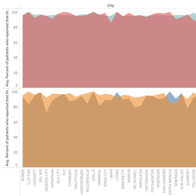
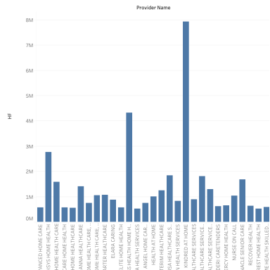

# Home health care providers
> Mapped and summarized home-health providers and patient volumes from a public U.S. survey dataset.

**Tools:** Tableau (maps, aggregation)

📊 Workbook: [`home-health-providers.twbx`](home-health-providers.twbx) · Data: public U.S. home health care survey

| Patients by city | Providers |
|---|---|
|  |  |
