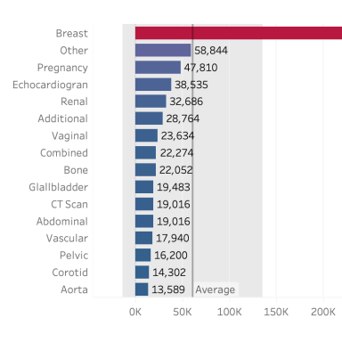
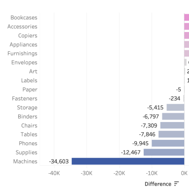
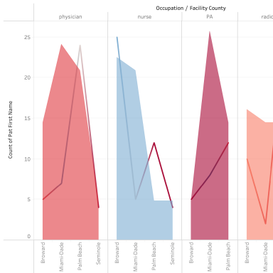

# Hospital revenue & procedure analysis
> Table calculations, cohorts, rankings and a what-if parameter on hospital revenue data.

**Tools:** Tableau (table calculations, LOD-style dimensions, parameters)

 Workbook: [`hospital-revenue-analysis.twbx`](hospital-revenue-analysis.twbx) · Data: course-provided sample dataset

| Revenue by procedure | Diverging view | Table calculation |
|---|---|---|
|  |  |  |

## Highlights
- Revenue by procedure against a reference average line.
- Diverging bars, cohort analysis and **top-N ranking**.
- A **what-if parameter** to test revenue scenarios.
