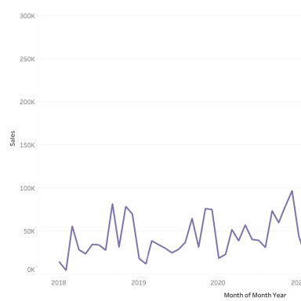
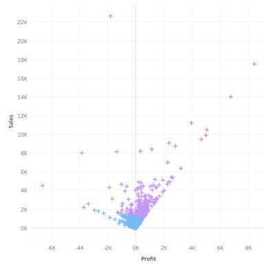
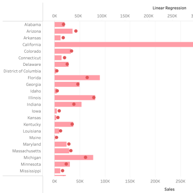

# Superstore sales: forecasting, trend lines & clustering
> Forecasted sales, fitted regression trend lines and clustered customers by profit and sales.

**Tools:** Tableau (forecasting, clustering, regression)

 Workbook: [`superstore-forecasting-clustering.twbx`](superstore-forecasting-clustering.twbx) · Data: Tableau "Sample – Superstore"

| Forecast | Clusters | Regression |
|---|---|---|
|  |  |  |

## Highlights
- Exponential-smoothing **sales forecast** with confidence bands.
- **K-means clusters** on profit vs. sales, broken down by region and quantity.
- **Linear trend lines** with model statistics to judge fit.
