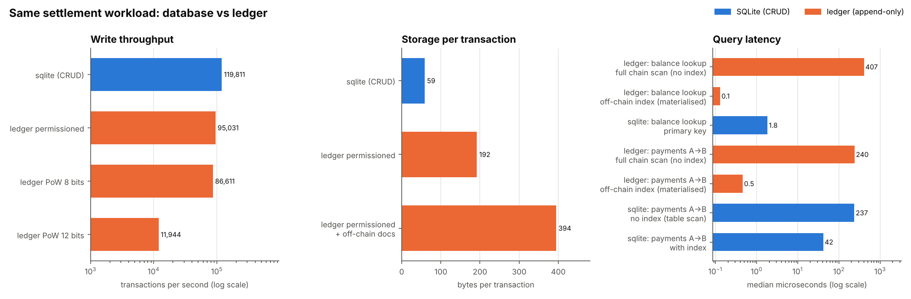
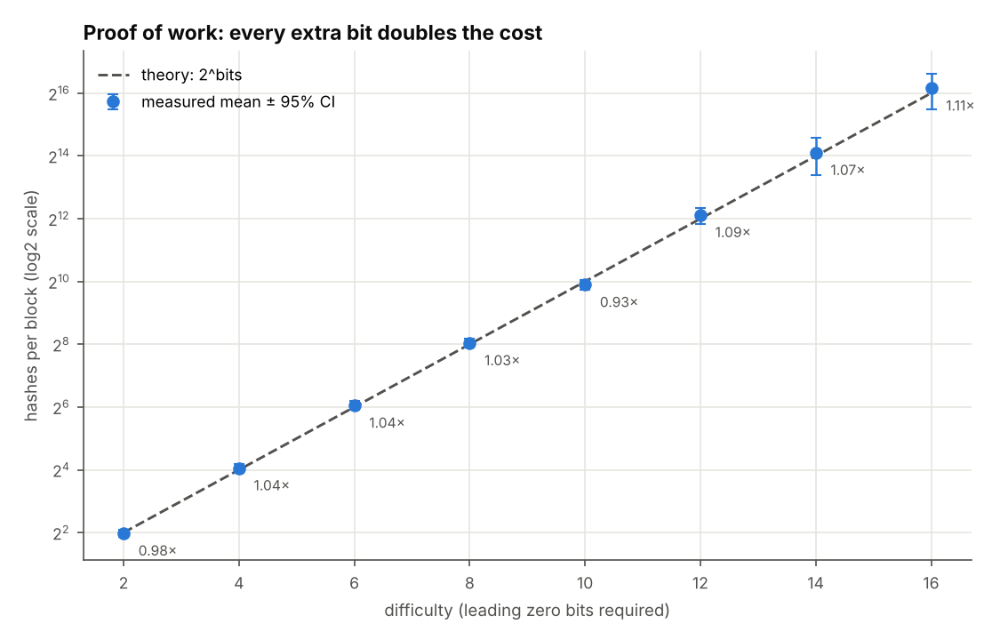
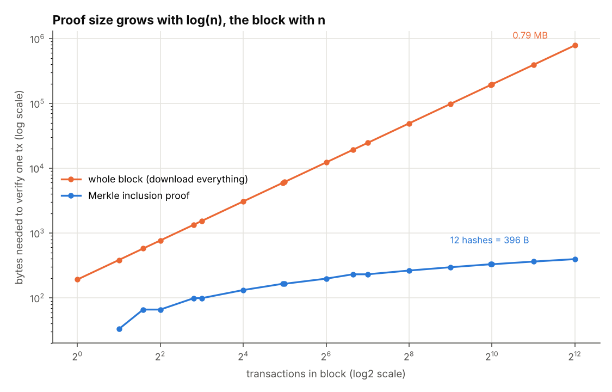
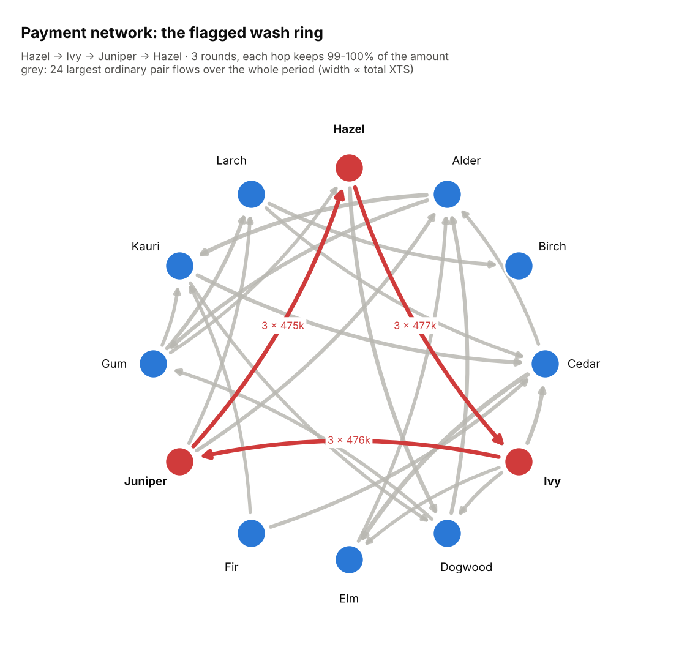

# Blockchain ledger vs database: a settlement data-management lab
> A from-scratch hash-linked ledger (Merkle trees, proof of work, a permissioned signer set, UTXO and account models, off-chain documents) run on the same settlement workload as a SQLite database, so tamper evidence, storage, speed and erasure can be compared with real numbers.

**Tools:** Python (hashlib, sqlite3, pandas, NumPy, matplotlib), SQL, graph cycle detection, pytest

*Based on a graduate team project on blockchain-based data management. The presentation compared ledgers with traditional databases; this version implements those ideas so the trade-offs can be measured.*
Everything is synthetic and seeded: invented firms, a test currency code (XTS), no real cryptocurrency, wallets or keys.



## The question
Twelve invented trading firms settle invoices between themselves. Should the shared record of who paid whom be a
**ledger** (append-only blocks, hash links, a consensus rule) or an ordinary **database** (UPDATE and DELETE)?
The usual answer is "the ledger is tamper-evident but slow and big". This project measures both halves of that sentence
on one workload: 4,000 invoice payments, 178 cancellations, 6 planted overdraft attempts and one planted wash-trading loop.

## What the code does
| Piece | Concept |
|---|---|
| [`hashing.py`](src/ledgerkit/hashing.py) | SHA-256, Merkle root and inclusion proofs (RFC 6962 style: leaf/node prefixes, odd node promoted) |
| [`chain.py`](src/ledgerkit/chain.py) | Blocks with a Merkle root and the previous block's hash; **PoW** (nonce search to *k* leading zero bits) or **permissioned** mode (round-robin proposer, 3-of-4 BFT quorum, simulated HMAC signatures); the **auditor** |
| [`models.py`](src/ledgerkit/models.py) | The same stream under an **account-balance** model and a **UTXO** (unspent coins) model; overdraft and double-spend rejection |
| [`tamper.py`](src/ledgerkit/tamper.py) | Three attackers: edit a transaction, edit + re-hash its block, or rewrite the rest of the chain |
| [`offchain.py`](src/ledgerkit/offchain.py) | Invoice bodies in SQLite, only a salted hash on-chain; integrity check; **right to be forgotten** |
| [`benchmark.py`](src/ledgerkit/benchmark.py) | Same workload in SQLite (CRUD) vs the ledger: throughput, bytes/tx, query latency with and without an index, PoW cost vs difficulty |
| [`analytics.py`](src/ledgerkit/analytics.py) | Payments table and flow matrix built from the chain; temporal cycle search for circular trading |
| [`workload.py`](src/ledgerkit/workload.py) | Seeded settlement stream with planted anomalies |

## Results
All numbers come from `python -m ledgerkit run` with the default seed ([`sample_output/report.txt`](sample_output/report.txt)).
Timings are from one laptop-class run; between runs the throughput figures move by around ±30%.

**Logical layer.** 4,199 events → 4,193 on-chain transactions in 85 blocks. The account model, the UTXO model
(523 unspent coins at the end) and the SQLite database end with **identical balances for all 12 firms**, and total
money is conserved. Both ledger models reject the same 6 overdrafts. Re-spending a consumed coin is rejected with
"double spend (coin already spent)".

**Tamper detection.** One payment in block 28 is halved (8,668.29 → 4,334.14 XTS):

| Chain | Attacker | First failing check | Attacker's hashes |
|---|---|---|---|
| permissioned | edit the transaction | block 28: Merkle root | 0 |
| permissioned | edit + re-hash block 28 | block 28: quorum (only 1 of 3 needed signatures valid), then block 29: link | 0 |
| permissioned | rewrite blocks 28–84 | block 28: quorum, on all 57 rewritten blocks | 0 |
| PoW 12 bits | edit the transaction | block 28: Merkle root | 0 |
| PoW 12 bits | edit + re-mine block 28 | block 29: link (`prev` no longer matches) | 2,221 |
| PoW 12 bits | rewrite and re-mine blocks 28–84 | **only** the published head-hash checkpoint | 205,489 |

The last row is the main lesson. Under proof of work, a chain that has been completely re-mined is internally valid.
It is caught only because the other members kept the old head hash, and the protection is the *cost* of re-mining
(here about 205k hashes; real networks make it prohibitive). In the permissioned mode a single insider can't forge the
other validators' signatures, so the rewrite fails on its first block.

**Off-chain documents and erasure.** All 4,003 invoice documents verify against their on-chain hashes. After erasing 3 invoices
(payload **and** salt deleted, tombstone kept) and editing 1 off-chain: `ok 3,999 · erased 3 · mismatch 1`, and the chain
**still validates**. The erased invoice's hash is still in block history but its content is gone.

**Ledger vs database** ([`benchmark.csv`](sample_output/benchmark.csv)):

| Measure | SQLite (CRUD) | Ledger |
|---|---|---|
| write throughput | 119,811 tx/s | 95,031 tx/s permissioned · 86,611 PoW 8 bits · 11,944 PoW 12 bits |
| storage | 59 bytes/tx | 192 bytes/tx (394 with off-chain documents) |
| history after cancellations | 3,825 rows; 178 deleted, unrecoverable | all 4,193 transactions, reversals included |
| balance lookup | 1.8 µs (primary key) | 407 µs full chain scan · 0.13 µs from an off-chain index (built in 3.2 ms) |
| payments A→B | 237 µs table scan · 42 µs with index | 240 µs chain scan · 0.5 µs off-chain index |

Without proof of work, the ledger's write path costs about as much as the database's: hashing and Merkle trees are cheap.
The real costs are **3.3× the storage**, **no in-place correction** (a cancellation is a new transaction), and
**queries that need a separately built index**, which is a database again. Proof of work is where speed goes: each extra
difficulty bit doubles the hashes per block (271 at 8 bits, 4,031 at 12 bits), and throughput falls with it.
For context only (textbook figure, not measured here): public PoW networks are usually quoted at single-digit transactions per second.



**Proof of work** ([`pow_sweep.csv`](sample_output/pow_sweep.csv)): the measured mean hashes to find a block are 0.93–1.11× the
theoretical 2^bits from 2 to 16 bits. The number of attempts follows a geometric distribution, so the 95% intervals widen at
high difficulty, where there are fewer trials.



**Merkle proofs** ([`merkle_proofs.csv`](sample_output/merkle_proofs.csv)): proving that one payment is in a 4,096-transaction block takes
12 sibling hashes (396 bytes) against 0.79 MB for the whole block. This is how a light client or an auditor can check one
invoice without downloading the ledger.



**Analytics on the chain.** The flow matrix ([`flow_matrix.csv`](sample_output/flow_matrix.csv)) and top flows are built directly
from block contents. The cycle search flags exactly one ring, **Hazel → Ivy → Juniper → Hazel, 3 rounds**: 480,000 XTS
in, 472,374 back, each hop passing on 99.8%. No other loop passes the rule, and on three clean seeds without the planted ring
nothing is flagged. Ranking by volume alone would not single out the ring as clearly: the three pairs it runs through rise from
0.6–1.0M to 2.0–2.4M XTS. Large flows are not unusual on their own (the biggest ordinary pair moves 1.09M); the repeated loop is what gives the ring away.

## Design decisions
- **Domain-separated Merkle tree** (`0x00` leaf, `0x01` node, odd node promoted): this avoids the duplicate-last-leaf ambiguity and stops an inner node being passed off as a leaf.
- **The auditor names the check and the block.** "Invalid" isn't actionable; "block 28 Merkle root" tells you which transaction set to inspect.
- **Checkpoints are part of the audit.** A PoW chain can be re-mined to look valid, so the auditor also compares the head hash other members published.
- **Salted document hashes.** An unsalted hash of a templated invoice can be confirmed by guessing amounts. Deleting the salt together with the payload makes the leftover on-chain hash meaningless, which is what makes erasure credible while the chain stays intact.
- **Wash rule = timing + amount retention + repetition, with at least 3 parties.** Two-party round trips are excluded because a cancelled invoice paid back has exactly that shape; there are 178 of them here.
- **Signatures are simulated with HMAC**: the auditor needs the demo secrets, which a real public-key scheme would avoid. The point is quorum logic, not cryptography.
- **SQLite runs in memory, like the ledger**, so neither side pays disk I/O; the comparison is about data structure, not hardware.

## What the tests check
| Test | Checks |
|---|---|
| `test_merkle_root_known_vectors` | empty-tree constant (SHA-256 of ""), 3- and 4-leaf roots recomputed by hand with `hashlib` |
| `test_merkle_proofs_verify_and_detect_tampering` | every proof in a 37-leaf tree verifies with ≤ ceil(log2 n) hashes; edited leaf or sibling fails |
| `test_clean_chain_validates` | untouched chain passes all checks and the checkpoint |
| `test_tamper_detected_at_exact_block` (×2 modes) | edit → Merkle failure at exactly block *k*, nothing earlier blamed; re-hash → quorum at *k* (permissioned) or link at *k*+1 (PoW) |
| `test_full_rewrite_needs_checkpoint_under_pow_but_fails_quorum_under_poa` | re-mined chain is internally valid, caught only by the checkpoint; insider rewrite fails the quorum |
| `test_pow_blocks_meet_difficulty` | every mined hash is below 2^(256−bits) |
| `test_measured_hashes_match_two_to_the_bits` | mean attempts within 20% of 2^bits at 4, 6 and 8 bits |
| `test_utxo_and_account_models_agree` | identical balances and rejections; money conserved; SQLite agrees too |
| `test_double_spend_rejected` | spent coin reused, and same coin twice in one transaction |
| `test_overdraft_rejected_in_both_models` | exactly the planted overdrafts are rejected |
| `test_offchain_erasure_keeps_chain_valid` | erased → 'erased', payload and salt gone, hash still on-chain, chain valid; edited doc → 'mismatch' |
| `test_planted_wash_ring_found` | one ring, the planted firms, 3 rounds |
| `test_no_false_rings_in_clean_data` (×3 seeds) | nothing flagged without the planted ring |
| `test_deterministic` | same seed → same events, salts and head hash (both modes) |
| `test_cli_writes_files` | CLI writes the CSVs, audit report and 4 figures; every attack detected |

## Run it
```bash
cd economics-finance/blockchain-ledger
pip install -r requirements.txt
PYTHONPATH=src python -m ledgerkit run --out sample_output --figures figures
pytest -q                                   # 18 tests
```
```
stream: 4199 events -> 4193 on-chain in 85 blocks, 6 rejected (overdraft)
account model == UTXO model == SQLite balances: True (523 unspent coins); double spend rejected
clean chain audit: VALID
 PoW 12 bits rewrite      True          checkpoint                1           205489
off-chain docs after  {'ok': 3999, 'mismatch': 1, 'erased': 3, 'missing': 0}; chain still valid: True
merkle proof at 4096 tx: 12 hashes = 396 bytes vs block 787,281 bytes
flagged wash rings: 1 -> Hazel -> Ivy -> Juniper -> Hazel x3 rounds; loops outside flagged rings: 0
```
Outputs: [`benchmark.csv`](sample_output/benchmark.csv), [`audit_report.txt`](sample_output/audit_report.txt),
[`tamper_results.csv`](sample_output/tamper_results.csv), [`pow_sweep.csv`](sample_output/pow_sweep.csv),
[`merkle_proofs.csv`](sample_output/merkle_proofs.csv), [`flagged_rings.csv`](sample_output/flagged_rings.csv),
[`top_flows.csv`](sample_output/top_flows.csv), [`flow_matrix.csv`](sample_output/flow_matrix.csv).
