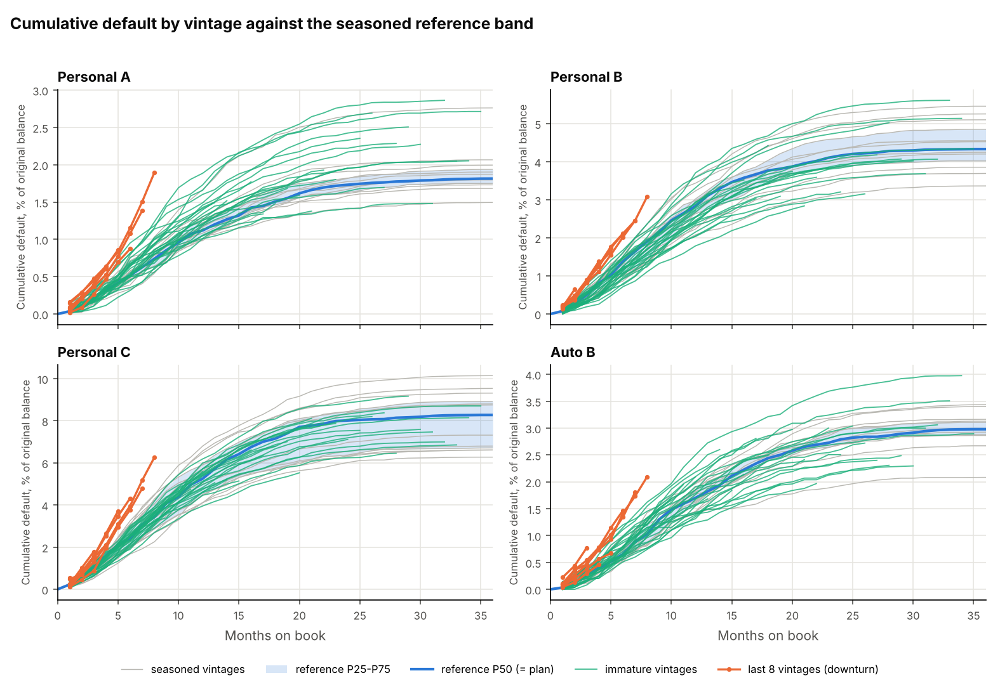
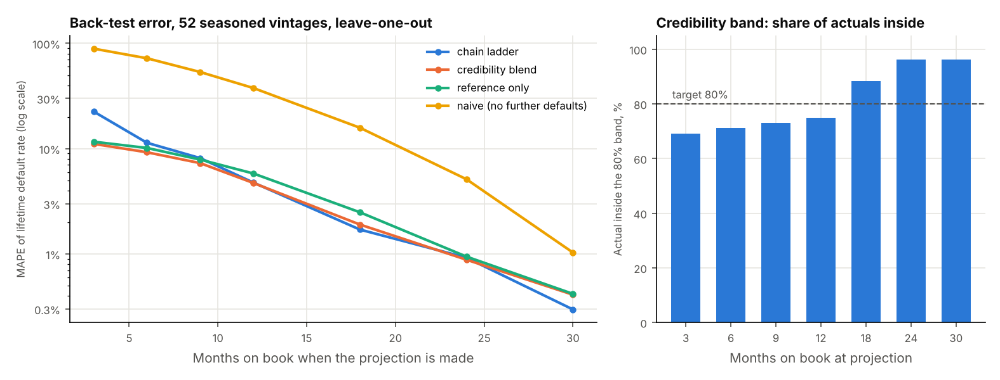
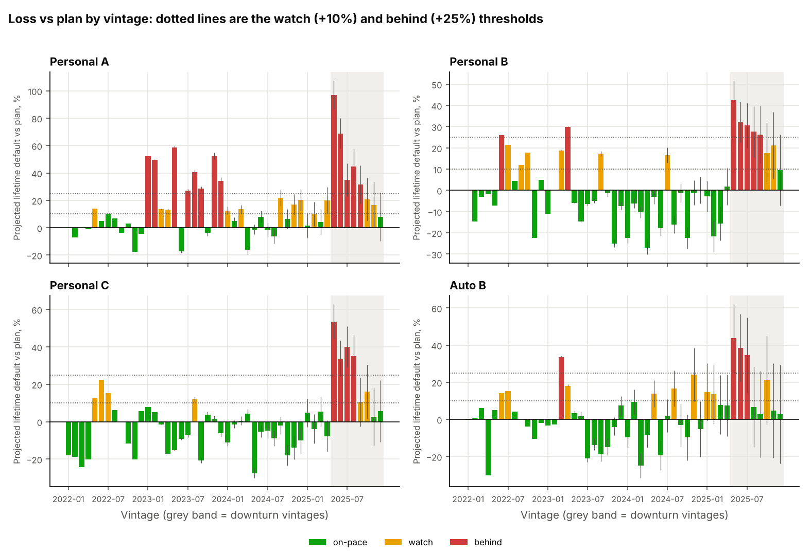
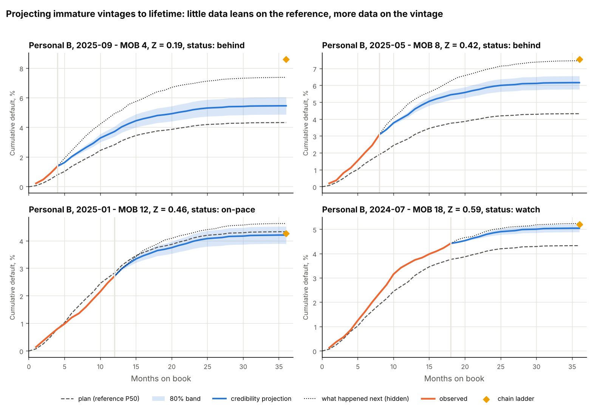

# Loan vintage curves: reference bands, credibility projection & loss vs plan
> Vintage analysis for a synthetic consumer-loan book: cumulative default curves by months on book, seasoned reference bands, lifetime projections that blend each vintage's own pace with the reference by Bühlmann credibility, and a back-test of how well that works.

**Tools:** Python (pandas, NumPy, matplotlib), survival/hazard simulation, chain ladder, Bühlmann-Straub credibility, pytest



## The question
A lender writes a new cohort ("vintage") of 36-month loans every month. A young vintage has shown only a few months
of defaults, but it has to be judged now: **is it on track for the lifetime loss we planned, and if not, how far off
will it end up?** Two easy answers are both wrong. Waiting until it is seasoned takes three years. Scaling up the first
few months is mostly noise.

## What the code does
| Piece | Technique |
|---|---|
| [`synth.py`](src/vintagekit/synth.py) | 4 segments (Personal A/B/C, Auto B) × 48 monthly vintages, 2,500–5,000 loans each. Monthly default hazard (hump-shaped, peaks at MOB 8–11) and prepayment hazard (ramps up over a year), calendar seasonality, vintage-quality noise; loan counts drawn binomially. **Planted downturn:** the last 8 vintages default at 1.8× the normal rate. |
| [`curves.py`](src/vintagekit/curves.py) | Level-payment amortisation `P·r / (1 − (1+r)^−n)` and remaining balance `P·((1+r)^n − (1+r)^t) / ((1+r)^n − 1)`. Cumulative default, prepayment and net loss, plus balance runoff, all as % of original balance by MOB. |
| [`reference.py`](src/vintagekit/reference.py) | Seasoned vintages (all 36 MOB observed, 13 per segment) → P25 / P50 / P75 at each MOB, forced non-decreasing with a running maximum. LGD per segment = net loss / defaulted balance. |
| [`project.py`](src/vintagekit/project.py) | Lifetime projection three ways: **chain ladder** (volume-weighted age-to-age factors), **reference only** (`C(n) + R(T) − R(n)`), and the **credibility blend** `C(n) + θ·(R(T) − R(n))`, with `θ = Z·pace + (1 − Z)·μ`, `pace = C(n) / R(n)`, `Z = e / (e + k)`. An 80% band comes from the remaining uncertainty in θ plus process noise on the defaults still to come. |
| [`plan.py`](src/vintagekit/plan.py) | Loss vs plan (plan = segment P50): status from projected lifetime ÷ plan (on-pace ≤ 1.10 < watch ≤ 1.25 < behind). Gap split into **pace gap today** `C(n) − plan(n)` and **projected lifetime gap** `C(T) − plan(T)`. Expected loss on the outstanding book = PD × LGD × EAD. |
| [`backtest.py`](src/vintagekit/backtest.py) | Cut each seasoned vintage at MOB 3…30, project with the vintage left out of the reference, factors and k, compare with what actually happened, and report MAPE by method. |

**How k is chosen.** Exposure `e` is the dollars of default the reference says should have emerged by MOB n
(`original balance × R(n)`), so Z grows with both age and vintage size. `k = σ² / τ²` is the Bühlmann-Straub ratio of
within-vintage month-to-month noise (σ², per segment) to the true spread between vintages (τ², pooled across segments
because θ is a relative multiplier and 13 seasoned vintages per segment are too few on their own). A test simulates a
case with known σ and τ and checks the estimator recovers k within 15%.

## Results (seed 7)
| Segment | Lifetime default P25 / P50 / P75 | LGD | k ($ expected default) | Outstanding (EAD) | PD (remaining) | Expected loss |
|---|---|---|---|---|---|---|
| Personal A | 1.75 / 1.82 / 1.94% | 69.7% | 0.94m | 888m | 1.44% | 8.9m (1.01%) |
| Personal B | 4.02 / 4.33 / 4.85% | 74.6% | 1.17m | 622m | 2.85% | 13.2m (2.13%) |
| Personal C | 6.71 / 8.27 / 8.92% | 79.8% | 1.36m | 399m | 5.22% | 16.6m (4.17%) |
| Auto B | 2.88 / 2.98 / 3.13% | 45.0% | 5.13m | 921m | 2.19% | 9.0m (0.98%) |
| **Portfolio** | | 66.9% | | **2,830m** | **2.53%** | **47.8m (1.69%)** |

Auto loans are larger, so each default is a bigger, noisier dollar amount: k is about 5× higher and an Auto vintage
earns credibility more slowly.

**Back-test, MAPE of the lifetime default rate (52 seasoned vintages, leave-one-out):**

| MOB at projection | 3 | 6 | 9 | 12 | 18 | 24 | 30 |
|---|---|---|---|---|---|---|---|
| chain ladder | 22.5% | 11.4% | 8.1% | 4.8% | **1.7%** | 0.9% | **0.3%** |
| credibility blend | **11.1%** | **9.2%** | **7.3%** | **4.7%** | 1.9% | 0.9% | 0.4% |
| reference only | 11.6% | 10.2% | 7.9% | 5.8% | 2.5% | 0.9% | 0.4% |
| naive (no further defaults) | 89.1% | 72.2% | 53.4% | 37.6% | 15.8% | 5.1% | 1.0% |
| credibility 80% band coverage | 69% | 71% | 73% | 75% | 88% | 96% | 96% |

Honest reading: the credibility blend wins up to MOB 12, where it halves chain-ladder error at MOB 3. From MOB 18 on,
chain ladder is as good or slightly better, because by then the vintage's own data says almost everything. The band
is too narrow early (69–75% coverage against an 80% target) and too wide late.



**Loss vs plan.** Of 140 immature vintages, 88 are on-pace, 26 watch and 26 behind. Downturn vintages flagged behind:
17 of 32 overall and 12 of 12 once they reach MOB 6. False alarms: 11 of the 160 non-downturn vintages are behind,
8 of them in Personal A, whose seasoned vintages happened to come in low and set a tight plan. The downturn
vintages are on average 0.67 points of balance above plan today and are projected to finish 1.12 points above,
10.2m of extra net loss. So most of their gap to plan is still to come.



**Where the blend fails.** Because the data is synthetic, the hidden future of each immature vintage is known. On normal
vintages the credibility projection is unbiased (−0.6%) and its band covers 93% of outcomes. On the downturn
vintages it under-projects by 30% and the band covers none of them. Credibility pulls a vintage toward the past, which
is right for noise and wrong for a regime change. Chain ladder, which trusts the vintage's own pace fully, is off by
12% on the same vintages. The status flag still catches them, but the lifetime number and the expected loss should be
treated as a floor while a downturn is under way.



## Design decisions
- **Curves as % of original balance**, not of loan count, so default and prepayment curves add up with scheduled
  principal and the remaining balance (a test checks this identity for every vintage).
- **Projection adds to what has happened**: `C(n) + θ·remaining`, never `θ·R(T)`. The projection can't fall below
  the defaults already booked, and a seasoned vintage projects to exactly its actual value.
- **Running maximum on percentiles**: cumulative curves can't fall, but MOB-by-MOB percentiles over 13 vintages can.
  The running maximum keeps P25 ≤ P50 ≤ P75 because it preserves pointwise order.
- **Status uses the projection, not the raw pace**: a vintage two months old with three extra defaults is not flagged.
  The cost is that real deterioration is flagged later: here every downturn vintage is flagged from MOB 6, but only some at MOB 3-5.
- **The back-test is leave-one-out, not a strict as-of replay**: the reference used for a vintage cut at MOB 6 still
  includes other vintages' later months, which on that date would not have existed yet. This flatters every method
  equally. It is the right comparison between methods and slightly optimistic in absolute terms.
- **Equal loan size within a cohort** keeps the simulation at cohort level (fast, 0.1 s for 192 vintages); loan-level
  size variation would mainly widen σ².

## What the tests check
| Test | Checks |
|---|---|
| amortisation schedule | principal sums to the loan, final balance 0, closed-form balance = month-by-month table |
| balance identity | original = defaults + prepayments + scheduled principal + outstanding, every vintage |
| monotone curves | cumulative default/prepay never fall; balance never rises |
| reference bands | P25 ≤ P50 ≤ P75 and each non-decreasing; 13 seasoned vintages per segment |
| credibility weight | Z = 0 at zero exposure, rises strictly, → 1; Z = ½ when exposure = k; Z = 0 if k = ∞ |
| Bühlmann-Straub k | recovers a known σ²/τ² within 15% on simulated data |
| chain ladder | reproduces a constructed triangle's factors and ultimates exactly |
| projection floor | every projection ≥ current cumulative; low ≤ central ≤ high; seasoned = actual |
| gap & EL arithmetic | pace gap + future gap = lifetime gap; EL = PD × LGD × EAD; segments sum to portfolio |
| planted downturn | all downturn vintages at MOB ≥ 6 are behind; < 10% of others are |
| robustness (3 seeds) | downturn hit rate ≥ 75% and > 5× the false-alarm rate on other seeds |
| back-test | credibility < ½ naive error at every cut, beats chain ladder at MOB 3, error falls with age |
| determinism | same seed → identical data; different seed → different data |
| CLI | writes the three CSVs and four figures; every vintage has a valid status |

## Run it
```bash
cd economics-finance/loan-vintage-curves
pip install -r requirements.txt
PYTHONPATH=src python -m vintagekit run --out sample_output --figures figures
pytest -q                                   # 16 tests
```
```
vintages: 192 (4 segments x 48 months), 140 still immature
credibility k ($ of expected default): Auto B 5,125k, Personal A 941k, Personal B 1,172k, Personal C 1,355k
status of immature vintages: behind 26, on-pace 88, watch 26
downturn vintages flagged behind: 17/32; other vintages flagged behind: 11/160
expected loss on outstanding book: EAD 2,830m x PD 2.53% x LGD 66.9% = 47.8m (1.69% of EAD)
```
Outputs in [`sample_output/`](sample_output/): `vintage_projection.csv` (one row per vintage: curves to date, Z, all
three projections, band, plan gap, status, EL), `segment_reference.csv`, `backtest.csv` (MAPE by cut and method),
`backtest_detail.csv`, `expected_loss.csv`.

## Where this comes from
The cohort-curve technique is the one I use at work to pace demand against targets; here it is applied to an invented consumer-loan book.
