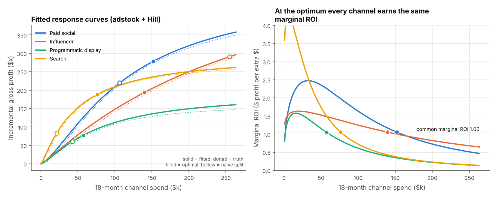
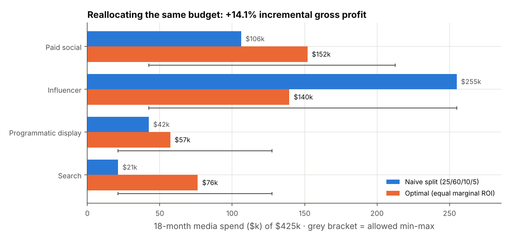
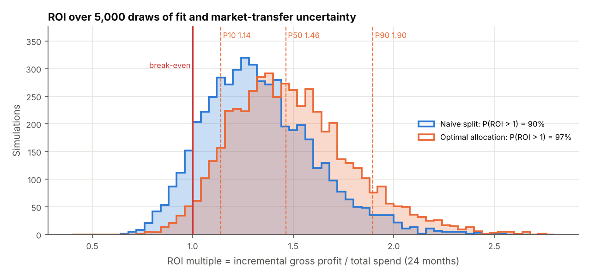
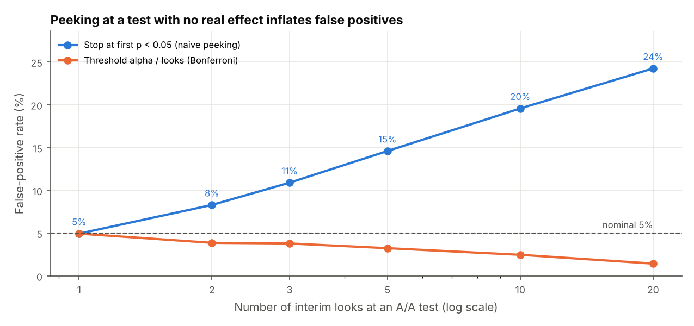

# Marketing budget allocation & ROI: response curves, optimal split, NPV and A/B test design
> Fits media response curves to weekly sales, splits a $500k digital budget so every channel earns the same marginal return, prices the plan (NPV, IRR, payback, ROI range from 5,000 simulations) and sizes the A/B tests that check it.

**Tools:** Python (NumPy, pandas, SciPy, matplotlib), nonlinear least squares, constrained optimisation (SLSQP, KKT check), discounted cash flow, Monte Carlo simulation, power analysis, pytest

*Based on a graduate team project where we designed an AI-driven digital marketing plan for a premium spirits brand. This version turns the plan's budget, ROI and testing ideas into working models; all figures come from the code, not the original deck.*



## The question
A premium spirits brand is moving from field sales to digital. It has **$500,000 for 18 months** in three test markets:
$75k for enablement (AI creative tools, training, analytics) and **$425k of media** across paid social, influencer,
programmatic display and search. The draft plan put 60% of the media budget into influencer. Three questions:

1. How much should each channel get, and what does the draft split leave on the table?
2. Is the programme worth it, given that the response curves are estimates and the test markets may not behave like the history?
3. How do we check it once it runs: which A/B tests, how long, and what to do with each market after 90 days?

## What the code does
| Piece | Technique | File |
|---|---|---|
| Response curves | Geometric adstock `a_t = x_t + λ·a_(t-1)` (carry-over) into a Hill curve `β·a^s / (a^s + K^s)` (diminishing returns). 156 weeks of synthetic sales are simulated from known true parameters plus noise, then **fitted back** by bounded nonlinear least squares with 8 random restarts; parameter covariance from the Jacobian. | [`mmm.py`](src/roikit/mmm.py) |
| Budget allocation | Maximise total gross profit subject to the budget and per-channel min/max shares. SLSQP started from a greedy marginal allocator, the equal split and the naive split; the result is checked against the **KKT conditions** (equal marginal ROI for interior channels). | [`allocate.py`](src/roikit/allocate.py) |
| Financials | Weekly simulation of the plan (adstock ramp-up and 6-month carry-over tail), bucketed into 24 monthly cash flows → NPV at 10%/yr (monthly discounting), IRR (root of NPV), payback month, ROI multiple. | [`finance.py`](src/roikit/finance.py) |
| Uncertainty | 5,000 Monte Carlo draws: parameters from the fit's asymptotic normal × a lognormal "transfer" factor (sd 20%) for test markets differing from the history → P10/P50/P90 ROI and P(ROI > 1). | [`finance.py`](src/roikit/finance.py) |
| A/B tests | Two-proportion power calculation (sample size per arm, MDE for given traffic), analysis of a synthetic result (lift, 95% Wald CI, pooled z-test), and an A/A simulation of peeking. | [`abtest.py`](src/roikit/abtest.py) |
| 90-day KPI review | Observed ROI per market × channel vs the plan: **exceed** (≥ 115% → scale), **meet** (85-115% → optimise), **below** (< 85% → pivot). | [`kpi.py`](src/roikit/kpi.py) |

Every assumption (true parameters, budget, bounds, margin, discount rate, test traffic) is in [`config.yaml`](config.yaml).

## Results
**1. The fit recovers the curves.** Carry-over is recovered within 0.03 for every channel (e.g. influencer 0.65 fitted vs 0.65 true,
search 0.13 vs 0.15). Individual `K`, `s`, `β` are off by up to 19% for display because they trade off against each other,
but the *curves* they produce stay within 10% of the true ones over the whole planning range, which is what the
allocation uses (dotted vs solid lines above; full table in [`fitted_params.csv`](sample_output/fitted_params.csv)).

**2. Reallocating the same $425k adds 14.1% gross profit.**

| Channel | Naive split | Optimal | Optimal on true curves | Marginal ROI at optimum |
|---|---:|---:|---:|---:|
| Paid social | $106,250 (25%) | $152,000 (36%) | $148,500 | 1.057 |
| Influencer | $255,000 (60%) | $139,500 (33%) | $139,000 | 1.056 |
| Programmatic display | $42,500 (10%) | $57,250 (13%) | $60,250 | 1.053 |
| Search | $21,250 (5%) | $76,250 (18%) | $77,250 | 1.058 |

All four channels end up strictly between their bounds with the same marginal ROI (1.053-1.058, spread 0.005): the last
dollar earns the same everywhere, so no move between channels can help. At the naive split the marginal ROI ranges from
0.67 (influencer, deep in saturation) to 3.31 (search, barely funded). The allocation from the fitted curves is within
$3.5k per channel of the one the true curves would give.



**3. The programme pays back.** Measured on the true curves (what would actually happen):

| | Optimal split | Naive split |
|---|---:|---:|
| Incremental gross profit (24 months) | $721,655 | $632,479 |
| ROI multiple (gross profit / $500k) | **1.44×** | 1.26× |
| NPV at 10%/yr | **$201,057** | $118,044 |
| IRR | 31.1% per month | 17.8% per month |
| Payback | month 5 | month 7 |

The IRR is per month because the outlay is small and early (the $75k enablement costs are mostly up front) and the
returns follow within weeks; annualised it is a meaningless four-digit percentage, so NPV and ROI are the decision numbers.

**4. Uncertainty.** Over 5,000 draws the optimal split's ROI has **P10 1.14 · P50 1.46 · P90 1.90** and a **97.4%**
chance of exceeding 1 (naive split: 90.4%). NPV P10 is +$60k for the optimal split and −$3k for the naive one.



**5. Test plan** (alpha 0.05 two-sided, 80% power; [`ab_plan.csv`](sample_output/ab_plan.csv))

| Test | Baseline | Lift to detect | n per arm | Weeks | MDE after 4 weeks |
|---|---:|---:|---:|---:|---:|
| AI vs studio creative (paid social) | 2.0% | +15% | 36,693 | 4 | +13.1% |
| Influencer promo-code landing page | 4.5% | +10% | 34,897 | 12 | +17.3% |
| Search ad copy | 6.0% | +8% | 39,861 | 8 | +11.4% |
| Display frequency cap 3 vs 6 | 0.8% | +20% | 53,486 | 3 | +16.2% |

The synthetic creative test (true lift +12%) came back at +16.0% relative, 95% CI [+0.11, +0.53] percentage points,
p = 0.003. The influencer test needs 12 weeks at current traffic, so it should start in the first month.

**6. Do not peek.** In A/A tests with no real difference, stopping at the first p < 0.05 gives false-positive rates of
8% with 2 looks, 15% with 5, 20% with 10 and 24% with 20. Dividing alpha by the number of looks keeps it under 5%.



**7. 90-day review** ([`kpi_decisions.csv`](sample_output/kpi_decisions.csv)): of 12 market × channel cells, 2 exceed
(scale), 4 meet (optimise) and 6 fall below (pivot). Market C, set up to be 30% less responsive, is below plan on all
four channels. Market B paid social is also flagged "below" even though its true responsiveness matches the plan;
that is 90-day noise, which is why a pivot should be confirmed with an A/B test before budget moves.

## Design decisions
- **Fit curves, not just ROIs.** Average ROI per channel says nothing about the next dollar. The Hill curve gives the
  marginal return, which is what an allocation needs.
- **Judge the fit by its curves.** `K`, `s` and `β` are partly interchangeable (several combinations draw almost the
  same curve), so the test checks curve error over the spend range, not each parameter.
- **Bounds on every channel.** Min/max shares (10-60% for the big channels, 5-30% for display and search) stop the
  optimiser from betting everything on a curve fitted outside the range ever spent, and keep each channel alive for learning.
- **Restarts and a KKT check.** Hill curves with `s > 1` are S-shaped, so a local optimiser can get stuck. The code starts
  from three points, keeps the best, and checks the equal-marginal-ROI condition instead of trusting the solver.
- **Steady state for allocation, weekly simulation for money.** The allocator uses the settled weekly response; the
  financials simulate the adstock ramp-up and carry-over tail month by month, so payback is not overstated.
- **Transfer uncertainty.** Parameter standard errors from 156 weeks of data are small; the bigger risk is that three test
  markets respond differently. A 20% lognormal factor on response makes that explicit.
- **Truth is kept separate from the model.** Allocation uses only the fitted curves; the "truth" columns show what
  that decision would actually earn.

## What the tests check
| Test | What it proves |
|---|---|
| `test_adstock_hand_case` | `[100, 0, 0, 50]` at λ = 0.5 gives `[100, 50, 25, 62.5]` |
| `test_hill_properties` | starts at 0, strictly rising, below 1, exactly 0.5 at `K` |
| `test_parameter_recovery` | carry-over within 0.08 and each fitted curve within 10% of the true one |
| `test_allocation_budget_and_bounds` | allocation sums to $425k and respects every min/max |
| `test_kkt_equal_marginal_roi` | KKT conditions hold, interior marginal ROIs equal within 1%, analytic derivative = finite difference |
| `test_optimal_beats_naive_and_random` | optimum beats the naive split (fitted and true curves) and 500 random feasible splits |
| `test_npv_irr_hand_case` | NPV of `[-100, 60, 60]` at 10%, IRR = 13.0662%, NPV at the IRR = 0, payback month |
| `test_plan_cash_flows_consistent` | all $500k is scheduled, NPV at the plan's IRR = 0, ROI = gross profit / spend |
| `test_monte_carlo_summary` | P10 < P50 < P90, true ROI inside the P10-P90 band, optimal beats naive on P(ROI > 1) |
| `test_sample_size_known_value` | 10% → 12% at alpha 0.05, 80% power = 3,841 per arm; MDE is its inverse |
| `test_ci_coverage_close_to_95` | 20,000 simulated tests: the 95% CI covers the true lift 94-96% of the time |
| `test_peeking_inflates_false_positives` | 1 look ≈ 5%, 10 looks > 12%, Bonferroni back under 5% |
| `test_ab_analysis_matches_hand_calc` | lift and CI match a hand calculation |
| `test_kpi_rules` | thresholds map to exceed / meet / below for all 12 cells |
| `test_deterministic` | the same seed gives identical allocation, simulation and test results |

## Run it
```bash
cd economics-finance/marketing-roi
pip install -r requirements.txt
PYTHONPATH=src python -m roikit run --out sample_output --figures figures
pytest -q                                   # 15 tests
```
```
fit: residual sd 581/wk · carry-over (fitted/true): paid_social 0.47/0.45, influencer 0.65/0.65, display 0.29/0.30, search 0.13/0.15
allocation of $425,000 media:
   Paid social            naive $  106,250  optimal $  152,000  marginal ROI 1.057 (interior)
   Influencer             naive $  255,000  optimal $  139,500  marginal ROI 1.056 (interior)
   Programmatic display   naive $   42,500  optimal $   57,250  marginal ROI 1.053 (interior)
   Search                 naive $   21,250  optimal $   76,250  marginal ROI 1.058 (interior)
KKT: common marginal ROI 1.056, spread across interior channels 0.0054, conditions hold: True
optimal (truth)  ROI 1.44x · NPV $201,057 · IRR 31.1%/month · payback month 5
naive (truth)    ROI 1.26x · NPV $118,044 · IRR 17.8%/month · payback month 7
uplift from reallocation: +14.1% gross profit
Monte Carlo ROI (optimal): P10 1.14 · P50 1.46 · P90 1.90 · P(ROI>1) 97.4%
A/B plan: 36,693/arm, 4 wk; 34,897/arm, 12 wk; 39,861/arm, 8 wk; 53,486/arm, 3 wk
A/B result (AI vs studio creative (paid social)): lift +16.0%, 95% CI [+0.0011, +0.0053] abs, p = 0.0029
peeking FPR: 1 looks 5.0%, 2 looks 8.3%, 3 looks 10.9%, 5 looks 14.6%, 10 looks 19.6%, 20 looks 24.2%
KPI review: 6 below, 4 meet, 2 exceed
```
Outputs in [`sample_output/`](sample_output/): `fitted_params.csv`, `allocation.csv`, `roi_simulation_summary.csv`,
`ab_plan.csv`, `ab_result.csv`, `peeking_fpr.csv`, `cash_flows.csv`, `financial_summary.csv`, `kpi_decisions.csv`.
All data is synthetic and seeded (`seed: 7` in the config), so every number above is reproducible.
