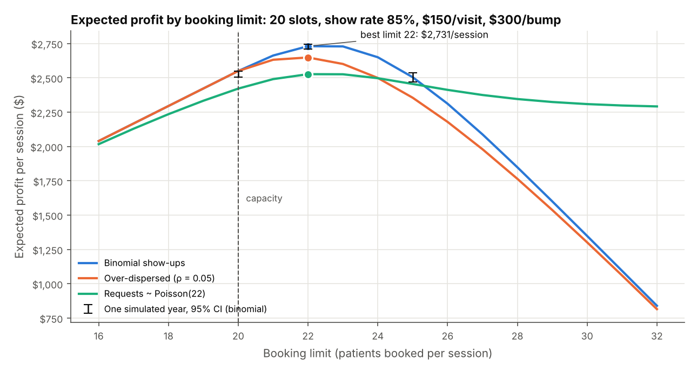
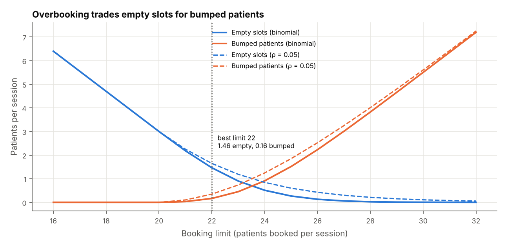
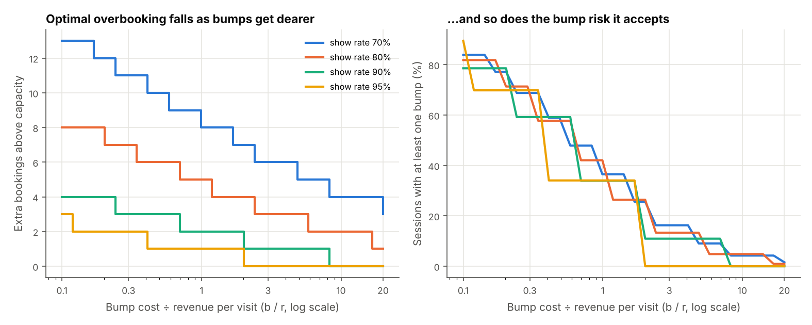
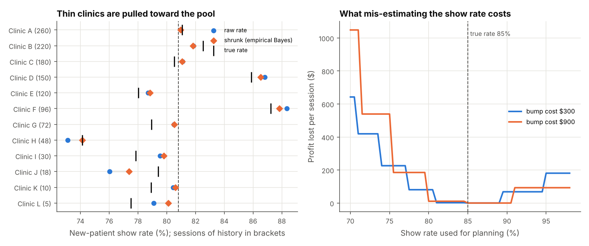

# Overbooking economics: how many patients to book into a session
> Exact expected profit for every booking limit when patients may not show, three ways to find the best limit (they agree), show-rate estimation with empirical-Bayes shrinkage, a Monte Carlo check, and an interactive calculator that runs the same maths in the browser.

**Tools:** Python (NumPy, SciPy, pandas, matplotlib), probability (binomial, beta-binomial, Poisson), empirical Bayes, Monte Carlo, JavaScript (SVG), Playwright, pytest

**Live demo:** [Try the overbooking calculator](https://katherinekarow.github.io/portfolio/overbooking/)



## The question
A clinic session has **C slots**. Booked patients show up with probability **p**, so booking exactly C leaves slots empty.
Each patient seen earns **r**. A patient who shows when all C slots are full has to be rescheduled and compensated at
cost **b** (a "bump"). **How many patients should be booked (the booking limit L), and what does getting it wrong cost?**

Default session: 20 slots, 85% show rate, $150 revenue per visit, $300 per bump.

## What the code does
| Step | Module | Method |
|---|---|---|
| Show-up models | [`showup.py`](src/overbook/showup.py) | Binomial, and beta-binomial for sessions whose show rate itself varies (same mean, intra-session correlation ρ). Both pmfs are built from the ratio P(k+1)/P(k) in log space, so they stay accurate for large sessions and match the JavaScript port. |
| Expected profit | [`profit.py`](src/overbook/profit.py) | `E[profit | L] = r·E[min(S, C)] − b·E[(S − C)+]`, summed exactly over the pmf of S. |
| Best limit, three ways | [`profit.py`](src/overbook/profit.py) | (a) exact enumeration, (b) the marginal / critical-ratio rule, (c) a normal approximation with a closed form |
| Limited demand | [`profit.py`](src/overbook/profit.py) | Requests ~ Poisson(λ), bookings = min(requests, L) |
| Estimation | [`estimate.py`](src/overbook/estimate.py) | ρ by profile maximum likelihood; between-clinic Beta prior by marginal beta-binomial likelihood; per-clinic posterior means; regret from estimation error |
| Simulation | [`simulate.py`](src/overbook/simulate.py) | Patient-level Monte Carlo of a year of sessions (500), repeated for 200 independent years |
| CLI | [`cli.py`](src/overbook/cli.py) | `run` writes 9 CSVs + 4 figures; `export` writes the web page's `data.json` |
| Web page | [`docs/overbooking/`](../../docs/overbooking/) | Same functions ported line for line to JavaScript; a browser test checks they give identical answers |

### The marginal rule, derived
Booking patient L+1 adds one Bernoulli(p) show X that is independent of the S_L patients already booked:
if X = 1 and S_L < C, one more patient is seen (+r); if X = 1 and S_L ≥ C, one more patient is bumped (−b). So

```
Δ(L) = E[profit | L+1] − E[profit | L] = p · [r − (r + b) · P(S_L ≥ C) ]
```

P(S_L ≥ C) rises with L, so Δ falls (profit is concave), and the best limit is **the first L where
P(S_L ≥ C) ≥ r / (r + b)**, the newsvendor critical ratio. p multiplies both terms and cancels from the stopping
rule: p only matters through the distribution of S_L. (The tempting shortcut "book while b·P(S_L ≥ C) < p·r" is
wrong. It treats the extra booking as earning p·r even in sessions that are already full.) With over-dispersion the next
patient's show is correlated with S_L, P(X = 1 | S_L = s) = (a + s)/(a + b + L), and the code uses that exact form.

Normal approximation: with a continuity correction, `L·p + z·√(L·p(1−p)) = C − ½` with `z = Φ⁻¹(b/(r+b))`. This is a
quadratic in √L, and the limit is the ceiling of its root. With over-dispersion the variance gains the design effect
`1 + (L−1)ρ`, and the root is found numerically.

With limited demand, `E[profit | L+1] − E[profit | L] = P(D ≥ L+1) · Δ(L)`. Demand scales the marginal value of a
higher limit but never changes its sign, so **the best limit is unchanged by demand**. Demand changes how much profit
that limit earns.

## Results
**Default session (20 slots, 85%, $150/$300, critical ratio 0.333)**

| Policy | Best limit | Profit / session | Empty slots | Bumped | Sessions with ≥ 1 bump |
|---|---:|---:|---:|---:|---:|
| Book to capacity | 20 | $2,550.00 | 3.00 | 0.00 | 0% |
| Binomial show-ups | **22** | **$2,730.87** | 1.46 | 0.16 | 13.7% |
| Over-dispersed (ρ = 0.05) | 22 | $2,648.59 | 1.65 | 0.35 | 25.3% |
| Requests ~ Poisson(22) | 22 | $2,526.90 | 2.97 | 0.09 | 7.5% |

Overbooking by two is worth **+$181 per session (+7.1%)**. Limit 23 is almost as good ($1.85 less), and limit 24 costs $81.
Holding P(≥ 1 bump) ≤ 5% would mean a limit of 21.



**The three methods agree.** On a 54-case grid (C from 10 to 400, p from 0.75 to 0.95, b/r from 0.5 to 5),
enumeration and the marginal rule match in **54/54** binomial cases, and in 27/27 over-dispersed cases (ρ = 0.03,
C ≤ 50). The normal shortcut is exact in
47/54 and never more than 1 booking off. For C ≥ 100 it is within ±1 everywhere tested. Over-dispersed show-ups are
skewed, so there the normal shortcut is only close in relative terms (within 1%).

**The analytic expected profit matches simulation.** For 9 cases (3 models × limits 20, best and best+3), 200
independent simulated years of 500 sessions:
- one-year 95% intervals contain the exact value in 92.0–96.5% of years;
- the pooled estimate is within its own interval in 9/9 cases, at most $0.93 from the exact value.

**Demand.** With Poisson requests, the best limit stays 22 for every λ from 12 to 40 (as derived above). What
overbooking adds over a limit of 20 grows with demand: $1.72/session at λ = 12, $105 at λ = 22, $181 at λ = 40.

**Sensitivity** (20 slots). Lower show rates and cheaper bumps both mean more overbooking. At b/r ≈ 2 the best limit is
27 / 24 / 21 / 20 for p = 70 / 80 / 90 / 95%. At b/r = 0.1 it is 33 / 28 / 24 / 23, and the model then accepts a bump in
about 80% of sessions. At b/r = 20 there is almost no overbooking.



**Estimation.** The history covers 12 clinics × 2 session types, with 5 to 260 sessions each. Within-session
correlation is recovered at ρ̂ ≈ 0.030 against a true value of 0.03. Shrinkage pulls the thin clinics toward their
type's pooled rate. Averaged over 30 synthetic histories:

| Planning input | Squared error in p | Profit lost / session (all clinics) | Profit lost / session (≤ 30 sessions of history) |
|---|---:|---:|---:|
| Raw clinic rate | 3.3e-4 | $5.61 | $14.17 |
| Shrunk rate (empirical Bayes) | **2.0e-4** | **$3.10** | **$6.40** |
| Shrunk rate, ignoring over-dispersion | | $10.86 | |

Ignoring over-dispersion costs more than using noisy raw rates. Correlated no-shows make full sessions likelier than
a binomial model expects.

The regret curve: if the true rate is 85%, planning with 80% costs $81 per session (limit 24 instead of 22), and planning with
90% costs $68. With 3× dearer bumps, under-estimating p becomes far more expensive than over-estimating it.



## Design decisions
- **Exact sums over Monte Carlo** for the answer itself. At these session sizes the pmf is cheap, so every number is
  exact and reproducible. Simulation is used only to check the maths.
- **Ties go to the smaller limit** (within a billionth of the best profit). When demand rarely reaches a limit, a higher
  limit buys nothing, so the smaller one is reported.
- **Beta-binomial, not a bigger p.** Weather or a flu week moves everyone's show-up together. That fattens the tail of
  "everyone came", which a binomial misses, and it is why the over-dispersed case bumps twice as often at the same limit.
- **Design-effect correction before shrinkage.** Correlated show-ups carry less information than their count suggests, so
  clinic totals are divided by `1 + (n̄−1)ρ̂` before the between-clinic prior is fitted. Without this, the model would trust
  thin clinics too much.
- **Regret, not error, as the yardstick.** An estimation error matters only if it changes the limit, and it costs more
  in one direction than the other.
- **One implementation per language, checked against each other.** The page's JavaScript is a line-for-line port of the
  Python, and the Python is the reference.

## What the tests check
86 test cases from 17 test functions:
- **Probability:** pmfs sum to 1, with the right mean and variance; the binomial matches SciPy and the beta-binomial matches `scipy.stats.betabinom`.
- **Reduction to binomial:** the beta-binomial approaches the binomial as ρ → 0, and the limit is then the same.
- **Profit formula:** expected profit equals a brute-force sum, and a 200,000-session Monte Carlo (binomial, over-dispersed, demand-capped).
- **Simulated years:** one-year confidence intervals cover the exact value 91–98% of the time.
- **Three methods:** enumeration = marginal rule on 54 parameter combinations (with and without over-dispersion); the normal approximation is within ±1 for C = 100 to 500.
- **Limits:** L* = C when bumps are extremely expensive; L* rises as p falls and falls as b rises.
- **Limited demand:** profit never exceeds the unconstrained profit up to the optimum; the demand-constrained limit and profit are ≤ unconstrained.
- **Service level:** the service-level limit is the largest one meeting the 5% bump-risk target.
- **Estimation:** shrinkage moves every clinic toward the pool and trusts small clinics less; it lowers squared error across histories; ρ̂ is recovered.
- **Regret:** regret ≥ 0, = 0 at the true p, and > 0 at the ends of the range.
- **Determinism and CLI:** seeded runs are deterministic; the CLI writes all CSVs and 4 figures; the exported presets carry the Python answer.
- **Browser (Playwright):** the page loads with no console errors and no horizontal scroll at phone width; the JS optimum, profit, bumps and empty slots equal Python on a 108-input grid; every preset shows the Python answer.

## Run it
```bash
cd economics-finance/overbooking-economics
pip install -r requirements.txt            # playwright install chromium   (for the browser tests)
PYTHONPATH=src python -m overbook run --out sample_output --figures figures
PYTHONPATH=src python -m overbook export --out ../../docs/overbooking/data.json
pytest -q                                   # 86 passed
```
```
session: 20 slots, show rate 85%, $150/visit, $300/bump (critical ratio r/(r+b) = 0.333)
  book to capacity (20): $2,550.00/session
  best limit binomial         22  $2,730.87/session  bumps 0.165  empty 1.465  P(bump>=1) 13.7%
  best limit overdispersed    22  $2,648.59/session  bumps 0.348  empty 1.648  P(bump>=1) 25.3%
  best limit demand_capped    22  $2,526.90/session  bumps 0.090  empty 2.974  P(bump>=1) 7.5%
methods: enumeration = marginal rule in 54/54 cases; normal approx exact in 47/54, max gap 1 (C>=100: 1)
Monte Carlo (200 years x 500 sessions, 9 limit/model cases): one-year 95% CIs cover the exact value in 92.0%-96.5% of years; ...
estimation (30 synthetic histories): MSE raw 3.30e-04 vs shrunk 1.97e-04; regret/session raw $5.61 vs shrunk $3.10 ...
```
Sample outputs are in [`sample_output/`](sample_output/).

The capacity and demand economics here are the ones I work with in revenue analytics; the setting (clinic appointment slots) and data are invented.
