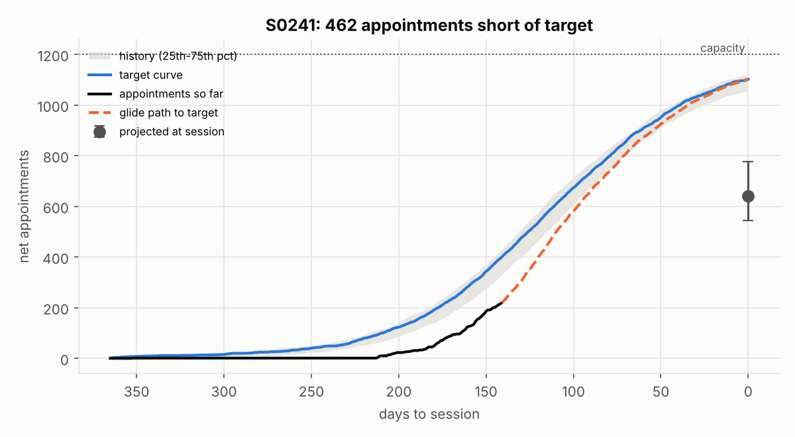
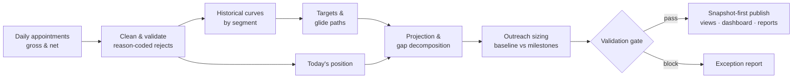
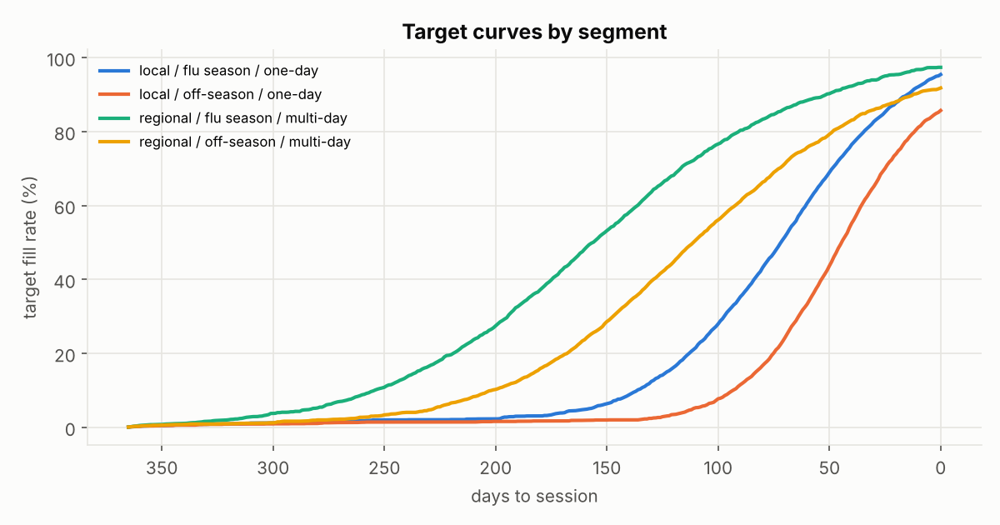
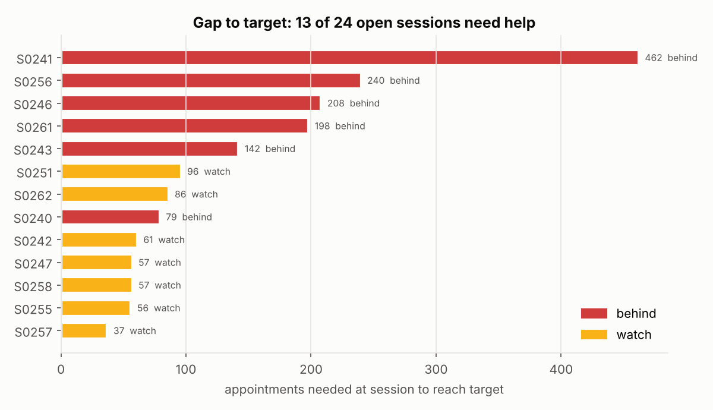
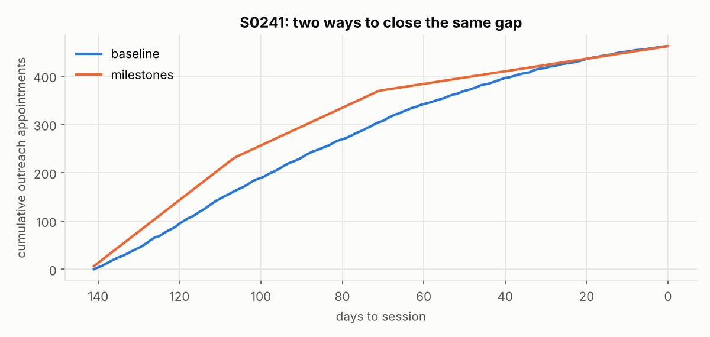

# Clinic capacity planning: fill targets, glide paths & outreach sizing
> A planning product for a clinic network's screening sessions: it turns appointment pace into targets, projections and gap-to-target, then sizes the outreach needed to close the gap, with a config-driven pipeline, SQL layer, notebook and live dashboard.

**Tools:** Python (pandas, NumPy), SQL (Snowflake dialect), YAML config, pytest, Jupyter, JavaScript (SVG)

**Live demo:** [Interactive fill dashboard](https://katherinekarow.github.io/portfolio/dashboards/fill-pace/)

*The techniques come from my professional work; the clinic network, sessions and every number are invented.*

▶ **[Try the interactive dashboard](https://katherinekarow.github.io/portfolio/dashboards/fill-pace/)** · **[Open the walkthrough notebook](notebooks/walkthrough.ipynb)**



## The setting
A clinic network runs screening sessions (one-day clinics and multi-day drives) with a fixed number of appointment slots.
Slots fill up over the months before each session, and some appointments cancel. For every upcoming session the
operations team needs one trusted answer to three questions:
**Are we on pace? Where will we land? If we're short, how many extra appointments do we need, and when?**

## What the code does
| Layer | Module | Technique |
|---|---|---|
| **Benchmarks** | [`curves.segment_curves`](src/curvekit/curves.py), [`01_segment_curves.sql`](sql/01_segment_curves.sql) | historical fill curves per segment (reach × season × length) from completed sessions |
| **Targets** | percentile target curves, [`curves.glide_path`](src/curvekit/curves.py) | target trajectories plus a glide path from today's position to the session |
| **Projection & gaps** | [`curves.project_and_decompose`](src/curvekit/curves.py), [`02_session_plan.sql`](sql/02_session_plan.sql) | pace-to-target, projected outcome, gap-to-target and gap-to-full |
| **Outreach sizing** | [`strategies.py`](src/curvekit/strategies.py) | extra appointments needed from outreach (reminders, waitlist calls, partner referrals), allocated over time: baseline vs milestones, with eligibility rules |
| **Gross vs net** | [`gross_net.py`](src/curvekit/gross_net.py) | cancellation profiles so targets reflect who actually shows up |
| **Quality & governance** | [`quality.py`](src/curvekit/quality.py), SQL [`03`](sql/03_quality_controls.sql) / [`04`](sql/04_snapshot_to_history.sql), [`tests/`](tests/test_curvekit.py) | snapshot-first runs, validation gate, reason-coded rejects, control totals |
| **Orchestration** | [`pipeline.py`](src/curvekit/pipeline.py) + [`config.yaml`](config.yaml) | multi-step, config-driven pipeline with continue-on-failure and a run summary |
| **Decision layer** | [`export.py`](src/curvekit/export.py) → [live dashboard](https://katherinekarow.github.io/portfolio/dashboards/fill-pace/) | the dashboard reads data produced by the same functions as the pipeline |

## How it works


### Methods
- **Time-to-session trajectories**: every metric is indexed by days (and weeks) before the session.
- **Percentile benchmarking**: targets come from what similar sessions actually achieved (60th percentile), forced never to decrease.
- **Pickup projection with credibility weighting**: early in the window, projections lean on history; later, on the session's own pace.
- **Volatility bands**: ± one standard deviation of historical pace gives a low/high range, not a single number.
- **Gap decomposition**: *pace gap today*, *gap to target at session*, *gap to full*. Each one maps to a different action.
- **Residual-demand allocation**: remaining demand is spread the way appointments usually arrive, not in a straight line.
- **Scenario comparison**: a stable baseline strategy vs a front-loaded milestone strategy, with eligibility rules (minimum gap, minimum historical support) to avoid over-allocating.
- **Reconciliation**: every plan must add up exactly to its gap (control totals), checked in code and in SQL.

```
gap to full           = capacity − projected appointments at session
gap to target         = target appointments at session − projected appointments at session
net target(days_out)  = gross target(days_out) × show-up rate(days_out)
```

## Design decisions
| Decision | Why |
|---|---|
| Glide paths follow how demand normally arrives, not straight lines | a static target doesn't tell a team *when* to act |
| A stable **baseline** strategy by default, milestone variants for scenarios | aggressive front-loading carries more execution risk where history is thin |
| Plan on **net**, not just gross | cancellations make gross targets look better than reality |
| Snapshot before every overwrite, plus a validation gate | every run stays recoverable and comparable over time |
| The dashboard reads the model's own export | the picture can never drift from the numbers |

## Try it
```bash
cd professional-work/capacity-planning
pip install -r requirements.txt
PYTHONPATH=src python -m curvekit.pipeline --config config.yaml                             # full pipeline + run summary
PYTHONPATH=src python -m curvekit.export --config config.yaml --out ../../docs/dashboards/fill-pace/data.json  # refresh the dashboard data
pytest -q                                                                                     # 10 invariant tests
python notebooks/build_notebook.py                                                            # rebuild the notebook + figures
```

| Target curves by segment | Gap to target | Two allocation strategies |
|---|---|---|
|  |  |  |
