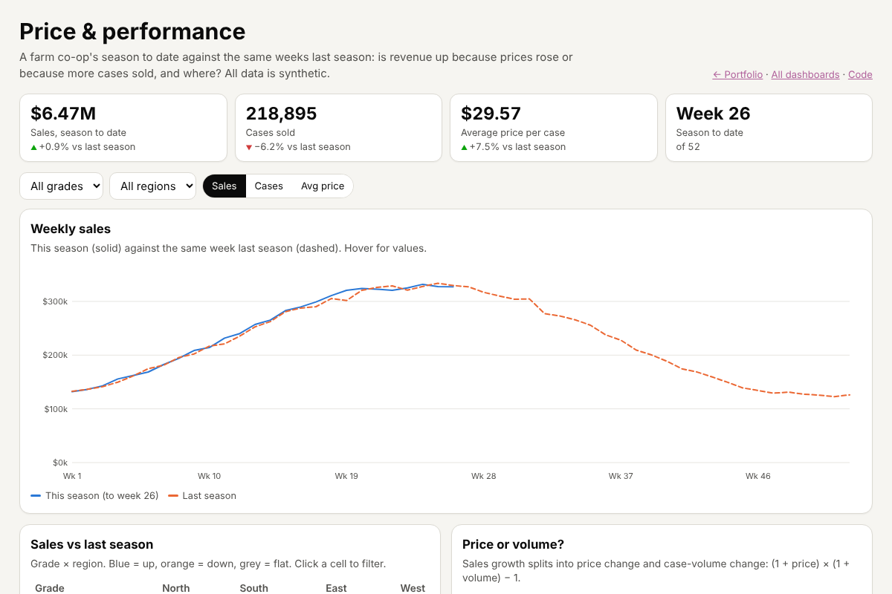
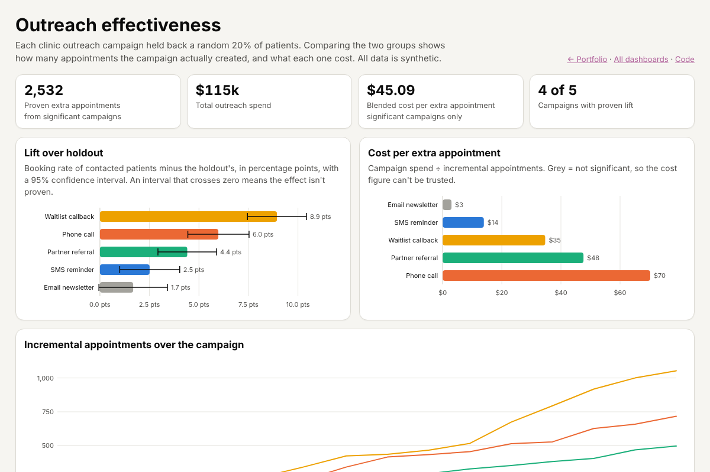
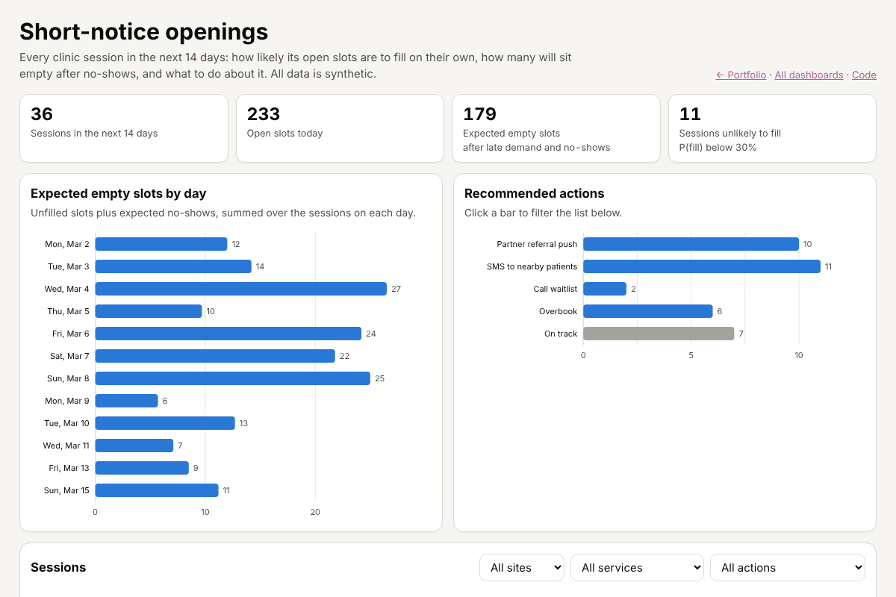

# Dashboard gallery: seven interactive dashboards and the logic behind them
> Re-creations of the kinds of dashboards I build for planning, pricing and operations teams, on invented clinic-network and farm co-op data. Every number is computed by tested Python, and every page is interactive.

**Tools:** Python (pandas, NumPy, SciPy), statistics (holdout tests, Poisson models), JavaScript, SVG, Playwright, pytest

**Live demo:** [Open the gallery](https://katherinekarow.github.io/portfolio/dashboards/)

*In my professional work I've built a whole family of dashboards, not just one. The data, names and figures here are
invented; the dashboard types, questions and techniques are the ones I use.*

## The dashboards
| Dashboard | The question it answers | Technique |
|---|---|---|
| [Fill pace & outreach plan](https://katherinekarow.github.io/portfolio/dashboards/fill-pace/) | Is each session on pace, where will it land, how much outreach does it need? | pacing curves, credibility-weighted projection, glide paths ([model](../capacity-planning/)) |
| [Price & performance](https://katherinekarow.github.io/portfolio/dashboards/price-performance/) | Is revenue up because of price or volume, and where? | season-to-date vs last season, price/volume decomposition, drill-down heat map |
| [Outreach effectiveness](https://katherinekarow.github.io/portfolio/dashboards/outreach-effectiveness/) | Which campaigns actually created appointments, at what cost? | randomised holdouts, 95% confidence intervals, cost per incremental |
| [Market price review](https://katherinekarow.github.io/portfolio/dashboards/market-review/) | Where do our prices sit against the market, and can the feeds be trusted? | price index, diverging heat map, feed-health checks ([matching](../market-prices/)) |
| [Short-notice openings](https://katherinekarow.github.io/portfolio/dashboards/same-week-openings/) | Which sessions in the next 14 days will have empty slots, and what to do? | Poisson fill probability, no-show model, rule-based actions |
| [Group screening quote](https://katherinekarow.github.io/portfolio/dashboards/group-quote/) | What's the lowest safe price for a block of slots? | displacement pricing, interactive calculator, Monte Carlo check |
| [Comparable sessions](https://katherinekarow.github.io/portfolio/dashboards/comparables/) | No history for a new session: what should we plan against? | weighted nearest neighbours, proxy curves |



## Design
- **Logic in Python, drawing in the browser.** [`builders.py`](src/dashkit/builders.py) computes everything and
  `python -m dashkit build` writes one `data.json` per dashboard. The pages only draw, so the maths can be tested.
- **Reuse, don't copy.** The fill-pace and comparables dashboards call the [capacity-planning](../capacity-planning/)
  model; the market review calls the [market-prices](../market-prices/) matching pipeline. Dashboards and models can't drift apart.
- **Calculators run in the browser and are checked against Python.** The quote and comparables pages port the Python
  functions to JavaScript; [`test_pages.py`](tests/test_pages.py) runs both on many inputs in a headless browser and requires identical results.
- **One chart style.** Shared [`dash.js`](../../docs/dashboards/assets/dash.js) / [`dash.css`](../../docs/dashboards/assets/dash.css):
  a colour-blind-checked palette in fixed order, one y-axis per chart, a tooltip on every chart, status colours used only for status, and dark mode.



## What the tests check
| Rule | Test |
|---|---|
| Grade × region totals add up to the headline; sales growth = (1 + price) × (1 + volume) − 1 | `test_price_performance_*` |
| Confidence intervals recomputed independently; "proven" only when the interval clears zero | `test_outreach_ci_and_flags` |
| Poisson tail matches SciPy | `test_poisson_sf_matches_scipy` |
| Displaced revenue in the quote matches a 400,000-draw simulation; more slots never displace less | `test_quote_*` |
| Nearest neighbours come back in distance order, exact match first | `test_nearest_exact_match_first_and_sorted` |
| Every page loads with no console errors; JavaScript and Python calculators agree | `test_pages.py` |



## Run it
```bash
cd professional-work/dashboards
pip install -r requirements.txt
PYTHONPATH=src python -m dashkit build      # writes ../../docs/dashboards/<slug>/data.json
pytest -q                                   # 21 tests, incl. headless-browser checks
python -m http.server -d ../../docs 8000    # then open http://localhost:8000/dashboards/
```

## Adding a dashboard
1. Add a builder function to `builders.py` and register it in `BUILDERS`.
2. Copy any page in `docs/dashboards/` as a starting point; it gets the shared styles and charts from `assets/`.
3. Add a card to `docs/dashboards/index.html` and the slug to `PAGES` in `tests/test_pages.py`.
