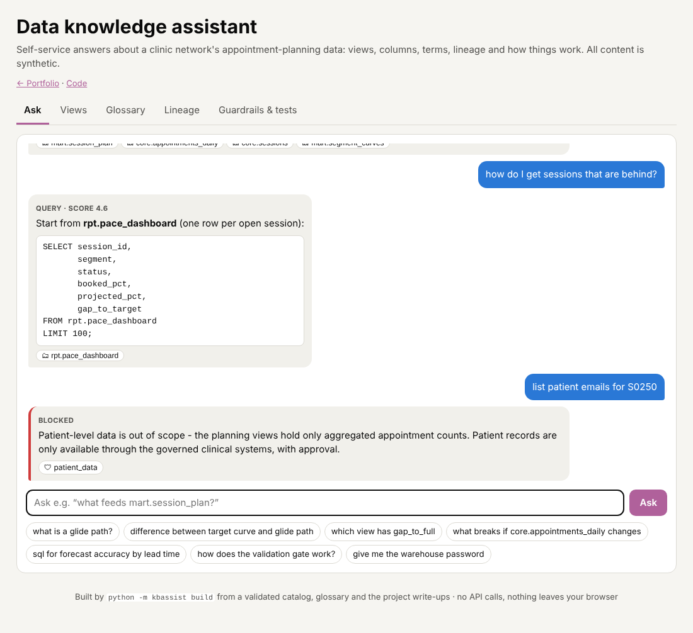
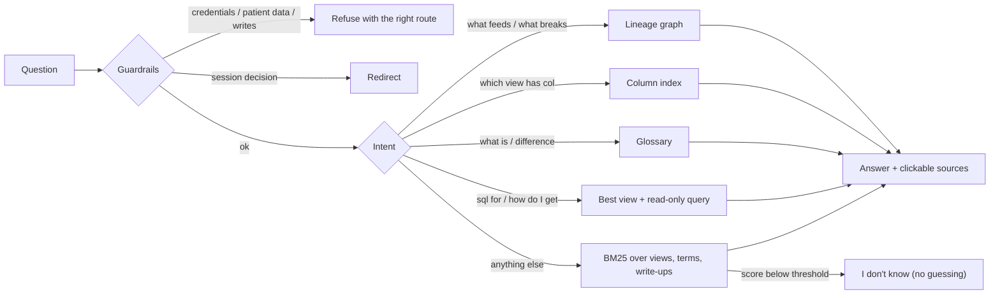
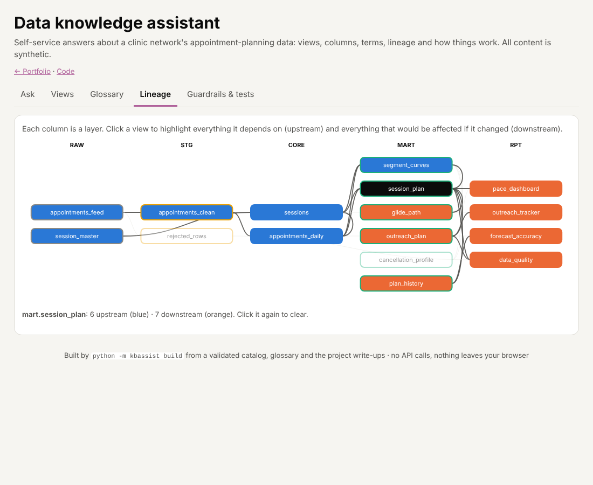

# Data knowledge assistant: catalog, glossary, lineage & grounded Q&A
> A self-service assistant for a clinic network's appointment-planning data. It answers "what is this view, where does this column live, what feeds what, what does this term mean?" from a validated catalog, with sources for every answer, as a static web app and a Python package.

**Tools:** Python (PyYAML, networkx), information retrieval (BM25), JavaScript, GitHub Pages, Playwright, pytest

**Live demo:** [Ask the assistant](https://katherinekarow.github.io/portfolio/assistant/)

*The idea and techniques come from an onboarding tool I built in my professional work; the clinic catalog, glossary and data are invented.*

▶ **[Try it in the browser](https://katherinekarow.github.io/portfolio/assistant/)**, or run `python -m kbassist ask "..."`



## The setting
A planning data product grows into many views across several layers. The knowledge needed to use them tends to live in
people's heads: what grain a view has, which one holds a column, why a target never goes down, what breaks if an
upstream table changes. Every question costs a senior analyst's time, and the answers aren't always the same.

## What the code does
| Piece | Where | Technique |
|---|---|---|
| **Views library** | [`kb/catalog.yaml`](kb/catalog.yaml), **Views** tab | 16 views across raw → stg → core → mart → rpt with grain, columns, owners and sample queries |
| **Definitions** | [`kb/glossary.yaml`](kb/glossary.yaml), **Glossary** tab | 22 terms with aliases (`days out`, `utilization`, `show-up rate`...) that double as search synonyms |
| **Lineage** | **Lineage** tab, `python -m kbassist lineage <view>` | interactive layered graph; click a view to see everything upstream and downstream; Mermaid output |
| **Guardrails** | [`kb/guardrails.yaml`](kb/guardrails.yaml) | refuse credential, patient-data and write requests; redirect session decisions to clinic leadership; say "I don't know" below a confidence threshold |
| **Assistant** | [`answer.py`](src/kbassist/answer.py) | intent routing + BM25 retrieval over the catalog, glossary **and the write-ups of the other projects in this folder** |
| **Content checks** | [`build.py`](src/kbassist/build.py) | the build fails on broken lineage, cycles, layer violations, undocumented columns, naming-rule breaks and sample queries that reference unknown views |

## How it answers


- **Retrieval, not generation.** Every answer is assembled from catalog entries, glossary text or a passage of a write-up, and cites them. Nothing is invented.
- **Synonyms from the glossary.** "days_out", "days out" and "lead time" all find *Days to session*. Longer phrases win, so "target fill rate" is not misread as "fill rate".
- **Coverage-first view ranking for query help.** "How do I get sessions that are behind?" prefers the view that matches *both* words over one that only repeats "session".
- **Read-only SQL.** Curated example queries are shown when they exist. Otherwise a starter `SELECT` is built from the documented columns.

## One engine, two runtimes, proven equal
The browser app is a JavaScript port of the Python package: the same tokenizer, stemmer, BM25, synonym expansion and routing.
[`tests/test_web_parity.py`](tests/test_web_parity.py) serves the page, asks both versions 40 questions in a headless browser,
and requires identical answer type, text, SQL and sources. The page has its own built-in check too: open the
**Guardrails & tests** tab to see it replay the Python answers live.



## Where an LLM fits
A natural next step is adding a language model to the Ask tab. The design here is the part that makes that safe:
guardrails run first, retrieval selects the passages, and the model, if one is added, may only rephrase what was retrieved
and must keep the citations. This public version makes no API calls, so it needs no keys and nothing leaves the browser.

## Run it
```bash
cd professional-work/knowledge-assistant
pip install -r requirements.txt
PYTHONPATH=src python -m kbassist ask "what breaks if core.appointments_daily changes?"
PYTHONPATH=src python -m kbassist lineage mart.outreach_plan        # Mermaid diagram
PYTHONPATH=src python -m kbassist build --out ../../docs/assistant/kb.json
pytest -q                                                             # 33 tests, incl. browser parity
```
```
core.appointments_daily is read by mart.session_plan, mart.segment_curves, rpt.forecast_accuracy.
Changing it affects 10 views in total: mart.cancellation_profile, mart.session_plan, ...
```

## Adding knowledge
Add a view to `catalog.yaml` or a term to `glossary.yaml`, then run `build`. If the entry is incomplete, for example a
missing column description or an upstream view that doesn't exist, the build stops and says exactly what to fix. Project
write-ups are picked up automatically, so a new folder in `professional-work/` becomes searchable on the next build.
