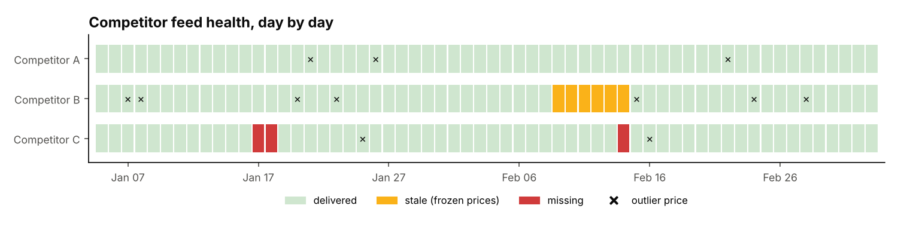
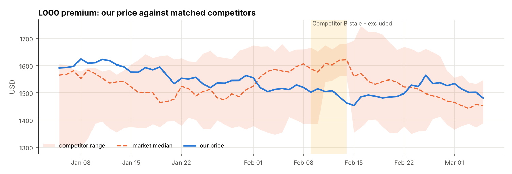
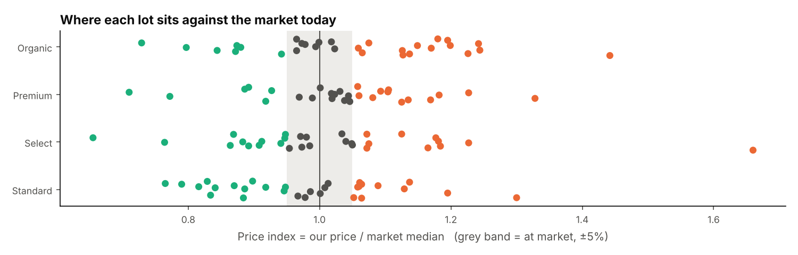

# Market price intelligence: product matching, feed monitoring & price index
> A pipeline that tells a farm co-op where its prices sit against competing suppliers: it matches their listings to the co-op's lots, cleans a daily price feed with every common defect planted, and computes a price index that only uses data it can trust.

**Tools:** Python (pandas, SciPy assignment, difflib), pytest

*The techniques come from my professional work; the co-op, competitors, products and prices are invented.*



## The setting
A co-op sells produce lots in four grades (Standard, Select, Premium, Organic). A market-data service delivers a daily
price feed for three competing suppliers. A price comparison is only as good as two things nobody sees on a dashboard:
**which competitor listings count as comparable**, and **whether today's feed is real**.

## The pipeline
**1. Match listings** ([`matching.py`](src/ratekit/matching.py))
- **Grade from free text.** Keyword rules first (`fancy` → premium, `certified` → organic), then a fuzzy match to known labels for typos (`Extra Fncy` → premium). Placeholders like `Grade TBA` are **left unmapped for review**, never guessed.
- **Comparable lots.** Same region, contract length within ±1 week, harvest date within ±7 days, scored by closeness.
- **One-to-one assignment.** For each competitor and region, the Hungarian algorithm (`scipy.optimize.linear_sum_assignment`) pairs listings with lots. A greedy nearest match lets one listing stand in for several lots; a test shows the difference.

**2. Clean the feed** ([`quality.py`](src/ratekit/quality.py))

| Problem | Detection |
|---|---|
| duplicates | identical deliveries collapsed |
| mixed currencies | everything converted to USD |
| typos (×10, ÷10) | outlier only if **both** statistically extreme for that listing (robust z > 6 against its rolling median) **and** economically implausible (> ~65% jump). The second test stops quiet listings from flagging ordinary moves. |
| **stale feed** | a competitor whose whole snapshot is identical to the previous day for ≥ 3 days: the provider is resending an old file. Excluded, not trusted. |
| missing days | days with no delivery, reported per competitor |

**3. Price index** ([`index.py`](src/ratekit/index.py)): `our price / median of matched competitors' usable prices`, per
lot, grade and day. A competitor's last good price is carried forward for at most 2 days. A cell needs at least 2
competitors to get an index, and gets "not enough comparables" otherwise. Positioning bands: below market (< 0.95), at
market, above market (> 1.05).



While Competitor B's frozen prices are excluded, the market band narrows. That's a change in **who is counted**, not a
market move, so the daily output carries a `competitors` count next to every index value.



## Proven against planted problems
The synthetic generator records everything it breaks. The 14 tests ([`tests/`](tests/test_ratekit.py)) require the
pipeline to find **exactly** that: every true listing match, all 40 duplicates, the 12 typo prices and no others, the 6
stale days and the 3 missing days. A market median recomputed by hand on a stale day must match the index.

```bash
cd professional-work/market-prices
pip install -r requirements.txt
PYTHONPATH=src python -m ratekit run --out outputs --figures figures
pytest -q
```
```
products matched: 328 competitor products -> 120 of our 120 lot-grades
grade labels: 9 fixed by fuzzy match, 4 left unmapped for review
feed: 40 duplicates removed, 12 outlier prices excluded
stale days: {'Competitor B': 6}   missing days: {'Competitor C': 3}
today's positioning: above market 49, below market 37, at market 33, not enough comparables 1
```
