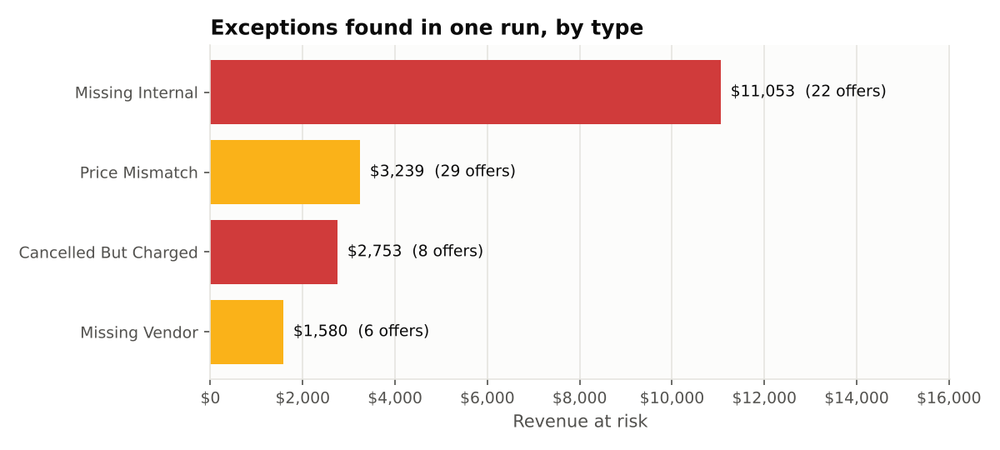
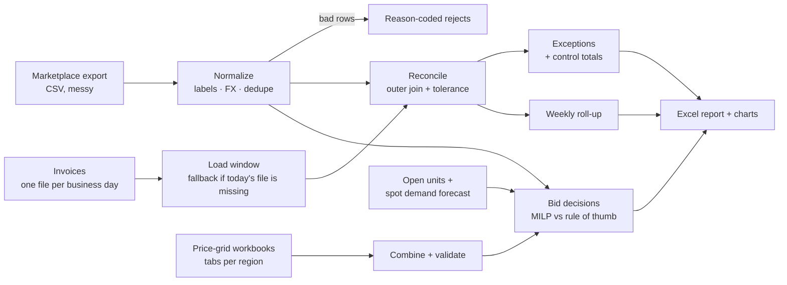
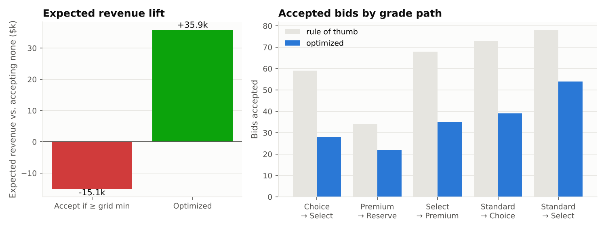
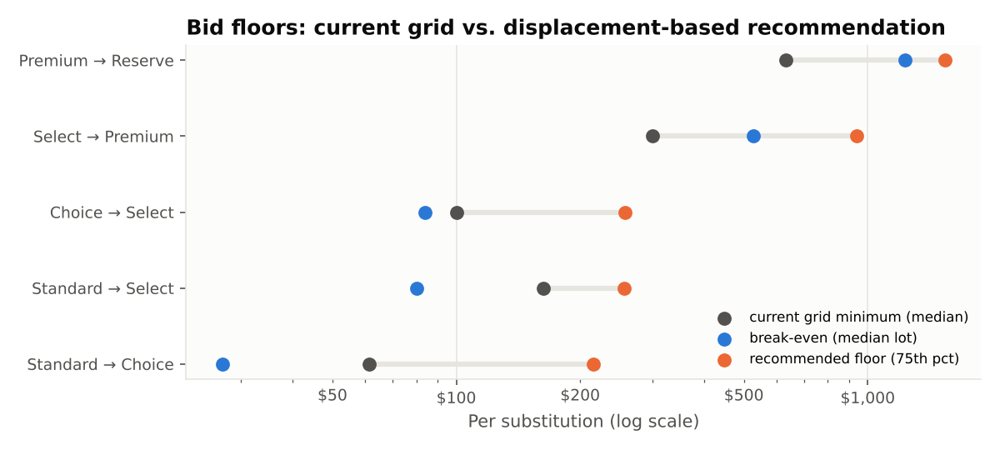
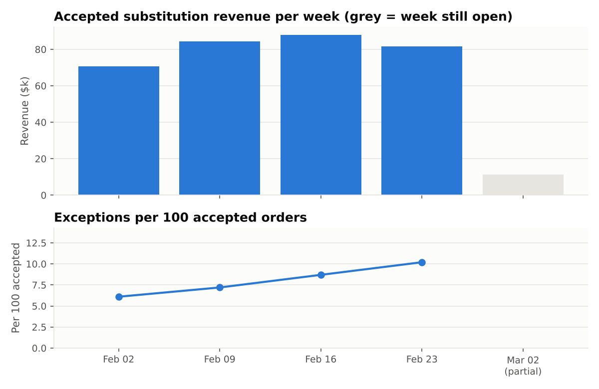

# Buyer-order reconciliation & substitution bids (farm co-op)
> Daily and weekly reconciliation between a buyer marketplace and a farm co-op's invoicing system, plus an optimizer that decides which grade-substitution bids to accept. Runnable, tested, with an Excel exception report.

**Tools:** Python (pandas, NumPy, SciPy MILP), Excel automation (openpyxl, XlsxWriter), pytest

*The techniques come from my professional work; the farm co-op setting, data and numbers are invented.*



## The setting
A farm co-op sells produce in grades (Standard → Choice → Select → Premium → Reserve) through a third-party buyer
marketplace. A buyer holding a contract for one grade can **bid a premium to receive a higher grade** instead. Two
systems keep the books: the marketplace records every bid and its status, and the co-op's invoicing system records what
was actually charged. Reconciling them by hand is slow, because:

- the marketplace export uses free-text grade labels (`"Prem."`, `"premium grade"`, `"PREMIUM"`), mixed currencies and money stored as text
- bids are **re-sent** when they change, so the export contains duplicates
- invoicing produces one file **per business day**: weekend activity lands in Monday's file, and on Monday morning that file often doesn't exist yet
- minimum-bid price grids live in **several workbooks, one tab per region, with drifting column names**
- every pending bid needs an accept/decline decision, and accepting uses up higher-grade produce that might otherwise sell on the spot market

## What the code does
| Piece | Module | Technique |
|---|---|---|
| **Clean the marketplace export** | [`normalize.py`](src/orderrec/normalize.py) | label map with prefix fallback, money parsing, FX, keep-latest de-duplication, reason-coded rejects (never guess) |
| **Daily reconciliation** | [`reconcile.py`](src/orderrec/reconcile.py) | outer join, 5 exception classes, a tolerance so rounding noise isn't flagged, control totals |
| **Missing-file fallback** | `load_internal` | uses the latest business-day file and records a warning. Bids newer than that cut-off are *in transit*, not errors. |
| **Weekly roll-up** | [`weekly.py`](src/orderrec/weekly.py) | volume, acceptance, revenue, exception rate; partial weeks are flagged so they don't look like a drop |
| **Combine price-grid workbooks** | [`ingest.py`](src/orderrec/ingest.py) | reads real `.xlsx` files, matches drifting headers through an alias table, rejects bad rows with their Excel row number |
| **Bid decisions** | [`bid_optimizer.py`](src/orderrec/bid_optimizer.py) | mixed-integer program over all pending bids, compared with the rule of thumb |
| **Reporting** | [`report.py`](src/orderrec/report.py) | 12-tab Excel report with a summary, filters and highlighted exceptions, plus charts |



### Reconciliation rules
| Class | Meaning | Action written into the report |
|---|---|---|
| `CANCELLED_BUT_CHARGED` | marketplace says cancelled, buyer still invoiced | credit the buyer; check that cancellations reach invoicing |
| `MISSING_INTERNAL` | accepted, the invoice file for that day exists, no charge | raise the invoice; check the interface for that day |
| `MISSING_VENDOR` | invoice with no marketplace record | request the record or reverse |
| `PRICE_MISMATCH` | both sides agree, but the amount differs by more than max($0.25, 0.5%) | correct to the accepted bid (FX or manual override) |
| `IN_TRANSIT` | accepted after the latest invoice file's cut-off | timing only; re-checked next run |
| `MATCHED` | agrees within tolerance | none |

**Control totals** prove nothing was dropped. Every bid in the union of both sources is classified exactly once, and the
charged total in the detail equals the invoicing total to the cent.

### Bid decisions
Accepting a bid from grade A to grade B **uses one unit of B and frees one unit of A**. With remaining spot-market demand
*D ~ Poisson(λ)*, the c-th remaining unit is worth `spot price × P(D ≥ c)`, so the cost of giving up units rises with
each bid accepted on the same lot. The optimizer maximises

```
Σ bid_i · x_i  −  Σ_lot,grade  displacement_cost(net units used)      x_i ∈ {0,1},   units used ≤ open units
```

The displacement cost is convex and piecewise linear, so it is modelled exactly through its epigraph, and the whole problem
is solved as a MILP with `scipy.optimize.milp`. A test checks it against brute force on a small instance. The same model
gives a **break-even floor** for each grade path.



In the synthetic run, 387 bids are pending. The rule "accept anything at or above the grid minimum while a unit is free"
accepts 312 of them and, once lost spot-market sales are counted, does **worse than accepting nothing**. The optimizer
accepts 178, mostly into produce unlikely to sell on the spot market, and comes out about $36k ahead.





## Run it
```bash
cd professional-work/order-reconciliation
pip install -r requirements.txt
PYTHONPATH=src python -m orderrec run --date 2026-03-02 --out outputs/
pytest -q          # 27 tests
```
```
run 2026-03-02  (internal cut-off 2026-02-27)
  ! internal file for 2026-03-02 not available; using 2026-02-27 as the latest cut-off
  vendor duplicates removed: 15   rejects: {'UNMAPPED_GRADE': 1, 'UNPARSEABLE_AMOUNT': 1, 'UNKNOWN_CURRENCY': 1}
  upload rejects: {'MIN_ABOVE_MAX': 2, 'MISSING_LOT': 2}
  MATCHED                    686
  NO_CHARGE_EXPECTED         656
  IN_TRANSIT                  96
  PRICE_MISMATCH              29
  MISSING_INTERNAL            22
  CANCELLED_BUT_CHARGED        8
  MISSING_VENDOR               6
  revenue at risk: $18,624.78   rows reconciled: True   money reconciled: True
  pending bids: 387   accept (rule of thumb): 312 -> -15,062   accept (optimized): 178 -> +35,858 expected USD
```

The run writes the raw inputs as real files (a marketplace CSV, 19 daily invoice CSVs, two multi-tab workbooks) and
reads them back. [`synth.py`](src/orderrec/synth.py) plants known problems and records them. **The tests assert that the
reconciliation finds exactly those problems:** none missed, no false alarms, and the ±$0.02 rounding noise is not flagged.
The full report is in [`sample_output/`](sample_output/).

## Design decisions
- **Reject, don't guess.** An unknown grade label or currency becomes a reason-coded reject someone can fix.
- **Timing is not an error.** Keeping `IN_TRANSIT` separate from `MISSING_INTERNAL` stops false alarms that make people ignore the list.
- **Tolerance is explicit and tested.** A test shows that zero tolerance would bury real mismatches under rounding noise.
- **Loud failures on structure, soft failures on rows.** An unknown column header stops the run; a bad row is set aside.
- **Same scoring for every policy.** The rule of thumb and the optimizer are judged with the same expected-revenue function.
