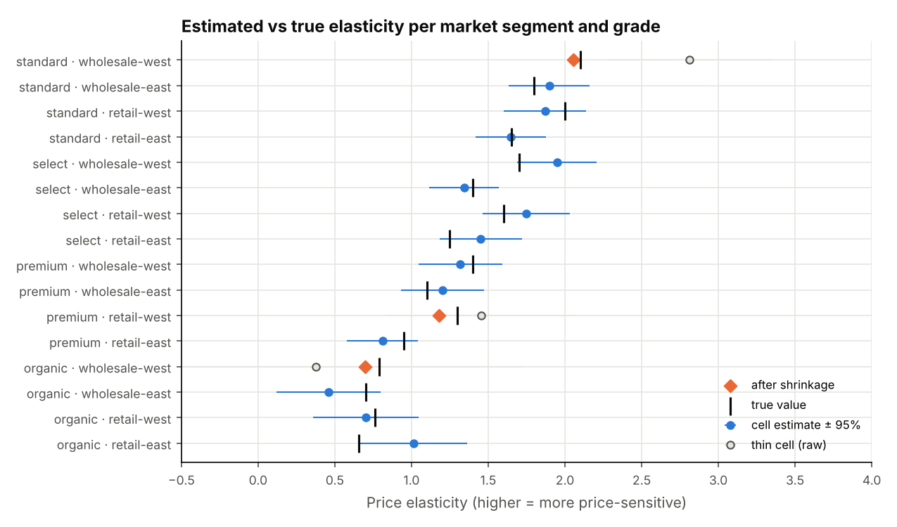
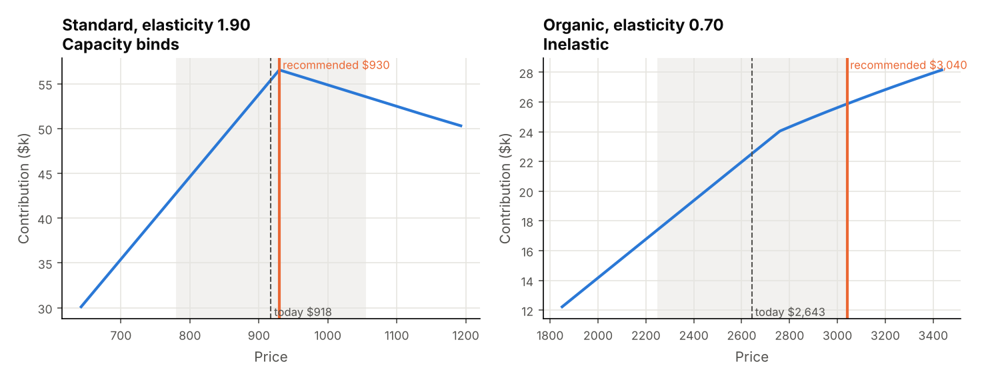
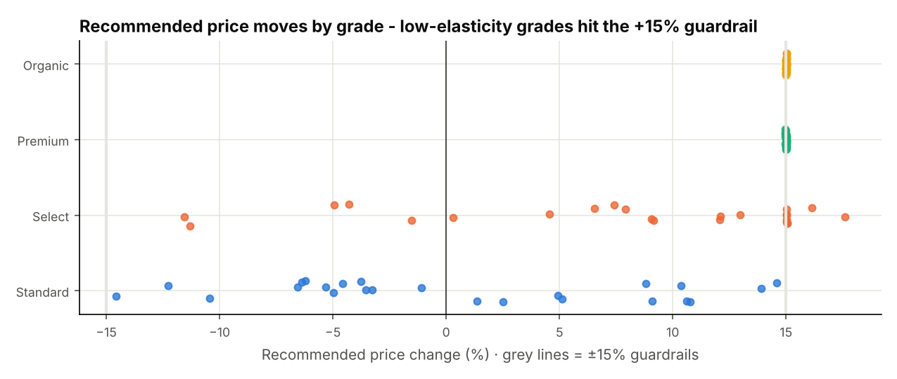

# Produce pricing: elasticity, constrained price optimization & handover
> A pricing model for a farm co-op: estimates how price-sensitive each market segment and produce grade is, recommends prices within harvest volume, guardrails and a grade ladder, and comes with plain-SQL validation checks for whoever runs it next.

**Tools:** Python (pandas, NumPy), regression (log-log OLS, empirical-Bayes shrinkage), optimization, SQL, pytest

*The techniques come from my professional work, including writing a model handover; the co-op setting, data and numbers are invented.*



## The setting
A co-op sells four grades (Standard, Select, Premium, Organic) into four market segments (retail and wholesale, east
and west). Each delivery lot has a harvest volume it can't exceed, a unit cost and a current price. The question every
cycle: **what price per lot and grade?** The answer has to be explainable and checkable by someone who didn't build the model.

## The method
**1. Elasticity per segment and grade** ([`elasticity.py`](src/pricekit/elasticity.py))

`log(units) = a − e · log(price / median price) + seasonality (sin/cos of week)`, fitted by OLS per cell. A cell stands
on its own only with **at least 30 weeks** of history and a correctly signed estimate whose 95% interval excludes zero.
Cells that fail are **shrunk toward their grade's pooled estimate** (empirical Bayes, weighted by how noisy the cell is)
and labelled. The data is synthetic, so the true values are known: the chart above shows the estimates landing on them,
and a test checks that shrinkage reduces the error on thin cells.

A **back-test** fits on all but the last 26 weeks and predicts sales at the prices actually charged: WAPE 16.9% for the
model, against 31.9% for a naive same-cell average.

**2. Recommended price** ([`optimize.py`](src/pricekit/optimize.py)): maximise contribution `(p − cost) · min(demand(p), volume)`

| Situation | Rule |
|---|---|
| elastic (e > 1) | closed-form optimum `p* = cost · e / (e − 1)` |
| inelastic (e ≤ 1) | contribution keeps rising with price → go to the guardrail |
| volume binds | never price below the sell-out price: extra demand can't be supplied, so a lower price only gives money away |
| guardrails | at most ±15% per cycle |
| grade ladder | within a lot each grade must cost ≥ 5% more than the grade below. Violations are repaired with weighted isotonic regression (pool-adjacent-violators), so the fix moves both grades as little as possible. A repair that crosses a guardrail is flagged for a person, not hidden. |

A test compares the closed form with a brute-force grid search on all 96 lot-grades.



**3. Validation queries** ([`validation.py`](src/pricekit/validation.py)): plain SQL that returns the rows breaking a
rule, so the next owner can run them in a warehouse without the Python code:

| Check | Fails when |
|---|---|
| thin cells never used unshrunk | a cell with < 30 weeks is used as its own estimate |
| plausible elasticities | an elasticity is missing, negative or > 4 |
| guardrails | a price moves more than 15% without a conflict flag |
| grade ladder | a higher grade costs less than the one below (+5%) |
| volume | planned units exceed harvest volume |
| revenue impact | `units_new × new price − units_now × current price` doesn't recompute |

Tests corrupt the output on purpose and confirm that each check catches it.



## Run it
```bash
cd professional-work/produce-pricing
pip install -r requirements.txt
PYTHONPATH=src python -m pricekit run --out outputs --figures figures
pytest -q                                   # 8 tests
```
```
elasticity cells: 16 (3 thin cells shrunk to their grade pool)
back-test WAPE: model 16.9% vs naive 31.9%
recommendations: 96 lot-grades · ladder fixes 16
    41  capacity binds: no lower than sell-out price
    38  elastic optimum
    17  inelastic: raise to guardrail
expected revenue impact +411,961 · contribution impact +557,859
validation queries: 6/6 passed
```
Sample outputs are in [`sample_output/`](sample_output/). Some recommendations *lower* revenue while raising contribution.
The model maximises contribution, and the output shows both numbers so the trade-off is visible.

## Handover structure (what the next owner gets)
1. **Overview**: what the model decides, what it doesn't, and who signs off.
2. **Inputs and outputs**: sales history, forecasts, volume and unit cost in; recommended price, reason, and revenue and contribution impact out.
3. **Methodology**: the three steps above, including each rule and why it exists.
4. **Validation queries**: run before every publish; an empty result means pass.
5. **Runbook**: how to rerun, where outputs land, and what to do when a check fails.
