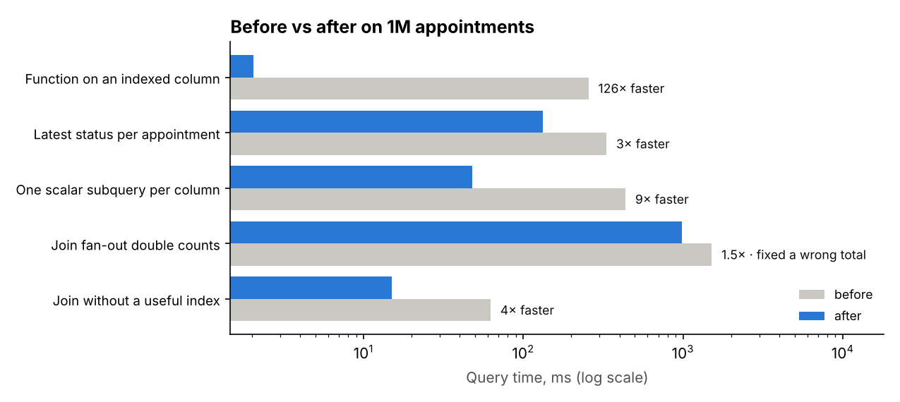

# SQL performance tuning: measured, explained and checked for correctness
> A benchmark on 1M clinic appointments and 2.5M status events: five slow-query patterns, each with query plans before and after, timings, and a check that the results didn't change, except where the old query was wrong.

**Tools:** SQL (SQLite here; the same patterns apply to Snowflake and Oracle), query plans (EXPLAIN), indexing, Python, pytest

*The patterns come from tuning report queries in my professional work; the clinic tables and data are invented.*

`python -m tunekit run` builds the database (about 30 s), runs every case, and writes [RESULTS.md](RESULTS.md) with the full SQL, plans and timings.



| Pattern | Before → after | What changed |
|---|---|---|
| Function on an indexed column (`STRFTIME(ts) = '2025-03'`) | 256 ms → 2.0 ms | range predicate on the raw column: SCAN becomes SEARCH, and the covering index means the table is never read |
| Latest status per appointment | 332 ms → 132 ms | composite covering index in (appointment_id, event_ts) order removes a per-row sort and table fetch. The window-function rewrite was **slower** (494 ms, measured), so the SQL stayed as it was. |
| One scalar subquery per output column | 437 ms → 48 ms | four correlated subqueries per session become one join with conditional aggregation |
| Join fan-out "fixed" in the report | 1,515 ms → 982 ms | **the old query overstated charges by 87%**: appointments with several RESCHEDULED events were counted once per event. `EXISTS` asks the intended question. |
| Join without a useful index | 62 ms → 15 ms | date index plus a composite covering index on the join key; same SQL, different physical design |

*Timings are medians of three runs on one machine. The [results file](RESULTS.md) records the SQLite and Python versions used.*

## How each case is checked
[`bench.py`](src/tunekit/bench.py) runs each case on a clean slate. Indexes both versions may use are created first, the
"before" query is planned and timed, the case's new indexes are added, then the "after" query is planned and timed.
Results are compared row by row. A case either declares the results identical, or, like the fan-out case, declares
that the old query was wrong, and the benchmark reports by how much.

The tests ([`tests/`](tests/test_tunekit.py)) run every case on a 30k-row database and assert the plan changes each case
claims: SCAN → SEARCH, the sort disappearing, four correlated subqueries becoming none, the new covering indexes
being used. Timing is never asserted in tests, because it depends on the machine. It is measured on the full run instead.

## What I take from this
1. **Read the plan before rewriting.** Every case starts from `EXPLAIN QUERY PLAN`, not from intuition.
2. **Measure the rewrite you believe in.** The window-function version of "latest status" looked cleaner and was slower.
3. **Performance work finds correctness bugs.** The fan-out join was slow *and* wrong. That's the most valuable finding here.
4. **Separate SQL changes from index changes**, so you know which one bought the speed-up and what it costs to keep.

## Run it
```bash
cd professional-work/query-tuning
pip install -r requirements.txt
PYTHONPATH=src python -m tunekit run                    # builds bench.sqlite on first run, then benchmarks
PYTHONPATH=src python -m tunekit run --rows 200000      # quicker
pytest -q                                               # 10 tests on a small database
```
