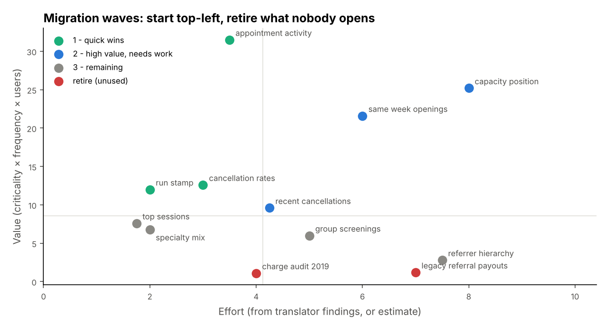

# Legacy report migration kit: Oracle → Snowflake translator, column audit & parity harness
> Tools for moving a clinic network's legacy Oracle reports onto a modern warehouse: a rule-based SQL translator that logs every change, an output-column audit that finds the cause of "merged" columns, a parity harness that explains every difference, and a migration-wave planner.

**Tools:** SQL (Oracle, Snowflake, SQLite), Python (pandas), pytest

*The approach comes from report migrations in my professional work; the clinic reports, tables and data are invented.*

## How I approach a migration
1. **Inventory** every report: owner, schedule, sources, consumers, criticality.
2. **Rebuild** the logic as a documented view, keeping business rules in one place.
3. **Prove parity**: same rows, same totals, and every difference explained before anyone switches.
4. **Automate** the run and the checks; alert on failures instead of leaving silent gaps.
5. **Hand over** with a short runbook so the report survives without me.

## The migration kit
[`src/migrationkit`](src/migrationkit/) does steps 1–3 on six invented legacy Oracle clinic reports in [`legacy/`](legacy/).



**1. Translate**: [`translate.py`](src/migrationkit/translate.py) is a rule-based Oracle → Snowflake translator. It works on
masked SQL, so strings and comments are never rewritten, and it logs every change with its line number. Anything it can't
translate safely is flagged for review instead of guessed.

| Oracle | Becomes | The trap it avoids |
|---|---|---|
| `DECODE(x, NULL, 'a', ...)` | `CASE WHEN x IS NULL THEN 'a' ...` | `CASE x WHEN NULL` never matches. DECODE treats NULLs as equal, so a column-valued search becomes `(x = s OR (x IS NULL AND s IS NULL))`. |
| `a.id = b.id(+)` | `LEFT JOIN b ON a.id = b.id` | comma joins become explicit INNER/LEFT joins in dependency order; sessions with no appointments are kept |
| `WHERE ROWNUM <= 10 ORDER BY d` | `ORDER BY d LIMIT 10` + **review flag** | Oracle picks the 10 rows *before* sorting, so the legacy "latest 10" report returned 10 arbitrary rows. Someone has to decide which result was intended. |
| `TRUNC(amount)` | unchanged + **review flag** | numeric TRUNC is not date TRUNC |
| `NVL`, `NVL2`, `ADD_MONTHS`, `TRUNC(date,'MM')`, `SYSDATE`, `FROM DUAL`, `MINUS`, hints | `COALESCE`, `CASE`, `DATEADD`, `DATE_TRUNC`, `CURRENT_TIMESTAMP()`, -, `EXCEPT`, removed | |
| `CONNECT BY`, `PRIOR`, `MERGE`, `ROWID`, `.NEXTVAL` | **review flag** | rewritten by a person (for example as a recursive CTE) |

The translator also has a **SQLite target**. The tests use it to *execute* the translated reports on synthetic data and
compare the results with an independent pandas implementation of Oracle semantics
([`reference.py`](src/migrationkit/reference.py)). Each report must match exactly. That's how the suite proves the
DECODE and outer-join rewrites are correct, not just that they look right.

**2. Audit output columns**: [`columns.py`](src/migrationkit/columns.py) finds the root cause of "merged" columns:
unaliased expressions, whose engine-generated names change between databases, and duplicate output names such as
`d.session_id, b.session_id`, which BI tools collapse into one. It then adds aliases:
```
capacity_position:
   col 2: b.session_id                          duplicate output name 'session_id' (also column 1) - BI tools merge these
   col 4: SUM(DECODE(b.status, 'C', 0, b.units))  expression without alias - engine-generated name changes between databases
   col 6: NVL2(MAX(b.referrer_id), 'REFERRED', ...)    implicit alias without AS - easy to break by editing; add AS
```
The translated, re-aliased views are in [`migrated/`](migrated/), each with its change log and any `REVIEW` items in the header.

**3. Prove parity**: [`parity.py`](src/migrationkit/parity.py) lines up the legacy extract and the new view on the
business key. It reports missing, extra and duplicate rows, column totals, and a **diagnosis for every differing value**:
rounding, NULL vs 0, formatting, a constant scale factor (units or currency), a constant date shift (timezone), or
*logic: investigate*. The verdict is PASS, PASS_WITH_EXPLAINED (only accepted categories), or FAIL.
```
$ python -m migrationkit parity
verdict: PASS_WITH_EXPLAINED
rows: legacy 1,260 · new 1,260 · only in legacy 0 · only in new 0
  revenue    22 differences  -> null_vs_zero: one side has NULL where the other returns 0 (NVL/COALESCE default) - NULL on the legacy side
  revenue  1214 differences  -> rounding: rounding only (whole units or cents)
```
In this demo the legacy extract came from an older query version without `NVL` on charge and was written to a file that
rounded money. Both are differences you can explain and sign off, not bugs. A changed value of any other kind turns the verdict to FAIL.

**4. Plan the waves**: [`inventory.py`](src/migrationkit/inventory.py) scores each report in [`inventory.yaml`](inventory.yaml).
Value comes from criticality, frequency and users. Effort comes from what the translator found in its SQL: automatic
rewrites are cheap, review items and column problems are not. Reports nobody has opened in 90 days are proposed for
retirement instead of migration.

```bash
cd professional-work/report-migration
pip install -r requirements.txt
PYTHONPATH=src python -m migrationkit translate     # legacy/*.sql -> migrated/*.sql with change logs
PYTHONPATH=src python -m migrationkit columns       # output-column audit
PYTHONPATH=src python -m migrationkit parity        # legacy extract vs migrated view
PYTHONPATH=src python -m migrationkit plan          # migration waves
pytest -q                                           # 29 tests, incl. executing translated SQL
```

## Skills shown
SQL dialect migration · data reconciliation and parity testing · SQL performance and correctness review · Python automation ·
release management · support for pricing, forecasting and leadership teams.
