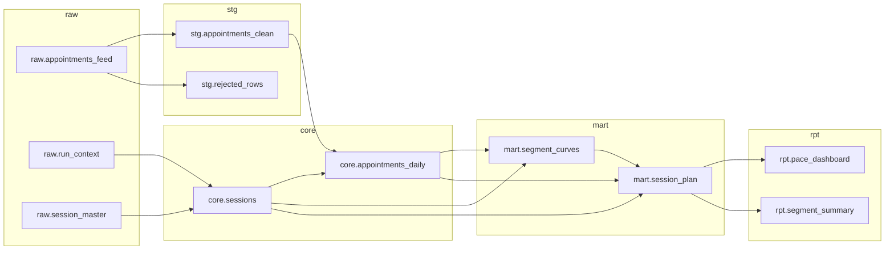

# Warehouse catalog

_Generated by `python -m whgov docs` from the model files - do not edit by hand._

| Model | Grain | Rows | Tests | Owner |
|---|---|---|---|---|
| [`core.sessions`](#coresessions) | one row per session | 80 | 5/5 ✓ | analytics engineering |
| [`stg.appointments_clean`](#stgappointments_clean) | one row per appointment event | 11,982 | 6/6 ✓ | analytics engineering |
| [`core.appointments_daily`](#coreappointments_daily) | one row per session and days_out | 26,590 | 5/5 ✓ | analytics engineering |
| [`mart.segment_curves`](#martsegment_curves) | one row per segment and days_out | 1,464 | 6/6 ✓ | operations analytics |
| [`mart.session_plan`](#martsession_plan) | one row per open session | 20 | 7/7 ✓ | operations analytics |
| [`rpt.pace_dashboard`](#rptpace_dashboard) | one row per open session | 20 | 4/4 ✓ | operations analytics |
| [`rpt.segment_summary`](#rptsegment_summary) | one row per segment | 4 | 3/3 ✓ | operations analytics |
| [`stg.rejected_rows`](#stgrejected_rows) | one row per rejected raw row | 26 | 4/4 ✓ | analytics engineering |

## core.sessions

Conformed session dimension with segment assignment and days to session as of the run date.

**Grain:** one row per session · **Owner:** analytics engineering · **Reads:** `raw.run_context`, `raw.session_master` · **Read by:** `core.appointments_daily`, `mart.segment_curves`, `mart.session_plan`

| Column | Description |
|---|---|
| `session_id` | session identifier |
| `session_date` | date of session |
| `segment` | region / season / length used for benchmarks |
| `capacity` | sellable units |
| `is_open` | 1 while the session is still taking appointments |
| `days_out_today` | days to session on the run date (negative once held) |

Tests: `unique(session_id)` · `not_null(session_id, session_date, segment, capacity)` · `expression(capacity > 0)` · `accepted_values(is_open: 0, 1)`

## stg.appointments_clean

Appointment events with standardized session ids; re-sent duplicates collapsed and invalid rows removed (see stg.rejected_rows).

**Grain:** one row per appointment event · **Owner:** analytics engineering · **Reads:** `raw.appointments_feed` · **Read by:** `core.appointments_daily`

| Column | Description |
|---|---|
| `event_id` | unique id of the event |
| `appointment_id` | reservation id |
| `session_id` | session id, trimmed and upper-cased |
| `event_type` | NEW or CANCEL |
| `units` | units affected, always positive |
| `event_date` | date of the event |

Tests: `unique(event_id)` · `not_null(event_id, session_id, event_type, units, event_date)` · `accepted_values(event_type: NEW, CANCEL)` · `expression(units > 0)` · `relationship(session_id -> core.sessions.session_id)`

## core.appointments_daily

Cumulative gross and net appointments for every session at every days-to-session point that has already happened.

**Grain:** one row per session and days_out · **Owner:** analytics engineering · **Reads:** `core.sessions`, `stg.appointments_clean` · **Read by:** `mart.segment_curves`, `mart.session_plan`

| Column | Description |
|---|---|
| `session_id` | session identifier |
| `days_out` | days to session (365 ... 0) |
| `gross_appointments` | cumulative units booked, including later cancellations |
| `net_appointments` | cumulative units booked minus cancelled |

Tests: `unique(session_id, days_out)` · `not_null(session_id, days_out, gross_appointments, net_appointments)` · `expression(net_appointments <= gross_appointments)` · `relationship(session_id -> core.sessions.session_id)`

## mart.segment_curves

Benchmarks from completed sessions per segment and days_out - 60th-percentile target fill rate (never decreasing toward session) and the median share of final appointments.

**Grain:** one row per segment and days_out · **Owner:** operations analytics · **Reads:** `core.appointments_daily`, `core.sessions` · **Read by:** `mart.session_plan`

| Column | Description |
|---|---|
| `segment` | demand segment |
| `days_out` | days to session |
| `target_fill` | target fill rate, running maximum toward session, capped at 1 |
| `median_fill` | median fill rate of completed sessions |
| `median_share` | median share of final appointments already on the books, running maximum |
| `n_sessions` | completed sessions supporting the benchmark |

Tests: `unique(segment, days_out)` · `not_null(segment, days_out, target_fill, median_share)` · `expression(target_fill BETWEEN 0 AND 1)` · `expression(median_share BETWEEN 0 AND 1)` · `assert_empty(SELECT a.segment FROM mart.segment_curves AS a INNER J...`

## mart.session_plan

Position, credibility-weighted projection and gap decomposition for every open session, with a status of on pace, watch or behind.

**Grain:** one row per open session · **Owner:** operations analytics · **Reads:** `core.appointments_daily`, `core.sessions`, `mart.segment_curves` · **Read by:** `rpt.pace_dashboard`, `rpt.segment_summary`

| Column | Description |
|---|---|
| `session_id` | session identifier |
| `segment` | demand segment |
| `capacity` | sellable units |
| `days_out_today` | days to session today |
| `net_appointments` | net appointments today |
| `projected_final` | projected net appointments at session |
| `target_today` | target appointments for today |
| `target_final` | target appointments at session |
| `pace_gap_today` | target today minus appointments today (positive = behind) |
| `gap_to_target` | target at session minus projection, never negative |
| `gap_to_full` | capacity minus projection |
| `status` | on pace, watch or behind |

Tests: `unique(session_id)` · `not_null(session_id, projected_final, status)` · `accepted_values(status: on pace, watch, behind)` · `expression(projected_final BETWEEN net_appointments AND capacity)` · `expression(gap_to_target >= 0)` · `assert_empty(SELECT 1 WHERE (SELECT COUNT(*) FROM core.sessions WHE...`

## rpt.pace_dashboard

Reporting view behind the pace dashboard - one row per open session with friendly, percentage-based columns and a priority rank.

**Grain:** one row per open session · **Owner:** operations analytics · **Reads:** `mart.session_plan` · **Read by:** -

| Column | Description |
|---|---|
| `session_id` | session identifier |
| `segment` | demand segment |
| `status` | on pace, watch or behind |
| `booked_pct` | net appointments / capacity |
| `projected_pct` | projected final / capacity |
| `gap_to_target` | units short of target |
| `priority_rank` | 1 = largest gap to target |

Tests: `unique(session_id)` · `unique(priority_rank)` · `expression(booked_pct <= projected_pct)`

## rpt.segment_summary

Segment roll-up for leadership - open sessions, booked and projected fill rate, total gap to target and status counts.

**Grain:** one row per segment · **Owner:** operations analytics · **Reads:** `mart.session_plan` · **Read by:** -

| Column | Description |
|---|---|
| `segment` | demand segment |
| `open_sessions` | sessions still taking appointments |
| `booked_fill` | booked units / capacity |
| `projected_fill` | projected units / capacity |
| `gap_to_target` | total units short of target |
| `behind_count` | sessions with status behind |

Tests: `unique(segment)` · `assert_empty(SELECT 1 WHERE (SELECT SUM(gap_to_target) FROM rpt.seg...`

## stg.rejected_rows

Raw rows that failed staging rules, with a reason code so they can be fixed at the source instead of silently dropped.

**Grain:** one row per rejected raw row · **Owner:** analytics engineering · **Reads:** `raw.appointments_feed` · **Read by:** -

| Column | Description |
|---|---|
| `source_table` | table the row came from |
| `source_key` | key of the rejected row |
| `reason_code` | MISSING_SESSION, INVALID_UNITS or UNKNOWN_EVENT_TYPE |

Tests: `unique(source_table, source_key)` · `not_null(source_key, reason_code)` · `accepted_values(reason_code: MISSING_SESSION, INVALID_UNITS, UNKNOW...`
