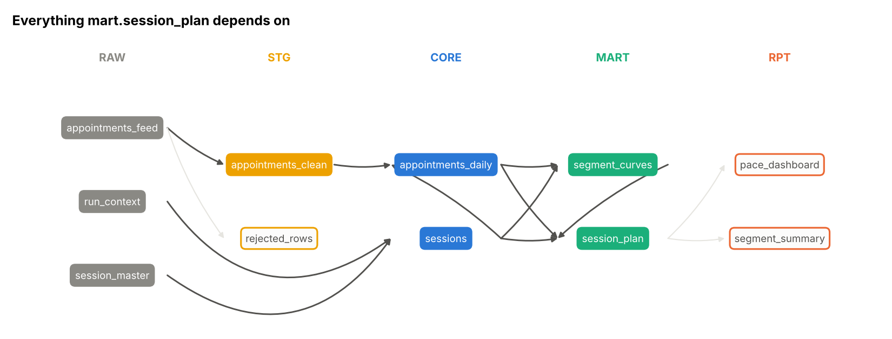

# Clinic data warehouse: layers, lineage, linting & data contracts
> A working mini-warehouse for a clinic network's appointment data: SQL models built in dependency order, a convention linter, data contracts and generated documentation, so everyone can see what feeds what and broken data can't reach a report quietly.

**Tools:** SQL (SQLite here, written to port to Snowflake), Python (networkx, matplotlib), pytest, data modelling, data governance

*The techniques come from my professional work designing warehouse layers and conventions; the clinic data is invented.*

`python -m whgov run` builds 8 models from raw appointment feeds and checks 40 contracts.



## Design
Five layers with one job each, enforced by the linter rather than by memory:

| Layer | Purpose | May read from |
|---|---|---|
| `raw` | data exactly as received, never queried by reports | (sources) |
| `stg` | clean, standardize and de-duplicate. Bad rows go to `stg.rejected_rows` with a reason code. | raw |
| `core` | conformed entities and facts (sessions, daily appointments) | raw, stg, core |
| `mart` | business logic (benchmarks, projections, plans) | core, mart |
| `rpt` | report-shaped outputs with friendly columns | mart |

## Models as code
Each model in [`models/`](models/) is a single `SELECT` with a header that documents it and declares its contract:

```sql
-- model: mart.session_plan
-- grain: one row per open session
-- column projected_final: projected net appointments at session
-- test: unique(session_id)
-- test: expression(projected_final BETWEEN net_appointments AND capacity)
-- test: assert_empty(SELECT 1 WHERE (SELECT COUNT(*) FROM core.sessions WHERE is_open = 1) <> (SELECT COUNT(*) FROM mart.session_plan))
WITH today AS ( ... )
```

- **Dependencies are read from the SQL** (FROM / JOIN / comma joins, excluding CTE names), not declared by hand, so the graph can't drift from the code.
  [`project.py`](src/whgov/project.py) builds the DAG, rejects cycles and unknown references, and materializes models in
  topological order. `select="+mart.segment_curves"` rebuilds a model and only its upstream.
- **Contracts** ([`contracts.py`](src/whgov/contracts.py)): `unique`, `not_null`, `accepted_values`, `expression`,
  `relationship` (no orphans) and `assert_empty` for reconciliation checks, such as "published rows = open sessions" or "segment totals = plan totals". Every built column must also be documented, and every documented column must exist.
- **Generated docs** ([`docs.py`](src/whgov/docs.py)): [`CATALOG.md`](CATALOG.md) with a Mermaid lineage graph, row counts and test status for every model, plus the lineage charts in [`figures/`](figures/).

## The linter
[`lint.py`](src/whgov/lint.py) masks comments and string literals, then checks each model:

| Code | Rule | Why |
|---|---|---|
| WG001 | no `SELECT *` | an upstream column change must not leak silently into reports |
| WG002 | every computed column has `AS alias` | unaliased expressions get engine-generated names that differ between databases, the root cause of "merged" columns after a migration |
| WG003 | no comma joins | a missing join condition becomes a silent cross join |
| WG004 | layer rules (table above) | keeps business logic out of reports and raw data out of marts |
| WG005 | description, grain, owner and a `unique(...)` grain test | a model nobody can describe can't be trusted |
| WG006 | no hard-coded dates | the run date comes from `raw.run_context`, so reruns and backfills work |
| WG007 | file path = model name, snake_case aliases | you can find any table's code from its name |
| WG008 / WG009 | no top-level `ORDER BY`; upper-case keywords | warnings: style and wasted work |

```
$ python -m whgov lint        # on a model copied from a legacy report
rpt.bad_report:3  WG001 [error] SELECT * - list the columns explicitly
rpt.bad_report:3  WG002 [error] expression without an alias: a.capacity * 2
rpt.bad_report:3  WG007 [error] alias Status is not snake_case
rpt.bad_report:4  WG003 [error] implicit comma join - use INNER JOIN ... ON
rpt.bad_report:4  WG004 [error] rpt model reads core.sessions (allowed: mart)
rpt.bad_report:5  WG006 [error] hard-coded date '2026-01-01' - use raw.run_context
rpt.bad_report:6  WG008 [warning] top-level ORDER BY in a model
...
```
The linter earned its place while this repo was being built: it flagged that `stg.rejected_rows` had no grain test.

## Run it
```bash
cd professional-work/warehouse-governance
pip install -r requirements.txt
PYTHONPATH=src python -m whgov lint                         # 8 models · 0 errors · 0 warnings
PYTHONPATH=src python -m whgov run                          # load raw -> build in order -> 40 contracts
PYTHONPATH=src python -m whgov impact core.appointments_daily   # what to re-test if it changes
PYTHONPATH=src python -m whgov docs                         # regenerate CATALOG.md + figures
pytest -q                                                   # 15 tests
```
```
build order
  core.sessions               80 rows
  stg.appointments_clean    11,982 rows
  core.appointments_daily   26,590 rows
  mart.segment_curves        1,464 rows
  mart.session_plan           20 rows
  rpt.pace_dashboard            20 rows
  rpt.segment_summary            4 rows
  stg.rejected_rows             26 rows
contracts: 40/40 passed
rejected raw rows: INVALID_UNITS 9, MISSING_SESSION 12, UNKNOWN_EVENT_TYPE 5
```

The raw feed is generated with known problems (re-sent events, messy codes, blank sessions, bad units, unknown event
types). The tests check that staging rejects **exactly** those rows, fixes the fixable ones, and that
`clean + rejected = distinct raw events`. Other tests break the data on purpose and confirm the contracts catch it.

## Notes
- Each layer is its own attached SQLite database, so `layer.table` names work like schemas. The same model files would run on a cloud warehouse with only dialect changes.
- The marts use the same method as the [clinic capacity planning](../capacity-planning/) project, written in SQL.
