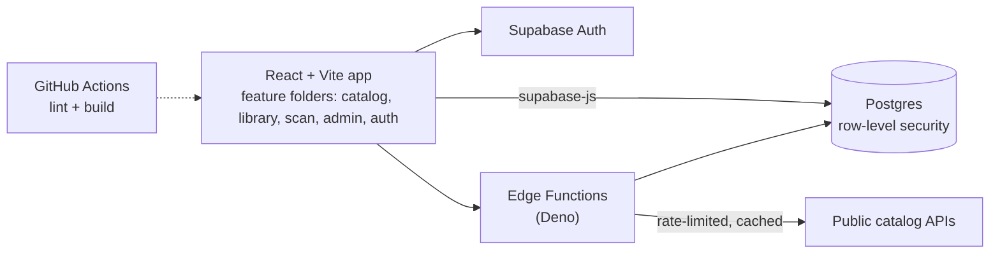

# Media library & catalog app
> A full-stack app for cataloging books, manga and anime: shared catalog, personal shelves, barcode scanning and admin import tools.

**Tools:** React 18, React Router, Vite, Supabase (Postgres, Auth, Storage, Edge Functions), SQL, GitHub Actions

*Source is private — this is a case study with small, rewritten examples.*

## What it does
- **Catalog** organized in tiers: franchises → series → individual volumes/media, plus creators and related works.
- **Personal library**: shelves, reading/watching progress, whole-series tracking and favorites.
- **Scan to add**: look up items by barcode/ISBN or keyword and place them in the catalog in bulk.
- **Admin tools**: import from public catalogs (Open Library, MangaDex, AniList), review queues,
  inline editing and merging duplicate creators.

## How it's built

- **Feature-based structure** (`features/catalog`, `features/library`, …) so each area owns its pages, hooks and helpers.
- **Database migrations** in SQL with **row-level security** policies: anyone can read the public catalog,
  only signed-in users change their own shelves, and only admins write catalog data.
- **Edge Functions** do the server-side work — syncing from external APIs with polite rate limits,
  a real User-Agent and caching — so no secret keys ever reach the browser.
- **CI** runs lint and a production build on every push.

## Example code (rewritten for this portfolio)
- [`snippets/politeFetch.js`](snippets/politeFetch.js) — a small helper for calling public APIs without hammering them.
- [`snippets/rls-example.sql`](snippets/rls-example.sql) — the row-level-security pattern used for shared vs. personal data.

## What I learned
Designing a relational catalog that stays clean as data comes in from many sources, keeping
privileged work on the server, and refactoring a growing React app into feature modules.
